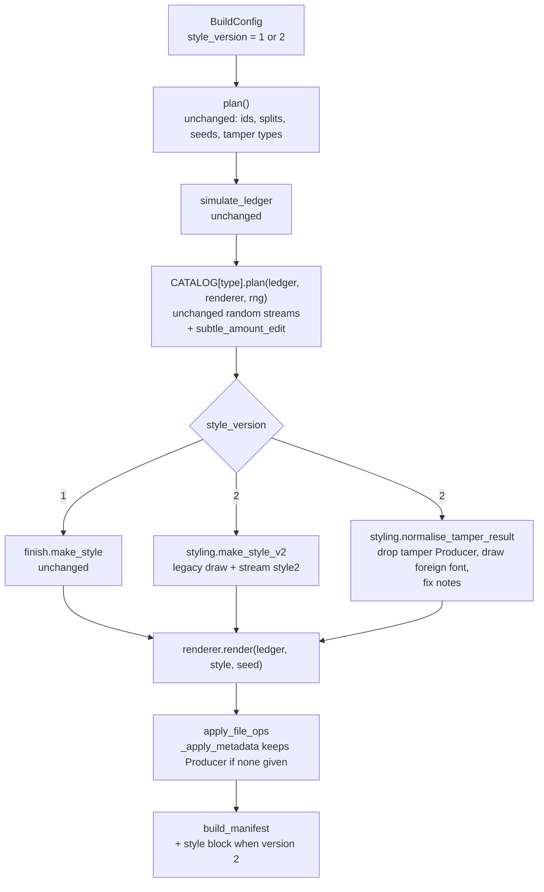

# Design Document: Generator Styling Variety

## Overview

The ml-retraining pipeline stops at its corpus gates because the Corpus_Generator ties styling to the label. This design removes that tie in a new, opt-in mode (Styling_Version 2, Balanced_Styling) and leaves the default mode (Styling_Version 1, Legacy_Styling) byte-for-byte as it is.

What changes in Balanced_Styling:

| Styling choice | Legacy_Styling | Balanced_Styling |
|---|---|---|
| Producer | 4 base values; `metadata_inconsistency` overwrites with an editor value; `genuine_resaved` overwrites with an export value | One draw per document from a family mix (base 65%, export 25%, editor 10%) that does not look at the label. The tamper no longer overwrites the Producer |
| Creator | One constant | Uniform from a pool of 5 fictional strings (the legacy string is one of them) |
| Fonts | Helvetica and Helvetica-Bold; Courier only via `font_mismatch` | Decorative text in Helvetica (65%) or Times-Roman (35%); table text unchanged. `font_mismatch` draws its foreign font from 4 fonts |
| Bank, row spacing, creation time of day | Drawn, label-independent | Same values as Legacy_Styling for the same document (copied from the legacy draw) |
| Street and address wording | Drawn but never printed | Printed in the page head; 3 wording templates |
| Subtle amount change | Does not exist | New tamper `subtle_amount_edit`, 1.0% to 4.9% |

Three rules drive the design:

1. **Legacy output cannot move.** Every new behaviour sits behind `style_version == 2`. New `StyleKnobs` fields have defaults that reproduce the old output. New random streams are separate from the old ones. A Golden_Hashes test recorded on the unchanged code guards this.
2. **The style draw never sees the label.** `make_style_v2(master_seed, *parts)` takes the same arguments as `make_style` and nothing else. A tamper is applied first, as before, and a pure post-step (`normalise_tamper_result`) removes the label-dependent Producer and font choices from the tamper result.
3. **Verify, do not assume.** A round-trip test renders each Layout, reads the PDF back and compares the values with the `StyleKnobs`. A Node 1 parity test checks that no table cell moved.

Nothing in this design was run. The code facts below come from reading the files named in each case. Measurements that need a build (Node 1 parity, text overlap, gate results at full size) are tasks and manual steps, not claims.

## What I checked in the code

| Fact | Where | Consequence for the design |
|---|---|---|
| `make_style(master_seed, *parts)` draws bank, street, producer, creation time, row step and the second-address flag from one stream `style`. It is called once per document with the document id, for genuine and tampered documents alike | `corpus/finish.py`, `builder._build_document` | The legacy draw is already label-independent. Balanced_Styling keeps it for bank, street, time, row step and flag, and replaces only the Producer. Same values make the two modes comparable |
| `StyleKnobs.address_lines` (the street) is read by no renderer. `dataset_family` prints `ledger.company.address_lines` (the company address); `generator_v1` prints no address | `layouts/dataset_family.py` `_first_page_block`, `layouts/generator_v1.py` | The street cannot be recovered today. Balanced_Styling prints the bank street in the page head |
| `ml/retraining/style_profile.py` takes the **first** street-pattern match in the text of page 1. For the five `dataset_family` layouts that is the company street, so `style_street` is today a per-company value, not the generator's | `style_profile.py` `_STREET_RE` | The bank-address line must come before the company address in reading order (Requirement 5.4). I did not change `style_profile.py` |
| `finish_pdf` writes `/Producer` from `style.producer` and `/Creator` from the constant `CREATOR`. `new_canvas` sets the Creator the same way | `finish.py` | `creator` becomes a `StyleKnobs` field with an empty default that falls back to `CREATOR` |
| `_apply_metadata` reads `params["producer"]` unconditionally. `plan_metadata_inconsistency` and `plan_genuine_resaved` always set it | `tamper/pdf_ops.py` | `_apply_metadata` must tolerate a missing `producer` (keep the PDF's own). Legacy plans still supply it, so Legacy_Styling is unchanged |
| Node 2 treats a font outside `{Helvetica, Helvetica-Bold, Arial, Arial-Bold, Times-Roman}` that has under 5% of the glyphs as `VF_FONT_MISMATCH` | `nodes/visual_forensics.py` `_BODY_FONTS` | A Courier footer on genuine documents would give Node 2 false alarms. The decorative pool is limited to `Helvetica` and `Times-Roman` |
| Node 2 raises `VF_EDIT_SOFTWARE` for the whole word `editor` in Producer or Creator, and `VF_MODIFIED_AFTER_CREATION` for a ModDate gap over 60 s with a Producer that is not a print or export tool | `visual_forensics.py` | Editor-family Producers on genuine documents, and `genuine_resaved` documents that draw a base Producer, make Node 2 flag some genuine documents by design. This is stated in the code comments (Requirement 10.6) and under Honest limits |
| Node 6b's `statement_features._EDITING_SOFTWARE` has no word `editor`. It matches `word`, `acrobat`, `corel` and similar as lower-case substrings | `ml/statement_features.py` | New Creator strings must avoid those substrings (Requirement 3.4). A test enforces it |
| `TAMPER_TYPES` has 16 names. `builder._tamper_types` deals the 16 equally when no mix is given. `tests/corpus/test_hygiene.py` pins `len(TAMPER_TYPES) == 16`, `GENERATOR_VERSION == "1.0.0"` and 25 `LABELS_COLUMNS` | `schema.py`, `builder.py`, `tests/corpus/test_hygiene.py` | The new tamper goes in a separate tuple `EXTRA_TAMPER_TYPES`. The three pinned values stay |
| `genuine_resaved` documents are planned in the *tampered* slots (`tamper_type` set, `is_tampered` false). Their share of the genuine class is `resaved / (genuine slots + resaved)` | `builder.plan`, `tamper/pdf_ops.py` | The resaved share is set by the tamper mix only; once the Producer is label-independent the mix no longer collides with styling |
| The determinism test compares CSV and JSON bytes but only text layers and metadata of PDFs | `tests/corpus/test_builder.py` | Golden_Hashes use the same notion: text-layer hash and metadata, not raw PDF bytes |
| `tests/ml_retraining/protected_hashes.json` lists 19 files under `fraud_detect/nodes/`, `registry.py` and `reference_data.py`. It lists nothing under `fraud_detect/corpus/` | `protected_hashes.json` | Correction to the starting assumption: the protected-hash map is not affected. Other pinned checks are (see Re-pin checklist) |
| `test_protected_paths_not_modified_in_git` requires `git status --porcelain` to be empty for `fraud_detect/corpus` (and the nodes) | `tests/ml_retraining/test_hygiene.py` | While the generator change is uncommitted this test fails. See Re-pin checklist |
| `vault.CODE_FINGERPRINT_PATHS` includes `fraud_detect/corpus`. `run.json` stores the fingerprint at run start | `ml/retraining/vault.py` | Every `run.json` written before this change reports "code unchanged since run start: no" |
| The Awkward_Set renderer calls `make_style(master_seed, doc_id)` directly | `ml/retraining/awkward.py` `_render` | The Awkward_Set stays on Legacy_Styling. Moving it needs a new `AWKWARD_VERSION` and an owner review (ml-retraining Requirement 8.8). Left as an open decision |

## Architecture

### Data flow of one document



### Design decisions (options, choice, reason)

#### D1. How the mode is selected

| Option | For | Against |
|---|---|---|
| A. Replace the legacy behaviour | One code path | Changes every existing corpus, the Mini_Corpus and many layout tests. Breaks the "reproducible or explicitly versioned" constraint |
| B. Opt-in field `style_version`, default 1 (chosen) | Legacy bytes stay; the new mode is explicit and recorded in `corpus_manifest.json` | Two code paths until the owner decides to switch the default |
| C. A second command or package | Full isolation | Duplicates the builder and the renderers |

Choice: B. Switching the default to 2 later is a one-line change plus a deliberate re-pin of the Golden_Hashes. That is an open decision, not part of this feature.

#### D2. How the Producer is made label-independent

| Option | For | Against |
|---|---|---|
| A. Draw the family independently of the label and let the tamper keep the drawn Producer (chosen) | Exact independence for any tamper mix and any re-saved share. Simple to test | `metadata_inconsistency` loses its editor-name signal; `genuine_resaved` loses its export-name signal. Both stay recognisable by the ModDate gap. Node 2 flags some genuine documents |
| B. Keep the tamper-set Producer (editor for `metadata_inconsistency`, export for `genuine_resaved`) and top up the other class with the same families | Closer to a real forger and a real re-save | Balance then depends on the mix. With `genuine_resaved` at 29% of genuine documents the tampered export share would have to be at least 29%, and the plain genuine export share would be near 0. The Producer would depend on the label within the genuine class. The gate passes only by tuning shares to the mix |
| C. Keep the tamper-set Producer, accept a bounded gap | No change to the tamper | The gap is `m x (1 - editor_share)` for editor, where `m` is the share of `metadata_inconsistency`, and it grows with the mix. Fragile |

Choice: A. The requirement asks for one distribution. The cost (a weaker Producer signal, more Node 2 findings on genuine documents) is real and is listed under Honest limits. The family weights are constants in `styling.py`, so the owner can lower the editor weight.

Where the Producer is removed: not in the tamper planners. Their random streams and results stay as they are (Requirement 8.5). A pure post-step, `normalise_tamper_result`, removes the `producer` pair from `set_metadata` and `resave` file operations. Under Legacy_Styling the step is not called.

#### D3. Which fonts vary

| Option | For | Against |
|---|---|---|
| A. Vary the body font of the whole document | Largest variety | Every cell width, description fit and Node 1 header position depends on the font. High risk to Node 1 parity and the Row_Map |
| B. Vary only Decorative_Text, with a pool inside Node 2's body-font set (chosen) | Table geometry untouched. No new Node 2 false alarm from fonts. Fonts differ between documents (2 values) | Only two values; `minor_font_share` of Node 6b becomes slightly noisy on genuine documents |
| C. Include `Courier` in the decorative pool | Courier is no longer tamper-only | Gives Node 2 `VF_FONT_MISMATCH` on genuine documents. Left as an open decision |

Choice: B. The capability gate needs at least 2 distinct `fonts` values in each class, which B meets (`(Helvetica, Helvetica-Bold)` and `(Helvetica, Helvetica-Bold, Times-Roman)`). `font_mismatch` stays a tampered-only addition of a foreign font, which is the tamper itself. To stop "Courier" from being the only foreign font, the Balanced_Styling draw uses four foreign fonts.

#### D4. Where the address is printed

| Layout family | Position | Reason |
|---|---|---|
| `generator_v1` | New line at baseline `PAGE_H - 29 mm`, x = 20 mm, 6.5 pt, between the 16 pt title (baseline 25 mm) and the first header line (33 mm) | Title and header lines are 4 mm apart; the 6.5 pt line fits with about 3 pt of clearance on each side (calculated from the constants; the overlap test confirms) |
| `dataset_family` (five layouts) | On the bank-name line (top 44), right of the bank text, x = 300 | The bank text is at most about 125 pt wide from x = 40. The line is above the company address (top 78 and below), so the bank street is the first street-pattern match |

Why not near the footer: `dataset_family` row capacity is set by `first_page_rows` and `cont_page_rows` in the specs, and I did not verify that a second line near the footer would clear the last row. The page head is empty to the right of the bank line. If the overlap test (task 4.5) finds a collision in some Layout, the task records the alternative position in this section before continuing.

#### D5. How the subtle tamper is added

| Option | For | Against |
|---|---|---|
| A. New Tamper_Type `subtle_amount_edit` in `EXTRA_TAMPER_TYPES` (chosen) | No change to the random streams of `edited_amount` or `font_mismatch`; labelled separately; present in `tamper_types` so catch rates can be reported per type | The ml-retraining mix and its test must add the new name |
| B. Add a small-factor branch to `plan_edited_amount` | No new type | Changes the random stream of `edited_amount` and so every legacy corpus. Rejected |
| C. Add to `TAMPER_TYPES` | Default mix includes it | Changes the default mix of every corpus, `test_hygiene` and the Mini_Corpus counts. Rejected |

#### D6. What is written to disk

`labels.csv` and `rows.csv` keep their columns (Requirement 9.3). The styling values go into a Style_Block in each per-document Manifest and a `styling_version` key in `corpus_manifest.json`, both only under version 2. Reason: `LABELS_COLUMNS` is pinned at 25 columns by `tests/corpus/test_hygiene.py`, and the ml-retraining reader reads `labels.csv` by column name. The Style_Block also gives the Retraining_Pipeline a way to check its PDF read-back against the truth.

#### D7. Versions

`GENERATOR_VERSION` stays `"1.0.0"` because `tests/corpus/test_hygiene.py` pins it and a change would alter the `generator_version` column of Legacy output. The styling mode has its own number, `styling_version`, shown in `corpus_manifest.json`, `README.txt` and the Style_Block.

### Where the requirements need an interpretation

| Item | Interpretation | Requirements |
|---|---|---|
| "Genuine ones can carry editor-like Producers where plausible" | Plausible is taken to mean "at the base rate of the shared draw" (10% of all documents, including plain genuine documents). A rule such as "only on `genuine_resaved`" would make the Producer depend on the label within the genuine class, which D2 rejects. Open decision 3 | 2.1, 2.6 |
| "Address wording" | Three printed templates plus the existing second-line flag. The street set is the six legacy `STREETS`; no new street names are added | 5.2, 5.3 |
| "Creation time of day" | Already label-independent in the legacy draw. Balanced_Styling copies it. The early-creation variant of `metadata_inconsistency` keeps its own recorded `created` parameter | 6.1, 6.5 |
| "Reproducible or explicitly versioned" | Both: Legacy output is reproducible (Golden_Hashes); Balanced output is explicitly versioned (`styling_version`) | 1.2, 1.7 |
| "Pass at full size without waiver" | The generator side is checked by a simulation (300 corpora of style tables) and by rendering tests. The full-size run is a manual step because it needs the ml-retraining session and about 5 x 960 PDFs | 11.1 to 11.6 |

## Components and Interfaces

### Package changes

```text
fraud_detect/corpus/
  schema.py        + STYLE_VERSIONS, EXTRA_TAMPER_TYPES, ALL_TAMPER_TYPES;
                   + StyleKnobs fields (defaults keep legacy output); + BuildConfig.style_version
  styling.py       NEW  catalogues, make_style_v2, address_text, normalise_tamper_result, style_block
  finish.py        creator from StyleKnobs; draw_footer(font=...); new_canvas/finish_pdf creator
  builder.py       style_version validation; v2 branch in _build_document; counts/warnings/readme/manifest additions
  build.py         --style-version
  labels.py        build_manifest(..., style_block=None)
  layouts/generator_v1.py, layouts/dataset_family.py   footer font, address line
  tamper/_registry.py   TAMPER_INFO entry + assertion over ALL_TAMPER_TYPES
  tamper/catalog.py     _IMPLEMENTATIONS += "subtle"
  tamper/subtle.py      NEW  subtle_amount_edit
  tamper/pdf_ops.py     _apply_metadata tolerates a missing producer
  verify.py             only if the new type needs handling (task 8.2)
fraud_detect/ml/retraining/runner.py   style_version=2, 26-part mix, plan_counts  (task 9.1)
tests/corpus/          legacy_golden.json, golden_tool.py, test_legacy_golden.py, test_styling_v2.py,
                       test_layout_style_v2.py, test_builder_style_v2.py, test_subtle_amount.py, test_prop_style_v2.py
tests/ml_retraining/   test_style_v2_gates.py, test_style_v2_roundtrip.py, test_build_mix.py (edited)
```

Nodes 1 to 4, `registry.py` and `reference_data.py` are not touched.

### Schema additions

```python
# schema.py
STYLE_VERSIONS: tuple[int, ...] = (1, 2)
EXTRA_TAMPER_TYPES: tuple[str, ...] = ("subtle_amount_edit",)
ALL_TAMPER_TYPES: tuple[str, ...] = TAMPER_TYPES + EXTRA_TAMPER_TYPES   # TAMPER_TYPES itself is unchanged

@dataclass(frozen=True)
class StyleKnobs:
    bank_name: str = ""
    address_lines: tuple[str, ...] = ()
    producer: str = ""
    creation_time: str = "09:00:00"
    row_step: float = 0.0
    second_address_line: bool = False
    # new, all defaulted so StyleKnobs() and every explicit legacy StyleKnobs(...) call still work
    creator: str = ""                      # "" -> finish.CREATOR
    font_regular: str = "Helvetica"        # Decorative_Text font
    font_bold: str = "Helvetica-Bold"
    print_address: bool = False            # True only under Balanced_Styling
    address_wording: int = 0               # 0, 1 or 2
    producer_family: str = ""              # "base" | "export" | "editor" | "" (legacy)
    style_version: int = 1

@dataclass(frozen=True)
class BuildConfig:
    ...                                    # existing fields unchanged, same order
    style_version: int = 1                 # new, last field
```

### `styling.py`

```python
FAMILY_WEIGHTS = (("base", 0.65), ("export", 0.25), ("editor", 0.10))
PRODUCER_CATALOGUE = {"base": finish.PRODUCERS,
                      "export": pdf_ops.EXPORT_PRODUCERS,
                      "editor": pdf_ops.EDITOR_PRODUCERS}
CREATOR_POOL = (finish.CREATOR, "StatementForge Batch 2.1", "LedgerCore Export Service 6",
                "BankDoc Render Node 7", "PrintStream Composer 3.4")
DECORATIVE_FONTS = (("Helvetica", 0.65), ("Times-Roman", 0.35))
FOREIGN_FONT_POOL = ("Courier", "Courier-Bold", "Times-Bold", "Helvetica-Oblique")
ADDRESS_TEMPLATES = 3

def make_style_v2(master_seed: int, *parts: object) -> StyleKnobs:
    """Same arguments as finish.make_style. Depends on nothing else, so never on the label."""
    legacy = finish.make_style(master_seed, *parts)          # bank, street, time, row step, flag
    r = make_rng(master_seed, "style2", *parts)               # new stream
    family = _weighted(r, FAMILY_WEIGHTS)
    return dataclasses.replace(
        legacy,
        producer=r.choice(PRODUCER_CATALOGUE[family]), producer_family=family,
        creator=r.choice(CREATOR_POOL), font_regular=_weighted(r, DECORATIVE_FONTS),
        print_address=True, address_wording=r.randrange(ADDRESS_TEMPLATES), style_version=2)

def address_text(style: StyleKnobs) -> str:
    """The printed bank-address line: street, plus the postcode line when second_address_line."""

def normalise_tamper_result(result: TamperResult, *, master_seed: int, doc_id: str) -> TamperResult:
    """Pure. Drops the 'producer' pair of set_metadata/resave ops, replaces the font of a
    set_font op by a draw from FOREIGN_FONT_POOL (stream 'font2'), and rewrites the label notes.
    Everything else (ledger, edits, label flags, ModDate and created params) is returned unchanged."""

def style_block(style: StyleKnobs) -> dict:
    """The per-document Manifest 'style' object (Data Models)."""
```

The order of the draws on stream `style2` is fixed: family, producer, creator, font, wording. The order is part of the Balanced_Styling definition; changing it is a new `styling_version`.

`styling.py` imports `finish` and `tamper.pdf_ops`. `finish` does not import `styling`, so there is no cycle.

### Renderer changes

| File | Change |
|---|---|
| `finish.new_canvas` | `c.setCreator(style.creator or CREATOR)` when `style` is given |
| `finish.finish_pdf` | `"/Creator": style.creator or CREATOR` |
| `finish.draw_footer` | New keyword `font: str = FOOTER_FONT`; renderers pass `style.font_regular` |
| `finish.draw_address(c, x, y_baseline, style)` (new) | Draws `styling.address_text(style)` at 6.5 pt in `style.font_regular`; returns nothing; does nothing when `style.print_address` is false |
| `generator_v1.render` | After the title, call `draw_address` at baseline `_PAGE_H - 29*mm`, x = `_X_DATE`; pass the font to `draw_footer` |
| `dataset_family._page_head` | Receives `style`; draws the bank line in `style.font_regular`; calls `draw_address` at top 44, x = 300; `draw_footer` gets the font |

Legacy defaults (`font_regular="Helvetica"`, `print_address=False`) reproduce the old drawing calls exactly, so the Legacy_Styling text layer does not change.

### Builder and command

```python
# builder._validate
if cfg.style_version not in STYLE_VERSIONS:
    raise ValueError(f"style_version must be one of {', '.join(map(str, STYLE_VERSIONS))}, got {cfg.style_version!r}")
# tamper_mix names are checked against ALL_TAMPER_TYPES

# builder._build_document
if cfg.style_version == 2:
    style = make_style_v2(cfg.master_seed, plan.doc_id)
    result = normalise_tamper_result(result, master_seed=cfg.master_seed, doc_id=plan.doc_id)
else:
    style = make_style(cfg.master_seed, plan.doc_id)
manifest = build_manifest(..., style_block=style_block(style) if cfg.style_version == 2 else None)
```

`_counts` adds each Extra_Tamper_Type that is in `cfg.tamper_mix` to `per_tamper_type`, and `_warnings` passes `TAMPER_TYPES + those types` to `find_gaps`. Without such a type in the mix, both produce exactly what they produce today. `corpus_manifest.json` gets `styling_version` and `README.txt` gets a `Styling version` line only when the version is 2. The Build_Command gets `--style-version {1,2}` (default 1).

### `tamper/subtle.py`

```python
@register("subtle_amount_edit")
def plan_subtle_amount_edit(ledger, renderer, rng) -> TamperResult:
    eligible = [r for r in ledger.rows if abs(r.amount) >= 100.0] \
               or [max(ledger.rows, key=lambda r: abs(r.amount))]
    row = eligible[rng.randrange(len(eligible))]
    for _ in range(8):                                   # bounded redraw instead of a loop with no end
        rel = rng.uniform(0.010, 0.049) * rng.choice((-1, 1))
        new = round(row.amount * (1 + rel), 2)
        if new != row.amount and 0.010 <= abs(new - row.amount) / abs(row.amount) <= 0.050:
            break
    else:
        raise ValueError(f"cannot change row {row.row_id} by 1.0% to 4.9% after rounding")
    overlay = rng.random() < 0.5                         # method
    recompute = rng.random() < 0.5                       # rerender only: balances recomputed or left
    ...                                                  # overlay: pdf_ops.overlay_result(...); else ledger_ops._result(...)
```

It mirrors `plan_edited_amount` for the two methods, so the label shape (`affected_rows` with `field`, `original`, `new`) is the one `corpus_gates.classify_subtle` already reads. The relative change is drawn up to 4.9%, not 5.0%, so that rounding to cents on an amount of at least 100.00 (rounding error at most 0.005, so at most 0.005% of the amount) cannot push the value over 5%.

### Key interfaces in ml-retraining (task 9.1)

```python
# runner.py
RESAVED_PER_26 = 10
def design_tamper_mix() -> tuple:     # 16 original types + subtle_amount_edit; resaved 10 parts, rest 1 part (26 parts)
def plan_counts(per_genuine, per_tampered, n_seeds) -> dict:   # divides by 26
# cmd_build: BuildConfig(..., style_version=2)
```

`RESAVED_PER_25` is renamed to `RESAVED_PER_26`; its old name is kept as an alias only if another module imports it (task 9.1 greps first).

## Data Models

### Catalogues

| Catalogue | Values | Source |
|---|---|---|
| Producer base | `ReportLab PDF Library`, `Statement Engine 4.2`, `BankDoc Composer`, `LedgerPrint Service` | `finish.PRODUCERS` |
| Producer export | `Mac OS X Quartz PDFContext`, `Skia/PDF m118`, `Microsoft: Print To PDF`, `GPL Ghostscript 9.55` | `pdf_ops.EXPORT_PRODUCERS` |
| Producer editor | `PixelForge PDF Editor 5.2`, `DocuMender PDF Editor 11`, `OpenLeaf PDF Editor`, `SheetSmith PDF Editor Pro` | `pdf_ops.EDITOR_PRODUCERS` |
| Creator pool | `synthetic-corpus-generator 1.0.0`, `StatementForge Batch 2.1`, `LedgerCore Export Service 6`, `BankDoc Render Node 7`, `PrintStream Composer 3.4` | `styling.CREATOR_POOL` |
| Decorative regular font | `Helvetica` 0.65, `Times-Roman` 0.35 | `styling.DECORATIVE_FONTS` |
| Foreign font pool | `Courier`, `Courier-Bold`, `Times-Bold`, `Helvetica-Oblique` | `styling.FOREIGN_FONT_POOL` |
| Street | `1 Specimen Road`, `22 Sample Avenue`, `7 Demo Street`, `15 Fictional Way`, `3 Mock Crescent`, `40 Example Link` | `finish.STREETS` |
| Address wording | 0: `<street>, Singapore <postcode>`; 1: `<street> Singapore <postcode>`; 2: `<street>` | `styling.address_text` |

The Creator strings are fictional product names. The test for Requirement 3.4 checks each one against the Node 2 and Node 6b keyword lists in lower case; for example `LedgerCore` contains the letters `core` but not the substring `corel`, and the test is what proves it.

### Style_Block (per-document Manifest, version 2 only)

```json
"style": {
  "styling_version": 2,
  "producer": "Skia/PDF m118",
  "producer_family": "export",
  "creator": "BankDoc Render Node 7",
  "decorative_font": "Times-Roman",
  "bank_name": "HARBOUR LION BANK",
  "street": "22 Sample Avenue",
  "address_wording": 1,
  "second_address_line": true,
  "creation_time": "14:07:31",
  "row_step": 12.43
}
```

`producer` and `producer_family` are the drawn values. For a document with a `set_metadata` or `resave` file operation the PDF carries the same Producer, because the normaliser removed the override (Requirement 2.4). For all other documents the PDF Producer equals the drawn value (Requirement 9.5).

### corpus_manifest.json and README.txt

Version 2 adds `"styling_version": 2` and one README line `Styling version : 2 (balanced)`. Version 1 adds nothing. `counts.per_tamper_type` gains the key `subtle_amount_edit` for each Split only when that type is in the mix.

### Golden_Hashes (`tests/corpus/legacy_golden.json`)

| Entry | Content |
|---|---|
| `cases` | Two cases: Master_Seed 20260801, default mix; Master_Seed 20260802, explicit six-type mix. Both 6 Layouts x (2 genuine + 2 tampered), 6 months, hold-out `two_col_ddmmyy_cr` (the Mini_Corpus settings) |
| per case | SHA-256 of `labels.csv`, `rows.csv`, `companies.json`, `corpus_manifest.json`; SHA-256 of each `manifests/<doc_id>.json`; for each PDF the `text_layer_sha256` and a canonical dump of Title, Subject, Author, Creator, Producer, CreationDate, ModDate and the sorted font names |
| `recorded_from` | The git commit hash of the unchanged generator and the date |

The file is created by `tests/corpus/golden_tool.py --write` on the code as it is before any other task changes the generator (task 1.1). Raw PDF bytes are not hashed, in line with the existing determinism test.

### Re-pin checklist (for the project owner)

None of these steps is done by a task. Each one is deliberate.

| # | Pinned check | Where | Effect of this feature | What the owner does |
|---|---|---|---|---|
| 1 | SHA-256 map of Nodes, `registry.py`, `reference_data.py` | `tests/ml_retraining/protected_hashes.json`, `test_hygiene.py::test_protected_file_hash`, `test_scaffold.py::test_protected_hashes_match_sources` | None. The map has no `fraud_detect/corpus/` entry and this feature does not touch those files | Nothing. If a hash fails, a protected file was changed by mistake: revert it. Do not re-pin |
| 2 | Git-clean check on `fraud_detect/corpus` | `test_hygiene.py::test_protected_paths_not_modified_in_git` | Fails while any change under `fraud_detect/corpus/` is uncommitted | Review the generator change, commit it, then run the test. If the owner would rather not tie a test to the commit state, replace the corpus part of that test by a SHA-256 map of the corpus files; that is a separate, deliberate change of the test |
| 3 | Code fingerprint | `vault.CODE_FINGERPRINT_PATHS` (includes `fraud_detect/corpus`), the `code_fingerprint` field of every `run.json` | Every `run.json` written before this change reports "generator and detector code unchanged since run start: no". The tests compute the fingerprint at run time and have no literal | Start a new run (`init`) for the Balanced_Styling build. Do not edit an old `run.json`; it is never rewritten |
| 4 | Tamper-mix test | `tests/ml_retraining/test_build_mix.py` | Asserts 16 types and 40% re-saved; the new mix has 17 types and 10/26 | Task 9.1 changes the test with the mix. This is a code change, not a pinned digest |
| 5 | Pinned Feature_Audit digest `audit-v1` | `tests/ml_retraining/test_audit.py` `PINNED_DIGESTS` | None. This feature does not edit the audit. The audit text still says "Creator: constant" and "Font names: Helvetica family", which describes the Legacy corpus | If the owner wants the audit text to describe Balanced_Styling, create `audit-v2` with a new digest. Never change the digest of `audit-v1` |
| 6 | Golden_Hashes | `tests/corpus/legacy_golden.json` | New file. It pins Legacy_Styling | If the owner later makes version 2 the default, regenerate this file in that change with a note |

### Output of a Balanced_Styling build compared with Legacy_Styling

| File | Same as Legacy for the same Master_Seed and mix without the Extra_Tamper_Type? |
|---|---|
| `labels.csv`, `rows.csv`, `companies.json` | Byte-identical (Requirement 8.3) |
| `corpus_manifest.json` | Differs by `styling_version` (and `command_line` if it differs) |
| `manifests/<doc_id>.json` | Differs by `style`, `text_layer_sha256`, and the label notes of `genuine_resaved`, `metadata_inconsistency` and `font_mismatch` |
| PDF | Same page count and the same position of every table cell. Different Producer, Creator, decorative font and one added address line |

## Correctness Properties

*A property is a characteristic or behavior that should hold true across all valid executions of a system-essentially, a formal statement about what the system should do. Properties serve as the bridge between human-readable specifications and machine-verifiable correctness guarantees.*

The generator is deterministic code with pure draws, a pure normaliser and a numeric tamper, so property-based testing fits. Exact reproduction of Legacy output (Requirement 1.2) and the statistical gate simulation (Requirement 11.1) are example tests, not properties: the first compares recorded hashes, the second checks a rate over fixed seeds.

### Property 1: Styling version validation

For any integer `v` other than 1 and 2, constructing a `CorpusBuilder` with `style_version=v` raises `ValueError` whose message names the accepted values 1 and 2, and no file is written to the output folder. For `v` equal to 1 or 2 no error is raised.

**Validates: Requirements 1.3**

### Property 2: The style draw is a pure function of seed and document id, and keeps the legacy values

For any Master_Seed and any document id, `make_style_v2` called twice returns equal `StyleKnobs`; its parameter list has no parameter other than `master_seed` and `*parts`; and its `bank_name`, `address_lines`, `creation_time`, `row_step` and `second_address_line` equal those returned by `finish.make_style` for the same arguments.

**Validates: Requirements 2.2, 6.1, 6.3**

### Property 3: Every drawn value comes from its catalogue

For any Master_Seed and any document id, the style from `make_style_v2` has a `producer_family` in `{base, export, editor}`, a `producer` that belongs to the catalogue of that family, a `creator` in the Creator_Pool, a `font_regular` in `{Helvetica, Times-Roman}`, `font_bold` equal to `Helvetica-Bold`, an `address_wording` in `{0, 1, 2}`, `print_address` true and `style_version` equal to 2.

**Validates: Requirements 2.1, 3.2, 4.1, 5.2**

### Property 4: The printed address follows the template and the second-line flag

For any style from `make_style_v2`, `address_text(style)` equals the street when `second_address_line` is false, whatever the wording; when it is true, it equals `"<street>, <postcode line>"` for wording 0, `"<street> <postcode line>"` for wording 1 and `"<street>"` for wording 2.

**Validates: Requirements 5.2, 5.3**

### Property 5: The normaliser removes only the label-dependent choices

For any tamper result, `normalise_tamper_result` returns a result in which no `set_metadata` or `resave` operation has a `producer` parameter; every other parameter of those operations (including `modified_delta_s` and `created`) is equal and in the same order; every `set_font` operation has a font in the foreign-font pool, the same font for the same Master_Seed and document id; the ledger, the edits, the label flags and the operations of other kinds are equal to the input; and applying the normaliser twice gives the same result as applying it once.

**Validates: Requirements 2.3, 2.5, 4.5**

### Property 6: Producer and Creator survive rendering and a metadata operation

For any style from `make_style_v2` and any Layout, the PDF of a document without a `set_metadata` or `resave` operation carries `/Producer` equal to `style.producer` and `/Creator` equal to `style.creator`; after a `set_metadata` operation that has no `producer` parameter, `/Producer` is still `style.producer`, `/Creator` is unchanged and `/ModDate` equals `/CreationDate` plus `modified_delta_s`.

**Validates: Requirements 2.4, 3.3, 9.5**

### Property 7: The bank street is the first street-pattern match on page 1

For any style from `make_style_v2`, any of the six Layouts and any company, the first match of the street pattern in the text of page 1, read from top to bottom, equals `style.address_lines[0]`.

**Validates: Requirements 5.4**

### Property 8: One non-overlapping address line on every page with the bank name

For any style from `make_style_v2`, any Layout and any ledger, every page that shows the bank name shows the address text exactly once, and the word boxes of the address text intersect no other word box on that page.

**Validates: Requirements 5.1, 5.5**

### Property 9: Fonts follow the style and stay inside the built-in set

For any style from `make_style_v2`, any Layout and any ledger, every character of a table cell or table header word has the same font as under Legacy_Styling, every character of the footer has `style.font_regular`, every font name is a reportlab built-in, and the set of fonts of a genuine document is a subset of `{Helvetica, Helvetica-Bold, Times-Roman}`.

**Validates: Requirements 4.2, 4.3, 4.4**

### Property 10: Table geometry does not depend on the Styling_Version

For any ledger, any Layout and any style from `make_style_v2`, rendering with that style and rendering with the Legacy_Styling style of the same document give the same page count and equal `row_map` cell boxes for every ledger row.

**Validates: Requirements 5.6, 10.5**

### Property 11: Node 1 reads the same rows under Balanced_Styling

For any ledger, any of the six Layouts and any style from `make_style_v2`, the transaction rows that Node 1 reads from the PDF (date, signed amount, balance, order) equal the rows it reads from the Legacy_Styling rendering of the same ledger.

**Validates: Requirements 10.4**

### Property 12: The plan does not depend on the Styling_Version

For any Master_Seed, document counts and tamper mix that names no Extra_Tamper_Type, `plan()` returns equal lists (document ids, splits, company ids, starts, month counts, document seeds, tamper types) under Styling_Version 1 and under Styling_Version 2.

**Validates: Requirements 8.2**

### Property 13: A subtle amount edit changes exactly one eligible amount

For any simulated ledger and any random stream, `plan_subtle_amount_edit` returns a result with exactly one `affected_rows` entry whose `field` is `amount`; the edited ledger (or the overlay) differs from the genuine ledger in that one amount; the changed row has an absolute amount of at least 100.00 when the ledger has such a row, and is the row of the largest absolute amount otherwise.

**Validates: Requirements 7.2, 7.5**

### Property 14: A subtle amount edit stays between 1% and 5%

For any simulated ledger and any random stream, the recorded `original` and `new` strings satisfy `original != new` and `0.010 <= abs(new - original) / abs(original) <= 0.050`, `new` has at most two decimals, and `corpus_gates.classify_subtle` on the entry contains `amount_le_5pct`.

**Validates: Requirements 7.3, 7.4**

### Property 15: A subtle amount edit is deterministic and replayable

For any simulated ledger and any seed, two calls with equal random streams return equal results; the label method is `overlay` or `rerender`; and for `rerender`, replaying the recorded edits on the genuine ledger reproduces the edited ledger and `arithmetic_consistent` matches the recorded balance handling.

**Validates: Requirements 7.7, 7.8**

### Property 16: Tamper-mix names are checked against the full list

For any string that is neither in `TAMPER_TYPES` nor in `EXTRA_TAMPER_TYPES`, constructing a `CorpusBuilder` with a tamper mix that names it raises `ValueError` naming the string; for any mix of names from `ALL_TAMPER_TYPES` with positive weights no such error is raised.

**Validates: Requirements 7.10**

### Property 17: Plan counts follow the 26-part mix

For any non-negative `per_genuine`, `per_tampered` and seed count, `plan_counts` reports `genuine_resaved per seed` equal to `per_tampered * 6 * 10 // 26` and `other tamper types per seed` equal to `per_tampered * 6 // 26`.

**Validates: Requirements 12.3**

## Error Handling

| Situation | Behaviour | Exit | Requirement |
|---|---|---|---|
| `style_version` not 1 or 2 | `ValueError` from `CorpusBuilder._validate`; the Build_Command prints `Refused: ...` on stderr; nothing is written | 2 | 1.3, 1.5 |
| `--style-version` is not an integer | argparse usage error (existing behaviour) | 2 | 1.5 |
| `tamper_mix` names an unknown type | `ValueError` naming the type; nothing is written | 2 | 7.10 |
| `subtle_amount_edit` cannot reach 1.0% to 4.9% on the chosen row after 8 draws | `ValueError` naming the row; the builder records the document under `failed` (existing mechanism) and builds the rest | 1 | 7.6 |
| A Layout draws an address line that overlaps another text box | Not a run-time case. The overlap test (task 4.5) fails; the fix is a position change recorded in decision D4 | n/a | 5.5 |
| `_apply_metadata` gets a `set_metadata` op without `producer` | Keeps the PDF's own Producer. A missing `created` key is handled as today | 0 | 2.4 |
| An old ml-retraining `run.json` after this change | Existing message "generator and detector code unchanged since run start: no" | n/a | 12.7 |
| The Retraining_Pipeline reads a version-2 corpus | No change in its reader; the Style_Block is an extra key it ignores | 0 | 9.2 |

## Testing Strategy

Language: Python. Test runner: pytest. Property tests use `hypothesis`, which the repository already uses. Test command, run from `/Users/weiyang01/AI-in-finance-`:

```
env -u AUDIT_SIGNING_KEY_PATH -u FRAUD_ENABLE_TXN_MODEL /Users/weiyang01/AI-in-finance-/.venv/bin/python -m pytest -q -p no:cacheprovider -W ignore
```

Work on `tests/corpus` first; run the whole suite at each checkpoint and compare with the counts recorded in task 1.2.

### Property-based tests

- One property test per property above. Each runs at least 100 examples when it is pure (Properties 1 to 5, 12 to 17).
- Properties that render PDFs (6 to 11) run 10 to 20 examples and say so in a comment; each example renders a 1 to 3 month ledger so a run stays short. Properties 7 to 11 cover all six Layouts by sampling the Layout in the strategy and by one fixed example per Layout.
- Tag format in a comment above each test: `Feature: generator-styling-variety, Property N: <text>`.
- Strategies: Master_Seed (integers), document id (text from the `<layout>-<g|t><nnnn>` pattern and arbitrary text), simulated ledgers from `simulate_ledger` with a drawn company seed, and tamper results from the real planners.

### Example and integration tests

| Test | Covers |
|---|---|
| `test_legacy_golden.py`: rebuild the two golden cases and compare every recorded hash | 1.2, 1.8, 7.9, 8.5, 8.6 |
| Existing `tests/corpus/` suite, unchanged assertions | 1.6, 8.4 |
| `test_styling_v2.py`: pool sizes, keyword scan of the Creator_Pool against the Node 2 and Node 6b lists, distribution shares over 20000 draws (family within 2 points of 65/25/10, font within 2 points of 65/35, creator within 2 points of 20), comment scan for `VF_EDIT_SOFTWARE` and `VF_MODIFIED_AFTER_CREATION` | 2.1, 3.1, 3.4, 4.1, 10.6 |
| `test_builder_style_v2.py`: tiny version-2 build; `styling_version` key and README line; Style_Block keys; labels and rows byte-identical to a version-1 build; headers unchanged; counts with and without the extra type; the CLI flag and exit status 2 | 1.4, 1.5, 1.7, 8.1, 8.3, 9.1 to 9.4 |
| `test_subtle_amount.py`: registration; a ledger with only tiny amounts raises `ValueError` | 7.1, 7.6 |
| `tests/ml_retraining/test_style_v2_gates.py`: 300 simulated 480 versus 480 style tables run through `styling_balance` (at most 6 failing tables), 20 tables through `capability_report` (empty), family shares at least 4% per class, and `resaved_share_gate` on a table built from `plan()` with the 26-part mix at full size | 2.6, 11.1, 11.2, 11.3, 11.5 |
| `tests/ml_retraining/test_style_v2_roundtrip.py`: build a tiny version-2 corpus, read each PDF with `style_profile`, compare producer, family, creator, street, fonts, creation hour with the Style_Block | 3.3, 5.4, 9.5 |
| `tests/ml_retraining/test_build_mix.py` (edited): 17 names, resaved 10 parts, total 26; `cmd_build` passes `style_version=2` with a fake builder | 12.1 to 12.3 |

### What stays manual

The full-size check is not run by any task. Steps for the project owner, after the final checkpoint:

1. Review and commit the generator change (Re-pin checklist, items 2 and 3).
2. `python -m fraud_detect.ml.retraining init` with the chosen options (a new run).
3. `python -m fraud_detect.ml.retraining check --plan` to see the counts, then `build` for the 5 training seeds and the held-out seed (this now builds Balanced_Styling corpora).
4. `python -m fraud_detect.ml.retraining check` at the full size (80 genuine and 80 tampered slots per Layout) and read the four gates. Expected: no failure for `styling_balance`, `resaved_share`, `capability`, `subtle`, and no waiver.
5. If a styling value fails by chance (see Honest limits), build that seed again with a different Master_Seed. Do not change a threshold or a weight to pass.

## Honest limits and risks

- **Chance of a false stop.** The 10-point rule is a hard cut on sample shares. For a value with a 65% share and 480 documents per class, the standard error of the difference is about 3.1 points, so 10 points is about 3.2 standard errors (two-sided probability about 0.15%). Two values sit near 65% (base Producer family and the Helvetica-only font set). With the other values the chance that one corpus fails by luck is about 0.4%, and about 2% over five corpora (my estimate from the normal approximation, not a measurement). The simulation in `test_style_v2_gates.py` measures it on fixed seeds. The ml-retraining design already notes that this rule needs several hundred documents per class.
- **Node 2 will flag some genuine documents.** About 10% of genuine documents carry an editor-family Producer (`VF_EDIT_SOFTWARE`, weight 24) and any `genuine_resaved` document that draws a base or editor Producer shows a ModDate gap with a non-export tool (`VF_MODIFIED_AFTER_CREATION`). That is the intended hard negative, but it lowers the Node 2 genuine pass rate in `verify` measurements on version-2 corpora. Numbers from `verify` on version-1 and version-2 corpora must not be compared as if they measured the same thing. I did not run `verify` on a version-2 corpus.
- **The Producer is a weaker signal for the tampers.** `metadata_inconsistency` is now recognised by its ModDate gap and, in half of the cases, an early creation date, not by an editor name. Node 6b's `has_editing_software` never matched the corpus editor names anyway (its list has no `editor`), so the model features do not change; the Node 2 finding does.
- **Font variety is small.** Two decorative fonts. Node 6b's `minor_font_share` (share of the least common font) becomes non-zero on about 35% of genuine documents because of the Times-Roman footer. The ml-retraining Leak_Test will show whether that feature now separates the classes less or more; I did not run it.
- **Geometry is unverified until task 4.5.** The address positions come from constants in the renderers (title and header lines in `generator_v1`; the page-head tops in `dataset_family`). The overlap and Node 1 parity tests are the evidence, and they have not been run.
- **Awkward_Set stays on Legacy_Styling** (see "What I checked"), so it is evaluated on documents styled differently from the Balanced_Styling training corpora.
- **Circularity.** The corpus is still generated by the same code that the models are judged on. Balanced_Styling removes known styling tells; it does not prove there are no others.

## Open decisions

| # | Decision | Default in this design | Where it matters |
|---|---|---|---|
| 1 | Make Styling_Version 2 the default | No. Keep 1 until the owner decides; the switch would regenerate Golden_Hashes | D1 |
| 2 | Family weights (base 65, export 25, editor 10) | As stated; constants in `styling.py` | D2, Honest limits |
| 3 | Restrict editor-family Producers on genuine documents to `genuine_resaved` ("where plausible") | No restriction; the draw is label-independent | D2, interpretation table |
| 4 | Add `Courier` to the decorative pool so it stops being tamper-only | No; it would cause Node 2 font alarms on genuine documents | D3 |
| 5 | Re-style the Awkward_Set with Balanced_Styling | No; needs a new `AWKWARD_VERSION` and an owner review | What I checked |
| 6 | Replace the git-clean check by a hash map of `fraud_detect/corpus` | No; commit instead | Re-pin checklist item 2 |
| 7 | Add style columns to `labels.csv` | No; Style_Block only | D6 |
