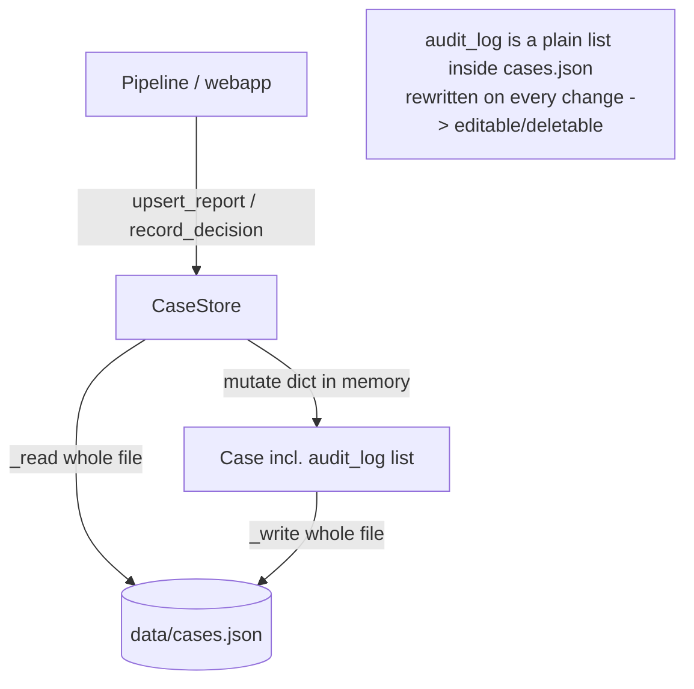
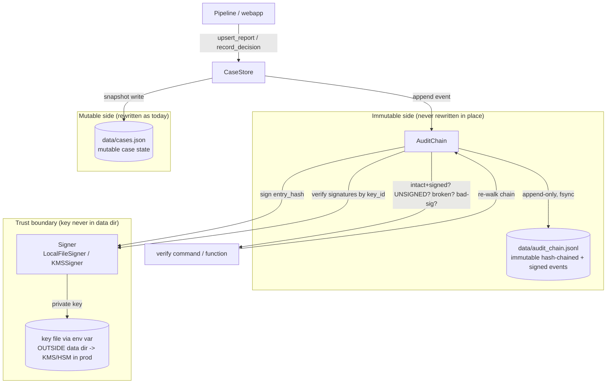

# Design Document: Immutable Audit Trail

## Overview

The `fraud_detect` AML/fraud-screening system records what it saw, scored, and
decided in a per-case `audit_log` — a plain Python list embedded inside each
`Case` object and persisted in a single `data/cases.json` file. On every write
the entire file is read, mutated, and rewritten. That design has a fatal
property for a regulated product: the audit record is as editable as any other
field. Anyone with file access can rewrite a past `SCREENED` entry, delete a
`HUMAN_REJECTED` event, or reorder history, and nothing in the system would
notice. For AML/fraud screening, audit integrity is regulatory table-stakes
(the README itself flags PDPA + MAS TRM as the production governance regime),
so this was ranked the #1 improvement for the commercial product.

This design makes the audit trail **append-only**, **self-verifying**, and
**digitally signed**. Two mechanisms combine:

1. A **hash chain**: each audit event stores a cryptographic hash of its own
   content plus the hash of the previous event, so the events form a linked chain
   where any edit, deletion, or reordering of a past event breaks the chain and is
   detectable by re-walking it.
2. A **per-event Ed25519 signature** over the canonical payload *including* the
   `entry_hash`, so the signature commits to the chained hash. An attacker who
   rewrites the whole file and recomputes every hash still cannot produce valid
   signatures without the private key — so forgery no longer yields a verifiable
   chain.

We separate the immutable event log (a new append-only JSONL file that is never
rewritten in place) from the mutable case snapshot (which can stay in `cases.json`).
A verification capability re-walks the chain, checks each event's signature against
the public key identified by its `key_id`, reports whether the chain is intact and
signed, and pinpoints the first broken link or invalid signature.

**A distinction this design takes seriously, because the user cares about
correctness:** signing closes the **forgery** gap that a plain hash chain leaves
open, but the trail is still not fully **tamper-proof** in the prototype:
- With signing, casual/partial tampering (editing, deleting, reordering) *and*
  whole-file rewrite-with-recomputed-hashes are now both detectable — a rewrite
  cannot forge valid signatures.
- Two gaps remain. (a) If the attacker also **steals the private key**, forgery is
  possible again; production must move the key into a KMS/HSM where it never leaves
  the boundary. (b) A full **wipe-and-restart** of the chain (deleting everything
  and starting a fresh genesis) is still not detectable by local verification alone;
  that requires external anchoring/checkpointing.

This document delivers the signed, hash-chained foundation for the prototype and
lays out, as explicit open questions, the production hardening (KMS/HSM custody and
external anchoring) that remains. We will not overstate what the prototype buys.

## Goals and Non-Goals

**Goals**
- Audit events are written to an append-only store that is never rewritten in place.
- Each event is cryptographically chained to its predecessor (hash chain).
- Each event is digitally signed (Ed25519) over a payload that commits to the
  chained `entry_hash`, so a rewrite that recomputes hashes cannot forge the chain.
- Signing is pluggable behind a `Signer` interface so a production KMS/HSM backend
  can replace the prototype's local-file key without changing `AuditChain` or the
  event model.
- A verification routine can prove the chain is intact *and* signed, distinguish an
  intact-but-UNSIGNED chain, or pinpoint the first broken link / invalid signature.
- The system is fail-safe but loud about signing: if no key is configured it still
  writes the hash chain (keeps working) but marks events UNSIGNED and `verify` says
  so plainly — it never silently implies events were signed.
- Existing behavior is preserved: `SCREENED`, `HUMAN_APPROVED`, `HUMAN_REJECTED`
  events still carry the same information; the never-auto-reject rule is untouched;
  the system stays fail-safe.
- Realistic for a prototype — one lightweight crypto dependency (`cryptography`),
  no mandatory external services.

**Non-Goals**
- Not a blockchain, distributed ledger, or consensus system. It is a single-writer,
  hash-chained, signed, append-only log.
- Not fully tamper-*proof* in the prototype: a wipe-and-restart, or forgery after
  the private key is stolen, is not defeated by the local design alone (see Security
  Considerations and Open Questions). Production KMS/HSM key custody and external
  anchoring close those.
- Not implementing key rotation operations in the prototype (single key), though the
  event model stores `key_id` so rotation does not break verification of old events.
- Not changing the risk-scoring logic, routing, or the human-in-the-loop model.
- Not replacing `cases.json` as the mutable case snapshot store (out of scope here).

## Architecture

### Current state (what we are replacing)



Weakness: the audit log lives inside the same blob that is fully rewritten on
every change. There is no link between consecutive entries, so an edit or deletion
leaves no trace.

### Proposed state

The audit trail moves to a dedicated append-only, hash-chained store. The mutable
case snapshot stays in `cases.json`; the immutable history of *events* lives in a
separate append-only JSONL file. `CaseStore` writes to both: it keeps the mutable
snapshot and delegates every audit event to the new `AuditChain`.



### Why separate the two stores

The mutable case snapshot legitimately changes (a `PENDING` review becomes
`APPROVED`; a report is re-run). That is fine to rewrite. The *history of events*
must never change. Co-locating them in one rewritten file is exactly what makes
the current audit log forgeable. Separating them lets the event store adopt a
strict append-only, never-rewrite discipline that `cases.json` cannot have.

The design intentionally mirrors the existing `data/access_audit.jsonl` prior art:
that file is already an append-only JSONL stream of access events (one JSON object
per line). We extend the same shape with a hash chain so the audit events gain
tamper-evidence the access log does not yet have.

## Components and Interfaces

### Component 1: `AuditEvent` (data model)

**Purpose**: The immutable unit written to the chain. One line of the JSONL file.

**Interface** (pydantic v2, consistent with the rest of `models.py`):

```python
class AuditEvent(BaseModel):
    # --- chain structural fields (unchanged by signing) ---
    seq: int                 # monotonically increasing, starts at 0 (genesis)
    prev_hash: str           # hex sha256 of the previous event's `entry_hash`;
                             # GENESIS_HASH (64 zeros) for seq == 0
    entry_hash: str          # hex sha256 over the canonical payload + prev_hash

    # --- payload (what actually happened) ---
    ts: str                  # UTC ISO-8601, as today's audit_log entries
    case_id: str             # which case this event belongs to
    event: str               # "SCREENED" | "HUMAN_APPROVED" | "HUMAN_REJECTED" | ...
    detail: str              # same human-readable detail string as today

    # --- signature fields (new) ---
    signature: str | None = None  # base64 of the Ed25519 signature over the signed
                                  # payload (see below); None/empty => UNSIGNED
    key_id: str | None = None     # identifier of the key that produced `signature`;
                                  # None when UNSIGNED. Verification picks the public
                                  # key by this id, so rotating keys does not break
                                  # verification of older events.
```

**What is signed (stated explicitly):** the Ed25519 signature is computed over the
canonical payload **including** `entry_hash` and **excluding** `signature` itself.
Including `entry_hash` means the signature commits to the chained hash (and
therefore transitively to the whole prefix of the chain, via `prev_hash`);
excluding `signature` avoids a field signing over itself. `key_id` is *not* part of
the signed bytes — it is a routing hint telling the verifier which public key to
check against; integrity of the event body is already covered by `entry_hash`, which
is signed.

```
signed_payload = { "seq", "prev_hash", "ts", "case_id", "event", "detail",
                   "entry_hash" }     # NOTE: includes entry_hash, excludes signature/key_id
signed_bytes   = canonicalBytes(signed_payload)
signature      = base64( Ed25519_sign(private_key, signed_bytes) )
```

An **UNSIGNED** event has `signature is None` and `key_id is None`; its structural
and payload fields are still present and still chained, so the hash chain remains
valid — it simply carries no signature.

**Responsibilities**:
- Carry the same `ts` / `event` / `detail` information the current `audit_log`
  entries carry, plus `case_id` (the current entries are implicitly scoped by
  living inside a Case; the flat log needs it explicit).
- Carry the optional `signature` / `key_id` without disturbing the hash-chain fields.
- Be canonically serializable so both the hash and the signed bytes are reproducible
  (see Data Models).

### Component 2: `AuditChain` (append-only hash-chained store)

**Purpose**: Own the append-only event file; compute the chain; append events;
verify the chain.

**Interface**:

```python
class AuditChain:
    def __init__(self, path: str = "data/audit_chain.jsonl",
                 signer: "Signer | None" = None) -> None:
        """`signer` signs each appended event. If None (no key configured),
        the chain is still written but events are UNSIGNED."""

    def append(self, *, case_id: str, event: str, detail: str,
               ts: str | None = None) -> AuditEvent:
        """Append one event, chained to the current tail. Computes the hash as
        before, then signs the entry if a signer is configured (recording
        signature + key_id); otherwise writes it UNSIGNED. Thread-safe,
        durable (fsync). Returns the written AuditEvent."""

    def verify(self) -> "VerificationResult":
        """Re-walk the chain from genesis, verify the hash links AND each signed
        event's signature (public key selected by key_id), and report integrity."""

    def events_for(self, case_id: str) -> list[AuditEvent]:
        """Read-only view of the events for one case, in chain order."""

    def tail(self) -> AuditEvent | None:
        """The last event in the chain, or None if empty."""
```

**Responsibilities**:
- Appending only — it never rewrites or truncates existing lines.
- Computing `prev_hash`/`entry_hash` so consecutive events are linked.
- Signing: after computing `entry_hash`, ask the `Signer` to sign the canonical
  signed payload and record `signature` + `key_id`; if no signer is configured,
  write the event UNSIGNED (fail-safe but loud — never pretend it was signed).
- Serializing payloads canonically so both hashes and signed bytes are reproducible
  across processes.
- Durability and concurrency (per-append `fsync` + in-process `threading.Lock`,
  reusing the existing `store.py` single-writer discipline) so a crash mid-append
  cannot silently corrupt the chain.
- During `verify`, resolving the public key for each event's `key_id` through the
  `Signer` and checking the signature; it does not hold private keys itself.

### Component 3: `CaseStore` integration

**Purpose**: Route every audit event through `AuditChain` instead of appending to
the in-memory `Case.audit_log` list.

**Interface** (existing signatures unchanged; internal behavior changes):

```python
class CaseStore:
    def __init__(self, path="data/cases.json",
                 audit_path="data/audit_chain.jsonl") -> None:
        # Build a Signer from the environment (LocalFileSigner if the key-path env
        # var is set; otherwise None -> AuditChain writes UNSIGNED events).
        # self._audit = AuditChain(audit_path, signer=build_signer_from_env())
        ...

    def upsert_report(self, report: RiskReport) -> Case:
        # ... existing snapshot write ...
        # NEW: self._audit.append(case_id=..., event="SCREENED", detail=...)

    def record_decision(self, case_id, decision, reviewer, reason, ...) -> Case | None:
        # ... existing snapshot write ...
        # NEW: self._audit.append(case_id=..., event=f"HUMAN_{decision.value}", detail=...)
```

**Responsibilities**:
- Preserve current call sites and the exact `event`/`detail` content.
- Keep writing the mutable snapshot to `cases.json`.
- Construct the `AuditChain` with a `Signer` resolved from the environment; signing
  is transparent to the call sites — they do not know or care whether events are
  signed. If no key is configured, appends still succeed as UNSIGNED.
- Write the immutable event to the chain. (The event is the source of truth for
  "what happened"; the snapshot's embedded `audit_log`, if retained at all, becomes
  a convenience mirror — see Migration open question.)

### Component 3b: `Signer` (pluggable signing backend)

**Purpose**: Encapsulate the signing key and the sign/verify operations so the
prototype's local-file key can be swapped for a production KMS/HSM backend without
touching `AuditChain` or `AuditEvent`.

**Interface** (a small `Protocol`/ABC):

```python
class Signer(Protocol):
    @property
    def key_id(self) -> str:
        """Stable identifier recorded alongside each signature."""

    def sign(self, data: bytes) -> bytes:
        """Produce an Ed25519 signature over `data`."""

    def verify(self, data: bytes, signature: bytes, *, key_id: str) -> bool:
        """True iff `signature` is a valid Ed25519 signature over `data` under the
        public key identified by `key_id`. Selecting by key_id lets a rotated key
        set still verify events signed by an older key."""

    def public_key_for(self, key_id: str) -> Ed25519PublicKey | None:
        """Resolve a public key by id (None if unknown), used during verification."""
```

**Prototype implementation — `LocalFileSigner`:**
- Loads an Ed25519 **private** key from a file whose path comes from an environment
  variable (e.g. `AUDIT_SIGNING_KEY_PATH`). The key file lives **outside** the
  `data/` directory so it is not co-located with the log it protects.
- Derives `key_id` deterministically (e.g. a short hash/fingerprint of the public
  key) and holds the matching public key for verification.
- Single key for the prototype; `key_id` is still stored per event so a future
  multi-key `LocalFileSigner` (or KMS backend) can verify older events.

**Production target — KMS/HSM-backed `Signer` (documented, not built here):**
- `sign` calls out to a KMS/HSM so the **private key never leaves the security
  boundary** — the app process holds no private key material, which is what defeats
  key theft.
- `key_id` maps to the KMS key version/ARN; `public_key_for` fetches the public key
  for verification. The interface is identical, so `AuditChain` is unchanged.
- **Production MUST move the key to a KMS/HSM.** The local-file key is a prototype
  convenience only; an attacker who reads the key file can forge signatures.

**Missing-key behavior (fail-safe but loud):** if no key path is configured,
`build_signer_from_env()` returns `None`. `AuditChain` then writes events UNSIGNED
(hash chain still intact, system still works) and `verify` reports the chain as
"intact but UNSIGNED" — never as signed.

**Responsibilities**:
- Own the private key material (prototype: local file; production: KMS/HSM) and
  never expose it through the data path.
- Produce signatures and resolve public keys by `key_id`.
- Keep the abstraction narrow enough that swapping backends changes only the
  `Signer` construction, not `AuditChain` or `AuditEvent`.

### Component 4: Verification capability (function + CLI)

**Purpose**: Operator-facing "is the audit trail intact?" check.

**Interface**:

```python
class VerificationResult(BaseModel):
    # Overall state. `intact` means the hash chain walks cleanly; `signed`
    # distinguishes a fully-signed chain from an intact-but-UNSIGNED one.
    status: str                        # "INTACT_SIGNED" | "INTACT_UNSIGNED"
                                       #   | "BROKEN_CHAIN" | "SIGNATURE_INVALID"
    intact: bool                       # True for INTACT_SIGNED / INTACT_UNSIGNED
    signed: bool                       # True only when every event is validly signed
    total_events: int
    unsigned_events: int               # count of events with no signature
    first_broken_seq: int | None       # seq of first hash-chain break (BROKEN_CHAIN)
    first_bad_signature_seq: int | None  # seq of first invalid signature
    reason: str | None                 # human-readable explanation when not fully OK

# CLI (mirrors statement_guard/cli.py style):
#   python -m fraud_detect.audit.verify [--path data/audit_chain.jsonl]
#   exit 0 = INTACT_SIGNED
#   exit non-zero = anything else (broken chain, invalid signature). An
#     INTACT_UNSIGNED result is surfaced loudly (distinct message / exit code)
#     so an operator is never left believing an unsigned chain was signed.
```

The four outcomes it must distinguish:
- **INTACT_SIGNED** — hash chain walks cleanly and every event's Ed25519 signature
  validates under the public key for its `key_id`.
- **INTACT_UNSIGNED** — hash chain walks cleanly but some/all events carry no
  signature (no key was configured when they were written). Reported plainly as
  "chain intact but UNSIGNED"; `unsigned_events > 0`.
- **BROKEN_CHAIN** — a hash-link / sequence / malformed-line failure. Carries
  `first_broken_seq` + `reason`.
- **SIGNATURE_INVALID** — hash chain is intact but a signed event's signature does
  not validate (tampered-then-rehashed content, wrong/unknown `key_id`, or a forged
  signature). Carries `first_bad_signature_seq` + `reason`.

**Responsibilities**:
- Re-walk from genesis: recompute each `entry_hash` and check it matches the stored
  one, that each `prev_hash` equals the previous event's `entry_hash`, and that
  `seq` increments by exactly 1.
- For each event that carries a `signature`, verify it against the public key the
  `Signer` resolves for that event's `key_id`; an unresolved `key_id` or a failed
  check is `SIGNATURE_INVALID`.
- Track `unsigned_events`; if any event is unsigned the chain is at best
  INTACT_UNSIGNED, never reported as signed.
- Report the first failing `seq` (chain or signature) and a reason (hash mismatch /
  broken link / sequence gap / malformed line / signature invalid / unknown key_id).

## Data Models

### Canonical payload and hashing

There are two canonical byte strings, both built with the same deterministic
serializer so they are reproducible across processes:

**1. Hash payload** (unchanged by signing) — hashed to produce `entry_hash`. Must
**exclude** `entry_hash` itself (a field cannot hash over itself) while **including**
`prev_hash` (that is what chains events together):

```
hash_payload = { "seq", "prev_hash", "ts", "case_id", "event", "detail" }
canonical_bytes = json.dumps(hash_payload, sort_keys=True,
                             separators=(",", ":"), ensure_ascii=False).encode("utf-8")
entry_hash = sha256(canonical_bytes).hexdigest()
```

**2. Signed payload** — the bytes the Ed25519 signature is computed over. It is the
hash payload **plus** `entry_hash`, and it **excludes** `signature` and `key_id`:

```
signed_payload = { "seq", "prev_hash", "ts", "case_id", "event", "detail", "entry_hash" }
signed_bytes   = json.dumps(signed_payload, sort_keys=True,
                            separators=(",", ":"), ensure_ascii=False).encode("utf-8")
signature      = base64( Ed25519_sign(private_key, signed_bytes) )   # None when UNSIGNED
```

Because the signed bytes include `entry_hash` (and `entry_hash` depends on
`prev_hash`), a valid signature transitively commits to the entire chain prefix. An
attacker who edits content and recomputes `entry_hash` still cannot produce a valid
`signature` without the private key.

Validation rules:
- `seq` is a non-negative integer; the first event is `seq == 0`.
- `prev_hash` is 64 lowercase hex chars; `GENESIS_HASH = "0" * 64` for `seq == 0`.
- `entry_hash` is 64 lowercase hex chars and equals `sha256(canonical_bytes)`.
- `signature` is either absent/`null` (UNSIGNED) or a base64 string that decodes to
  a 64-byte Ed25519 signature valid over `signed_bytes`.
- `key_id` is present iff `signature` is present; verification resolves the public
  key by `key_id`. An unknown `key_id` on a signed event is a `SIGNATURE_INVALID`
  failure.
- `ts` is a valid UTC ISO-8601 string (same format as today's entries).
- Lines are newline-delimited JSON objects; a malformed line = chain break at that
  position (fail-safe, do not skip it).

### On-disk format (`data/audit_chain.jsonl`)

One JSON object per line, append-only, mirroring `access_audit.jsonl` shape. Signed
events carry `signature` + `key_id`; an UNSIGNED event has them as `null`:

```
{"seq":0,"prev_hash":"000...000","entry_hash":"a1b2...","ts":"2026-...Z","case_id":"CASE-1","event":"SCREENED","detail":"risk=72 (HIGH), ...","signature":"MEUCIQD...","key_id":"ed25519:3f9a1c"}
{"seq":1,"prev_hash":"a1b2...","entry_hash":"c3d4...","ts":"2026-...Z","case_id":"CASE-1","event":"HUMAN_REJECTED","detail":"reviewer=alice; reason=...","signature":"MEQCIF...","key_id":"ed25519:3f9a1c"}
```

An UNSIGNED line (no key configured when written) looks the same but with
`"signature":null,"key_id":null`.

### Relationship to the existing `Case.audit_log`

Today `Case.audit_log: list[dict]` holds `{"ts","event","detail"}`. Under this
design the authoritative audit record is the chain. Whether `Case.audit_log` is
(a) removed, (b) kept as a read-only mirror derived from the chain, or (c) kept and
backfilled is the subject of the Migration open question below. The design does not
hard-commit; it recommends keeping it as a derived mirror for UI convenience while
making the chain authoritative.

## Hash-Chain Algorithm

```pascal
ALGORITHM appendEvent(chain_file, signer, case_id, event, detail, ts)
  SEQUENCE
    ACQUIRE lock                      // single-writer discipline

    tail ← readLastEvent(chain_file)  // None if empty
    IF tail = None THEN
      seq ← 0
      prev_hash ← GENESIS_HASH        // 64 zeros
    ELSE
      seq ← tail.seq + 1
      prev_hash ← tail.entry_hash
    END IF

    // 1. Hash exactly as before (signing does not change the chain).
    hash_payload ← { seq, prev_hash, ts, case_id, event, detail }
    entry_hash   ← SHA256(canonicalBytes(hash_payload))

    // 2. Sign the payload INCLUDING entry_hash, if a signer is configured.
    IF signer ≠ None THEN
      signed_bytes ← canonicalBytes({ ...hash_payload, entry_hash })
      signature    ← base64(signer.sign(signed_bytes))
      key_id       ← signer.key_id
    ELSE
      signature ← null                // UNSIGNED: fail-safe but loud
      key_id    ← null
    END IF

    line ← JSON({ ...hash_payload, entry_hash, signature, key_id })

    APPEND line + "\n" TO chain_file
    FLUSH and FSYNC chain_file        // durability: survive crash

    RELEASE lock
    RETURN AuditEvent(hash_payload, entry_hash, signature, key_id)
  END SEQUENCE
END
```

```pascal
ALGORITHM verifyChain(chain_file, signer)
  SEQUENCE
    events ← readAllLines(chain_file)
    IF events is empty THEN
      RETURN IntactSigned(total = 0, unsigned = 0)   // vacuously signed
    END IF

    expected_prev ← GENESIS_HASH
    expected_seq  ← 0
    unsigned      ← 0

    // Pass 1: hash chain must walk cleanly before we trust any signatures.
    FOR each e IN events DO                       // in file order
      IF e failed to parse THEN
        RETURN BrokenChain(e.position, "malformed line")
      END IF
      IF e.seq ≠ expected_seq THEN
        RETURN BrokenChain(e.seq, "sequence gap/reorder")
      END IF
      IF e.prev_hash ≠ expected_prev THEN
        RETURN BrokenChain(e.seq, "prev_hash does not match prior entry_hash")
      END IF
      recomputed ← SHA256(canonicalBytes(hashPayloadOf(e)))
      IF recomputed ≠ e.entry_hash THEN
        RETURN BrokenChain(e.seq, "entry_hash mismatch (content altered)")
      END IF

      expected_prev ← e.entry_hash
      expected_seq  ← expected_seq + 1
    END FOR

    // Pass 2: verify signatures. Chain links are sound; now check authenticity.
    FOR each e IN events DO
      IF e.signature = null THEN
        unsigned ← unsigned + 1
        CONTINUE                                   // UNSIGNED event, not an error
      END IF
      pubkey ← signer.public_key_for(e.key_id)     // select key by key_id
      IF pubkey = None THEN
        RETURN SignatureInvalid(e.seq, "unknown key_id: " + e.key_id)
      END IF
      signed_bytes ← canonicalBytes(signedPayloadOf(e))   // includes entry_hash
      IF NOT Ed25519_verify(pubkey, base64decode(e.signature), signed_bytes) THEN
        RETURN SignatureInvalid(e.seq, "signature does not validate")
      END IF
    END FOR

    IF unsigned > 0 THEN
      RETURN IntactUnsigned(total = count(events), unsigned = unsigned)
    ELSE
      RETURN IntactSigned(total = count(events), unsigned = 0)
    END IF
  END SEQUENCE
END
```

What each check catches:
- **Content edited** → recomputed `entry_hash` ≠ stored → `BROKEN_CHAIN`.
- **Content edited then entry_hash recomputed** → hash passes, but the stored
  `signature` no longer validates over the new `signed_bytes` → `SIGNATURE_INVALID`.
- **Event deleted** → the next event's `prev_hash` no longer matches, `seq` jumps →
  `BROKEN_CHAIN`.
- **Events reordered** → `seq` out of order and/or `prev_hash` mismatch → `BROKEN_CHAIN`.
- **Event inserted** → its `prev_hash`/`seq` will not line up → `BROKEN_CHAIN`.
- **Full-file rewrite with recomputed hashes** → hash chain now walks cleanly, but
  the attacker cannot produce valid signatures without the private key →
  `SIGNATURE_INVALID`. **Signing closes this forgery gap** (the previous design could
  not detect it). It remains defeatable only if the private key is also stolen.
- **No key configured at write time** → events are UNSIGNED → `INTACT_UNSIGNED`
  (reported plainly, never as signed).
- **Wipe-and-restart (fresh genesis)** → still **NOT caught** locally; requires
  external anchoring/checkpointing (see Security Considerations and Open Questions).

## Error Handling

### Scenario 1: Append fails mid-write (crash / disk full)
**Condition**: Process dies after partial write, or `fsync` fails.
**Response**: fsync before returning; a partial trailing line is detectable as a
malformed last line during `verify` (reported as a break at the tail, not silently
accepted).
**Recovery**: Operator truncates the partial trailing line; the chain before it
remains valid and verifiable. The design does not auto-truncate (auto-editing an
append-only log would itself be a tamper vector).

### Scenario 2: Chain file missing or empty
**Condition**: First run, or file deleted.
**Response**: An empty chain verifies as intact with `total_events == 0`. A missing
file on `append` is created (genesis event becomes `seq 0`). A *previously non-empty*
chain that is now empty cannot be distinguished from a fresh start by the local
chain alone — this is exactly the wipe attack the external-anchor open question
addresses.
**Recovery**: Fail-safe — verification surfaces the state; it never fabricates events.

### Scenario 3: Verification detects a break
**Condition**: `verify` finds a mismatch.
**Response**: Return `intact = False` with `first_broken_seq` and a `reason`. CLI
exits non-zero. The system does **not** attempt repair and does **not** alter the
never-auto-reject behavior — a broken audit trail is an operational/compliance
incident surfaced to humans, consistent with the system's governance stance.

### Scenario 4: Concurrent appends
**Condition**: Two writers append at once.
**Response**: Reuse the single-writer discipline already in `store.py` (`threading.Lock`).
Appends are serialized so `seq` and `prev_hash` stay consistent. Cross-process
concurrency is an open question (see below) — the prototype is single-process.

### Scenario 5: Signing key configured but unreadable or invalid
**Condition**: `AUDIT_SIGNING_KEY_PATH` is set, but the file is missing, has wrong
permissions, is not a valid Ed25519 private key, or cannot be parsed.
**Response**: Fail loudly at `Signer` construction / startup — do **not** silently
fall back to UNSIGNED when a key was clearly *intended*. Surface a clear error
("signing key configured but could not be loaded: <reason>") so the misconfiguration
is fixed rather than masked. (Contrast Scenario 6, where no key is configured at
all.) The system does not invent a key or disable signing on its own.

### Scenario 6: No signing key configured (UNSIGNED mode)
**Condition**: `AUDIT_SIGNING_KEY_PATH` is unset/empty.
**Response**: Fail-safe but loud. `AuditChain` writes the hash chain and marks
events UNSIGNED (`signature`/`key_id` = null). The system keeps working. `verify`
reports `INTACT_UNSIGNED` ("chain intact but UNSIGNED") — it never implies the
events were signed. Operators are expected to configure a key for any environment
where signing is required.

### Scenario 7: Signature verification failure during verify
**Condition**: A signed event's signature does not validate, or its `key_id`
resolves to no known public key.
**Response**: `verify` returns `SIGNATURE_INVALID` with `first_bad_signature_seq`
and a `reason` (e.g. "signature does not validate" or "unknown key_id: …"). CLI
exits non-zero. The chain is **not** repaired; this is a compliance/security
incident surfaced to a human, consistent with the governance stance.

### Scenario 8: Unsigned events encountered when a key IS expected
**Condition**: A key is configured/expected, but some events on disk are UNSIGNED
(e.g. written during an earlier UNSIGNED window, or an attacker stripped a
signature hoping it passes as merely "unsigned").
**Response**: `verify` still reports the chain as `INTACT_UNSIGNED` (not signed) and
counts `unsigned_events`. Because operators run verification with the expectation
that current events are signed, an UNSIGNED result in a signed environment is itself
the alarm — it is surfaced, never treated as equivalent to signed. (Note: stripping
a signature does not let an attacker *alter* content, since any edit still breaks the
hash chain; it only downgrades an event to UNSIGNED, which verification exposes.)

## Testing Strategy

### Unit testing approach
- Genesis event has `seq == 0` and `prev_hash == GENESIS_HASH`.
- Appends increment `seq` by 1 and link `prev_hash` to the prior `entry_hash`.
- `verify` returns `INTACT_SIGNED` for a freshly built, signed chain of N events.
- Tampering cases (each should be caught, with correct `first_broken_seq`):
  edit a `detail` in the middle; delete a middle line; swap two lines; truncate the
  tail; corrupt one `entry_hash`.
- `CaseStore.upsert_report` / `record_decision` write the same `event`/`detail`
  content to the chain as the old `audit_log` did.
- **Signing unit cases:**
  - A chain built with a `LocalFileSigner` verifies as `INTACT_SIGNED`; every event
    carries a non-null `signature` and `key_id`.
  - A chain built with no signer verifies as `INTACT_UNSIGNED` with
    `unsigned_events == total_events`; `verify` message says "UNSIGNED", not signed.
  - **Tampered-but-rehashed event**: edit a `detail`, recompute and overwrite its
    `entry_hash` (so the hash chain would pass) — `verify` returns
    `SIGNATURE_INVALID` at that `seq` because the stored signature no longer matches.
  - **Wrong key_id**: flip an event's `key_id` to an id the signer cannot resolve →
    `SIGNATURE_INVALID` ("unknown key_id").
  - **Key configured but unreadable/invalid** → `Signer` construction raises a clear
    error (Scenario 5), not a silent UNSIGNED fallback.
  - Signature produced by key A validates under key A's public key and fails under a
    different key B's public key.

### Property-based testing approach
The project already uses property-based tests (`.hypothesis/` present, Hypothesis
is in the ecosystem). Candidate properties:
- **Append grows the chain by exactly one and preserves verifiability**: for any
  sequence of events, appending them one by one with a configured signer yields a
  chain that `verify` reports `INTACT_SIGNED` with `total == number appended`.
- **Any single-point mutation is detected**: for any built chain and any edit to
  exactly one stored field of one event (other than re-deriving all downstream
  hashes), `verify` reports `intact == False` (`BROKEN_CHAIN`).
- **Deletion is detected**: for any chain of length ≥ 2 and any deleted index,
  `verify` reports a break.
- **Determinism of hashing**: for any payload, `entry_hash` is identical across
  repeated computations and across process boundaries (canonical serialization).
- **Signing round-trip**: for any event payload and any generated Ed25519 keypair,
  `verify(sign(signed_bytes))` succeeds under that key's public key.
- **Rewrite-with-rehash is caught by the signature**: for any built, signed chain
  and any edit to one event's `detail` followed by recomputing *all* downstream
  `entry_hash` values (a full rehash that defeats the hash chain alone), `verify`
  still reports `SIGNATURE_INVALID` — because the attacker cannot re-sign.
- **Wrong key fails**: for any event signed by key A, verification under any
  different key B's public key returns false; a mismatched `key_id` yields
  `SIGNATURE_INVALID`.
- **UNSIGNED is reported as such**: for any chain written with no signer, `verify`
  returns `INTACT_UNSIGNED` and `unsigned_events == total_events`, never signed.

**Property test library**: Hypothesis (already in use in `tests/`).

### Integration testing approach
- End-to-end: run a screening then a human decision through `CaseStore`, then
  `verify` the resulting chain is intact and contains the expected two events.
- CLI exit-code contract: intact → exit 0; tampered fixture → non-zero.

## Correctness Properties

*A property is a characteristic or behavior that should hold true across all valid
executions of a system — essentially, a formal statement about what the system
should do. Properties serve as the bridge between human-readable specifications and
machine-verifiable correctness guarantees.*

### Property 1: Append preserves the existing chain as a prefix

*For any* audit chain and any new event, appending that event leaves every
previously written line byte-identical and adds exactly one new line — the prior
file content is an unchanged prefix of the new file content.

**Validates: Requirements 1.1**

### Property 2: Genesis and chaining invariant

*For any* sequence of appended events, the first event has `seq == 0` and
`prev_hash == GENESIS_HASH`, and every subsequent event has `seq` equal to the
previous event's `seq` plus 1 and `prev_hash` equal to the previous event's
`entry_hash`.

**Validates: Requirements 2.1, 2.2**

### Property 3: Deterministic canonical hashing

*For any* event payload, the canonical serialization and the resulting `entry_hash`
are identical across repeated computations and across process boundaries, and the
recomputed `entry_hash` over the canonical hash payload (excluding `entry_hash`
itself) equals the stored `entry_hash`.

**Validates: Requirements 2.3, 2.4**

### Property 4: Field-format invariant

*For any* chain, every event has a non-negative integer `seq`, a 64-lowercase-hex
`prev_hash`, and a 64-lowercase-hex `entry_hash`.

**Validates: Requirements 2.5**

### Property 5: Signed chain round-trip verifies as INTACT_SIGNED

*For any* chain built with a configured Signer, verification returns `INTACT_SIGNED`
with `total_events` equal to the number of events appended, and every event carries
a non-null base64 `signature` and a non-null `key_id` that validates under the
resolved public key.

**Validates: Requirements 4.1, 4.3, 7.2**

### Property 6: Signatures resolve by key_id and wrong keys fail

*For any* event signed by key A, verification resolves the public key by that
event's `key_id` and succeeds under key A's public key, while verification under any
different key B's public key fails and a mismatched or unknown `key_id` yields a
verification failure.

**Validates: Requirements 4.4, 5.4**

### Property 7: Unsigned chains are reported as UNSIGNED, never signed

*For any* chain containing one or more events written with no Signer, verification
reports `INTACT_UNSIGNED` with `signed == False` and `unsigned_events` equal to the
number of unsigned events, while the hash links remain valid.

**Validates: Requirements 6.1, 6.2, 7.3**

### Property 8: Any single structural corruption is caught as BROKEN_CHAIN

*For any* built chain and any single structural corruption — editing one event's
field (without re-deriving the signature path), deleting a line, reordering two
lines, inserting a line, or writing a malformed line — verification returns
`BROKEN_CHAIN` with `first_broken_seq` pointing to the first affected position.

**Validates: Requirements 7.4, 9.3**

### Property 9: Signature tampering is caught as SIGNATURE_INVALID

*For any* signed chain, invalidating exactly one event's `signature` or changing its
`key_id` to an unresolvable value (while leaving the hash chain intact) causes
verification to return `SIGNATURE_INVALID` with `first_bad_signature_seq` at that
event's `seq`.

**Validates: Requirements 7.5**

### Property 10: Rewrite-with-rehash forgery is still caught

*For any* signed chain, editing one event's content and recomputing that event's and
all downstream `entry_hash` values (so the bare hash chain would walk cleanly) still
causes verification to return `SIGNATURE_INVALID`, because the attacker cannot
produce a valid signature without the private key.

**Validates: Requirements 7.7**

### Property 11: Verification has no side effects on the chain

*For any* chain — intact or corrupted — running verification leaves the chain file
bytes unchanged; verification never modifies, repairs, truncates, or rewrites the
chain.

**Validates: Requirements 9.1**

### Property 12: Concurrent in-process appends serialize to a contiguous chain

*For any* set of N concurrent in-process append operations, the resulting chain
contains each `seq` value from 0 to N-1 exactly once and verification reports the
chain as intact.

**Validates: Requirements 10.2**

### Property 13: Every event carries its case_id

*For any* audit event recorded for a case, the written event includes a non-empty
`case_id` equal to the identifier of the case it was recorded for.

**Validates: Requirements 3.3**

## Security Considerations

This is the heart of the spec, so it is stated plainly. Signing is now **in scope**,
so the threat analysis reflects a signed hash chain, not a bare one.

### What the hash chain gives you: tamper-EVIDENCE
A hash chain reliably detects any change that does not recompute every downstream
hash: editing a past event, deleting one, reordering, or inserting. Re-running
`verify` turns "did someone touch the record?" into a yes/no with a pointer to the
first break. This catches casual or partial tampering.

### What signing adds: it closes the FORGERY gap
Previously, the one attack a bare chain could not catch was a **full-file rewrite
with recomputed hashes** — an attacker who controlled the file and the hashing code
could forge a perfectly valid-looking chain. Per-event Ed25519 signatures close that
gap. Because each signature is computed over a payload that **includes `entry_hash`**
(which in turn commits to `prev_hash` and the whole prefix), recomputing hashes is no
longer enough: the attacker would also have to produce a valid signature, which
requires the **private key they do not hold**. So a rewrite-and-rehash now fails
`verify` with `SIGNATURE_INVALID`. This is the single highest-leverage hardening and
it is delivered in the prototype.

### What it STILL does NOT give you: full tamper-PROOFING
Two honest gaps remain even with signing:

1. **Private-key theft.** If the attacker also obtains the signing key, they can
   re-sign forged events and the chain verifies again. The prototype stores the key
   in a local file (outside the data dir, via env var) — better than co-locating it
   with the log, but still reachable by anyone who compromises the host. **This is
   why production MUST move the key to a KMS/HSM**, where `sign` happens inside the
   boundary and the private key never leaves it; compromising the app host no longer
   yields the key.
2. **Wipe-and-restart.** An attacker can still delete the whole file and start a new
   `seq 0` genesis chain. Local verification cannot distinguish a legitimately-fresh
   chain from a wiped one (there is nothing left to compare against). Signing does
   **not** help here — the new chain can be validly signed by the same key. Detecting
   wipe/truncation requires an **external anchor** the attacker cannot rewrite.

So **prototype = tamper-evident + forgery-resistant (while the key is safe), but not
wipe-proof and not proof against key theft.** We will not claim otherwise.

### Mitigation layers, re-ranked (signing now delivered, not hypothetical)
Ordered by how much trust each moves away from the local writer:

0. **Hash chain (delivered).** Tamper-evidence for edits/deletes/reorders/inserts.
1. **Per-event Ed25519 signing (delivered, prototype).** Closes the forgery gap:
   rewrite-and-rehash no longer verifies. `key_id` stored per event so key rotation
   does not break verification of older events. Effectiveness is bounded by key
   custody (layer 2).
2. **KMS/HSM key custody (production, required).** Move the private key off the app
   host so key theft via host compromise is no longer a forgery path. The `Signer`
   interface is designed for exactly this swap — no change to `AuditChain` or the
   event model. This is the production upgrade that makes layer 1's guarantee hold
   against a host-level attacker.
3. **External anchoring / checkpointing (production).** Periodically publish the
   current tail `entry_hash` (a checkpoint) to a location the attacker cannot rewrite
   — a WORM bucket, a managed transparency/timestamping service, or a second
   custodian. Verification then also checks the local tail against the last anchored
   checkpoint, so a **wipe or truncation is detectable**. This is the remaining layer
   needed to close the wipe-and-restart gap signing cannot.
4. **Write-once/WORM storage (production).** Store the JSONL on object storage with
   object-lock / retention so past bytes physically cannot be overwritten within the
   retention window.
5. **Append-only database with restricted grants (production).** A real DB (the
   README's eventual target under PDPA + MAS TRM) with INSERT-only grants and no
   UPDATE/DELETE for the app role, plus DB-level audit.

The prototype delivers layers 0 and 1. Layer 2 (KMS/HSM) and layer 3 (anchoring)
are the two production tasks that take the trail from "forgery-resistant while the
key is safe" to "resistant to host compromise and wipe".

### Governance preserved
Nothing here changes the never-auto-reject rule or the human-in-the-loop model. A
broken or missing chain is surfaced to humans as an incident; the system never
"repairs" its own audit trail and never makes a reject decision on its own. This is
consistent with the existing stance that components add evidence and escalate.

## Dependencies

- **`cryptography`** (PyCA) — **new.** Provides Ed25519 signing/verification
  (`cryptography.hazmat.primitives.asymmetric.ed25519`). This is the feature's
  **first non-stdlib runtime dependency**; it is added to `requirements.txt`. It is a
  widely-used, well-maintained library and is a deliberate, scoped addition — signing
  is now a first-class part of the design, not optional infra.
- **Standard library** for the rest of the core: `hashlib` (sha256), `json`,
  `threading`, `os`/`pathlib` (fsync + env var for the key path), `base64`. No other
  third-party runtime deps — consistent with keeping heavy infra out of the prototype
  (the project already isolates heavy deps like the GNN stack in separate
  requirements files).
- **pydantic v2** — already a project dependency; reused for `AuditEvent` /
  `VerificationResult`.
- **Hypothesis** — already used in `tests/` for property tests.
- A production KMS/HSM backend would add a client SDK (e.g. a cloud KMS client), but
  that is a swap behind the `Signer` interface and is out of scope for the prototype
  (see Open Questions). The prototype stays at `cryptography` + stdlib + pydantic v2
  + Hypothesis.

## Open Questions

These are deliberately left open for the review discussion; none block the design.

1. **Integrity hardening — what remains after signing.**
   **Decided and in scope:** per-event Ed25519 signing is now part of the prototype
   (not deferred). That closes the rewrite-and-rehash **forgery** gap. **Still open
   as production hardening:** (a) moving the signing key to a **KMS/HSM** so key theft
   via host compromise is no longer a forgery path (the `Signer` interface is built
   for this swap), and (b) **external anchoring/checkpointing** — publishing the tail
   `entry_hash` to a location the attacker cannot rewrite — to detect a
   wipe-and-restart, which signing alone cannot catch. Recommendation: ship signed +
   hash-chained for the prototype; make KMS/HSM custody and anchoring the first two
   production tasks, in that order.

2. **Migration of existing `data/cases.json` audit_log entries.**
   Options: (a) **start fresh** — new chain begins at genesis, old embedded
   `audit_log` kept read-only for history; or (b) **one-time backfill** — replay
   existing entries into the chain in timestamp order to produce a single continuous
   chain. Backfill is cleaner for continuity but means the genesis block covers
   pre-existing, previously-mutable data (so it inherits that data's lower assurance).
   Recommendation: start fresh, clearly dating the chain's genesis; optionally import
   old entries as a labeled "legacy, unverified" prefix.

3. **Scope of immutable events.**
   The chain today would cover `SCREENED` + `HUMAN_APPROVED`/`HUMAN_REJECTED`. Should
   it also absorb access/view events currently in `access_audit.jsonl` (unifying both
   into one chained log), or stay decision-focused and leave access logging separate?
   Recommendation: keep decision events in this chain for v1; consider chaining the
   access log as a follow-up using the same `AuditChain` primitive.

4. **Concurrency and durability of appends.**
   The prototype is single-process and reuses the existing `threading.Lock` plus
   `fsync` per append. Do we need cross-process safety (file locking / `flock`) or a
   dedicated writer process now, or defer until a real DB replaces the JSONL? Also:
   is per-append `fsync` acceptable for throughput, or do we batch with periodic sync
   (trading a small durability window for speed)? Recommendation: per-append fsync +
   in-process lock for the prototype; revisit with the production DB.

5. **Key management and rotation operations (now first-class, since signing is in).**
   The prototype uses a single local-file key and stores `key_id` per event so a
   future rotation does not break verification of older events — but the *operational*
   side is open: Where does the key live in production and who holds custody (which
   KMS/HSM, which access policy)? What is the rotation cadence, and how are multiple
   active/retired public keys distributed to verifiers so each event's `key_id`
   resolves? How is a key **revoked** if compromised, and what does `verify` report
   for events signed by a revoked key (still "was validly signed at the time" vs
   "untrusted now")? Recommendation: single key + stored `key_id` for the prototype;
   treat custody, rotation cadence, key distribution, and revocation as a production
   key-management design that rides on the same `Signer` interface.
