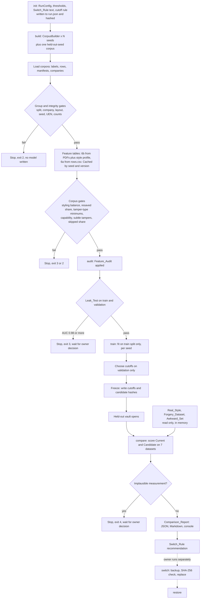

# Design Document: ML Retraining (Stage B)

## Overview

Stage A built a synthetic corpus generator (`fraud_detect/corpus/`). Stage B uses that corpus to retrain and re-evaluate the two machine-learning checks: **Node 6b** (statement forgery, a gradient-boosted model on PDF file features) and **Node 6a** (transaction fraud, a gradient-boosted model on statement rows, plus a graph-model account lookup). The aim is a model that learns what tampering looks like, not how our own generator prints a statement.

The danger is circularity: a model trained on the generator's output and judged on the generator's output can score well by learning the generator's habits. This design answers it with seven mitigations, each of which is a step in the pipeline and not a promise in a document:

1. Whole groups are held out (layout, company, Master_Seed), checked by code before any training.
2. Cutoffs are chosen on validation only, and the test data cannot be opened until the cutoffs are written to disk.
3. Every feature is audited for generator tells, and a leak test runs before training.
4. Styling is checked for independence from the label, from the PDFs themselves.
5. `statement_E`, `statement_F`, the answer key and the forgery dataset are never trained on.
6. A fixed Switch_Rule, written into the report before any test score exists, decides whether a new model replaces an old one.
7. A small hand-built Awkward_Set of hard cases is kept, and a person reviews it.

The pipeline is offline tooling under `fraud_detect/ml/retraining/`. It adds no runtime dependency, does not change Nodes 1 to 4, `registry.py`, `reference_data.py` or the Node 4 weights, and never copies a model over a live one by itself. Everything it writes goes to git-ignored folders (`data/private/ml_retraining/` and `models/`).

**The pipeline can refuse to train on the generator as it stands today.** Section "What I checked in the code" shows that the generator does not randomise the Creator string or the fonts, never prints a genuine file with an editing-tool name, and cannot make a 5%-or-smaller amount change. Requirement 5.6 says to stop and not change the generator, so `train` stops with a named list until the project owner records a written decision. This is the intended behaviour, and it is the first thing to read.

### Stages and scope

| Item | In this spec |
|---|---|
| Corpus build for Stage B (several seeds, mixes, held-out seed corpus) | Yes, by calling the existing `CorpusBuilder` |
| Feature audit, leak test, group checks, styling checks | Yes |
| Training Node 6b and Node 6a candidates | Yes |
| Retraining the GNN | No. The corpus has no transfer graph (finding F8) |
| Evaluation, comparison report, Switch_Rule, switch and restore commands | Yes |
| Changing the generator, a detector, a layout renderer, Nodes 1 to 4 | No |
| Changing Node 6a/6b code to read cutoffs or show a label | No, listed as open decisions |

## What I checked in the code (verified, not assumed)

### Assumption 1: styling is randomised independently of the label

I read `corpus/finish.py` (`make_style`, `finish_pdf`), `corpus/builder.py` (`_build_document`), `corpus/tamper/pdf_ops.py`, `corpus/tamper/ledger_ops.py` and the layout renderers. `make_style(master_seed, doc_id)` is called once per document, with the same arguments whether the document is genuine or tampered, so each value it draws is label-independent. The table shows what it does and does not draw.

| Styling choice | How the generator sets it | Varies across documents? | Label-independent? | Verdict |
|---|---|---|---|---|
| Producer | 4 values from `PRODUCERS` via `make_style`. File-level tampers overwrite it: `metadata_inconsistency` takes one of 4 `EDITOR_PRODUCERS` (tampered only), `genuine_resaved` takes one of 4 `EXPORT_PRODUCERS` (genuine only) | Yes | Mostly. The editor names exist only on tampered files | **Partly missing** (Requirement 5.4) |
| Creator | One constant, `"synthetic-corpus-generator 1.0.0"`, on every document | No | Yes, trivially | **Missing** (not randomised) |
| Fonts | Helvetica and Helvetica-Bold in every renderer. `Courier` appears only through `font_mismatch` | No | No, for `font_mismatch` | **Missing** |
| Bank name | 1 of 8 `BANK_NAMES` | Yes | Yes | Present |
| Address wording | 1 of 6 `STREETS`, random postcode, optional second line | Yes | Yes | Present |
| Row spacing | `row_step` drawn from 12.0 to 12.8 | Yes | Yes | Present |
| Creation time of day | 06:00 to 20:59, random seconds. The date is fixed as 1 to 3 days after the last month | Time of day only | Yes (except the early-creation variant of `metadata_inconsistency`) | Present |
| Page size, footer wording | A4 and one fixed footer string on every page | No | Yes, trivially | Not in the Requirement 5.1 list, but recorded in the audit |

**Can the generator make genuine documents that look edited?** Only one kind: `genuine_resaved` (a print/export Producer and a ModDate 60 seconds to 3 days after CreationDate). No genuine document carries an editing-tool name, an extra content stream or a rare font. Measured on the existing `data/corpus_large` (120 documents, default even tamper mix): 4 of 64 genuine documents (6.3%) are `genuine_resaved`, below the 15% that Requirement 5.5 asks for. The share is not a separate generator setting; it follows the `--tamper-mix` weight of `genuine_resaved`, which the pipeline can set without changing the generator.

**Result, stated plainly.** Requirement 5.1 asks for Creator and fonts to be drawn from the same distribution for both classes. The generator draws neither. Requirement 5.4 asks for genuine documents that share Producer, Creator and modification pattern with tampered ones. Producer base values and the Creator are shared; editing-tool names and ModDate gaps of more than 3 days are tampered-only. Per Requirement 5.6, the `capability` gate (below) reports the missing choices by name and `train` exits without training. A follow-up spec for the generator would remove the stop. The owner can also record a written waiver (see D2), which is then printed in the report.

### Assumption 2: the manifest records a difficulty or subtlety setting

It does not. `labels.csv` has no such column, `corpus_manifest.json` has no such key, and `DocumentPlan.variant` exists in `schema.py` but `CorpusBuilder.plan()` never sets it. Variants (fast or slow structuring, large or moderate deposit, balances recomputed or left) are chosen from the tamper random stream and appear only in the free-text `label.notes` of each per-document manifest. I do not parse free text. Requirement 6.5 is conditional ("WHERE the manifest records..."), so the report prints "difficulty: not recorded in the corpus manifest (generator 1.0.0)" and gives no per-difficulty rows.

Requirement 6.6 asks for a subtle tamper with an amount change of 5% or less. `plan_edited_amount` and `plan_font_mismatch` multiply the amount by a factor drawn from 1.2 to 3.0 or from 0.2 to 0.8, so every changed amount moves by at least 20%. A `subtle` gate computes the relative change from the `original` and `new` strings in `affected_rows` and will report that no document meets the 5% case. Single changed amounts and single changed dates do exist (`edited_amount`, `altered_date`).

### What the corpus files contain

| File | Contents that Stage B uses | Not present |
|---|---|---|
| `labels.csv` | `doc_id`, `file`, `split` (`train`, `validation`, `test`, `test_unseen_layout`), `layout`, `company_id`, `n_months`, `n_pages`, `n_rows`, `is_tampered`, `tamper_types` (a semicolon list that is non-empty for `genuine_resaved` too), `tamper_method` (`overlay`, `rerender`, `content`, `file`), `genuine_resaved`, `n_affected_rows`, `genuine_hard_cases` | Master_Seed, style values (Producer, bank name...), difficulty |
| `rows.csv` | `doc_id`, `row_index`, `row_id`, `page`, `month`, `date` (a calendar date), `amount` (signed), `balance`, `kind`, `is_fraud_row`, `fraud_type` | account id, counterparty, time of day |
| `corpus_manifest.json` | `master_seed`, `hold_out_layout`, `counts` (documents, per layout, per split, per tamper type per split), `failed`, `warnings`, `uen_check` object (`source`, `snapshot_file`, `snapshot_sha256`, `snapshot_uens`, `uens_checked`, `redraws`, `real_registry_checked`) | Per-document seeds |
| `companies.json` | `company_id`, `uen`, `name`, `baseline` | |
| `manifests/<doc_id>.json` | Everything above per document, plus `affected_rows` with `original` and `new`, `edits`, `file_ops`, `seeds.master` | Style values |

Two consequences. First, style values must be read back from the PDFs (finding F6). Second, `company_id` is built from layout, group and position (`C1G0001`), so **the same company id string appears in every corpus** and means a different fictional company in each (finding F2).

### The two feature sets as they are

- **Node 6b**: `statement_features.FEATURE_NAMES` has 11 model inputs: `n_pages`, `n_text_objects`, `n_distinct_fonts`, `minor_font_share`, `n_content_streams`, `has_editing_software`, `moddate_after_creation`, `n_money_tokens`, `balance_reconcile_breaks`, `balance_reconcile_rate`, `n_currency_styles`. `extract_features` also returns `n_distinct_date_formats` and `duplicate_amount_overlap`, which are deliberately not inputs (their comment explains why). `SIZE_FEATURES` (`n_pages`, `n_text_objects`, `n_money_tokens`) feed only the Size_Guard.
- **Node 6a PDF_Feature_Set**: `transaction_features.PDF_FEATURE_COLUMNS` has 13 columns: numeric `amount_sgd`, `balance_after_sgd`, `day_of_week`; history `log_amount`, `n_txn_24h`, `n_txn_7d`, `n_cr_7d`, `cr_sum_7d`, `dr_sum_7d`, `out_in_ratio_7d`, `gap_hours`, `amt_vs_acct_median`; categorical `direction`. History windows group by `account_id` and look only at the past.

### Other findings that shape the design

| # | Finding (verified by reading code or measuring) | Consequence |
|---|---|---|
| F1 | The Current Node 6b model (`statement_forgery_clf.joblib`) has `size_ranges` of 1 to 2.8 pages, 1,103 to 6,305 text objects and 23 to 179 money tokens. All 120 documents in `data/corpus_large` have 6 to 21 pages, so every one is above the page limit. | With the guard on, the Current model abstains on every document of that corpus. Model-quality comparison therefore runs with the guard off for both models; guard-on results are reported beside it (D3, Requirement 12.3). |
| F2 | Company ids repeat across corpora (`C1G0001` in every seed). Doc ids repeat too. | The Group_Key is the qualified pair (Master_Seed, company id). The real cross-corpus identity check is the UEN (D11). |
| F3 | In `data/corpus_large`, all 64 genuine documents carry a `genuine_hard_cases` entry (instalments, rate 4% per invoice). | "Ordinary genuine" cannot be defined as "no hard case". Corpus Hard_Negative means `genuine_resaved`. The Awkward_Set supplies explicit hard negatives. |
| F4 | `has_editing_software` looks for photoshop, illustrator, gimp, inkscape, acrobat, pdfescape, pdf-xchange, foxit, libreoffice, word. The corpus editor names (`"... PDF Editor"`) contain none of them. | The feature is constant 0 on the corpus. The model cannot learn from it, and it can still fire on a real genuine file made by Word or LibreOffice. |
| F5 | Genuine rows sit on weekdays (`ledger.py`), except month-end `service_charge` and `interest` rows. Behavioural tampers use `_pick_date`, which can pick any day. In `data/corpus_large`: 816 of 44,266 genuine rows (1.8%, all service charge or interest) and 15 of 137 fraud rows (10.9%) fall on weekends. | `day_of_week` is a generator habit. Real FAST and PayNow payments settle on weekends. |
| F6 | The manifests hold no style values. | The pipeline reads Producer, Creator, fonts, bank name, address, row spacing and creation time of day back from each PDF, in the same pass as feature extraction (about 0.3 s per PDF measured for `extract_features` on 5 corpus PDFs; the style pass is an estimate of a similar size). |
| F7 | `ml_statement.assess` builds the input row as `feats[name] for name in bundle["feature_names"]`, where `feats` is the output of `extract_features`. A model that needs a feature name that function does not return raises `KeyError`, which `analyze` catches, so the node would silently produce no findings. | A new feature name cannot be added without changing Node 6b code. "Neutralise" is therefore done inside the model as a scikit-learn step on existing columns (D5). |
| F8 | `graph_builder.py` builds edges from `counterparty_type == "INTERNAL"` transfers between accounts in the same split. `rows.csv` has no counterparty column, and each corpus company is isolated. The Current GNN store has 413 account keys from the external dataset. | The GNN cannot be retrained on the corpus. Every held-out corpus UEN will be a "no score" lookup (0.0% coverage), which the report states. |
| F9 | The live Node 6a uses fixed cutoffs 0.5 and 0.8 in code (`_MEDIUM_PROB`, `_HIGH_PROB`), reads no thresholds from the model file, and is off unless `FRAUD_ENABLE_TXN_MODEL` is set. The file `txn_fraud_clf.joblib` is the full feature-set model (no `feature_set` key); a separate `txn_fraud_clf_pdf.joblib` also exists. | Validation-chosen Node 6a cutoffs cannot take effect live without a Node 6a code change (open decision 8). The baseline file is configurable and recorded by SHA-256. |
| F10 | `report.topk_precision_recall` uses `round(n * 0.01)`; Requirement 9.9 says round up. | The new metrics module uses `ceil` and a test pins it. The old helper is untouched. |
| F11 | `~/Downloads` holds `statement_E.pdf`, `statement_F.pdf`, `ANSWER_KEY_6M_v2.json` (per-file `is_tampered`) and `statement_forgery_dataset` (2,000 PDFs; splits `train` 1120, `val` 240, `test_in_layout` 240, `test_ood_layout` 400). The forgery `labels.csv` has no row-level labels. | Real_Style labels come from the key (E tampered, F genuine). Forgery splits map as `test_in_layout` = "Forgery_Dataset test Split" and `test_ood_layout` = "out-of-layout Split". Node 6a on forgery data can only be scored per statement. |
| F12 | `UenChecker(snapshot=...)` accepts any iterable of UENs and `is_taken(uen)` also asks the in-repo registry. The builder de-duplicates UENs inside one corpus only. | Cross-corpus UEN overlap is checked by reusing `UenChecker` with the other corpora's UENs as the snapshot. |

## Architecture

### Data flow, from corpus to report



### Run matrix

A full run uses 5 training seeds (default `20260801` to `20260805`, set by `--seeds`), one held-out-seed corpus (default `20260899`), and one held-out layout (default `two_col_ddmmyy_cr`, the layout already used for `data/corpus_large`). All corpora are built with the same hold-out layout, so the layout check passes for every one of them.

- For each training seed, the pipeline builds a corpus, fits a Node 6b and a Node 6a candidate on that corpus's `train` split, and chooses cutoffs on its `validation` split. These **per-seed candidates** give the mean, minimum, maximum and sample standard deviation across seeds.
- The **held-out-seed corpus** is used only for evaluation. All 5 per-seed candidates score it.
- A **release candidate** is fitted on the pooled `train` splits of all completed seeds, with cutoffs chosen on the pooled `validation` splits. It is the only file `switch` can install. It must pass the same decisive checks as a single run, in addition to the per-seed means passing (D4).

### Freeze points and the held-out vault

Requirements 2.1 to 2.5 and 14.1 are about order: rules and cutoffs first, held-out scores second. The design enforces the order in code and not by convention.

| Phase | What happens | What is written | What can be read |
|---|---|---|---|
| 0 `init` | Config, thresholds, cutoff rule and Switch_Rule are fixed | `run.json` with its SHA-256 and a code fingerprint (D6) | Nothing scored |
| 1 `train` | Fit on `train`, choose cutoffs on `validation`, print the validation operating curve | Candidate files, `frozen.json` (cutoffs, candidate SHA-256, rule hash) | `train`, `validation` only |
| 2 `compare` | The vault opens only if `frozen.json` exists and its hash matches `run.json` | Per-dataset result files, the report | Everything, read-only |
| 3 after the first test score | Any change to cutoff, hyperparameter, feature or generator | `post_test_changes.json` entry; affected test rows get `held_out: "no longer held out"` | |

`HeldOutVault.open()` raises `VaultClosed` unless the freeze record is valid. Test splits, the held-out-seed corpus, Real_Style_Files and the Awkward_Set are only reachable through the vault object, so there is no code path that reads a held-out label before the freeze.

### Gates

A **gate** is a named check that returns pass or fail and, on fail, a plain list of offenders. Gates have two kinds. *Integrity* gates protect the honesty of the measurement and can never be waived: splits, company and UEN overlap, held-out seed, counts, Real_Style in a training list, a path not ignored by git, styling balance, resaved share, tamper-type minimums, skipped share. *Waivable* gates describe something the generator cannot do or a feature that looks too good: `capability`, `subtle`, and each leak-test feature. A waiver is a signed entry in the append-only `decisions.json` (D2) and is printed in the report.

### Design decisions (options, choice, reason)

#### D1. Where the code lives and how it is driven

| Option | Verdict |
|---|---|
| A. Extend `train_statement.py` and `train_transaction.py` | No. They train on the external datasets, have no gates, and the existing tests depend on them |
| B. **A new package `fraud_detect/ml/retraining/` that imports the existing feature code and model families, with one subcommand per step** | **Yes** |

The package is run as `python -m fraud_detect.ml.retraining <command>`. The six required commands are `audit`, `leak-test`, `train`, `compare`, `switch`, `restore`. Four helper commands are added: `init`, `build`, `check`, `decide`. Exit codes: 0 success, 1 other failure, 2 refused by an integrity gate or bad arguments (nothing trained), 3 blocked by a waivable gate and waiting for a decision, 4 stopped by an implausible measurement. Importing the package imports no `torch`, `pdfplumber` or `sklearn`; those are imported inside the functions that need them.

#### D2. How a stop is resolved

Every stop prints what failed and which command records a decision. `python -m fraud_detect.ml.retraining decide <kind> ...` appends one entry (`id`, `kind`, `target`, `decision`, `reason`, `author`, `date`) to `data/private/ml_retraining/runs/<run_id>/decisions.json`. Kinds: `leak-feature` (`exclude` or `accept`), `waive-gate`, `investigation` (`continue` or `abort`), `awkward-review`. The file is append-only: `decide` never edits or removes an entry, and the report lists all of them. Integrity gates have no `waive-gate` path.

#### D3. What "at least as good" is compared on

| Option | Verdict |
|---|---|
| A. Each model at the cutoffs it runs with today | Not decisive: the Current model's cutoffs came from another dataset and its guard hides almost all corpus documents (F1) |
| B. **Both models, same cutoff rule, applied on the same corpus `validation` scores, guard off** | **Decisive basis** |
| C. As deployed (Current at its stored cutoffs and guard, Candidate at its chosen cutoffs) | Reported beside B, never used by the Switch_Rule |

B gives both models the same target false-alarm rate, so the catch-rate test in Requirement 14.3 compares like with like. Requirement 13.1 ("same Cutoff rules") is read this way. For Node 6a, "as deployed" means the fixed 0.5 and 0.8 in the node (F9).

#### D4. Per-seed models and the release candidate

Requirement 9 needs spread over seeds, which needs one model per seed. A switch needs one file. The per-seed means test the recipe; the release candidate, fitted on pooled training data, is the installable artefact and must itself pass on the held-out-seed corpus, the held-out layout (all seeds' `test_unseen_layout` documents), the forgery out-of-layout split and the Real_Style_Files. Both must pass for `switch` to be allowed.

#### D5. How a feature is "neutralised" so the live node can still run it

| Option | Verdict |
|---|---|
| A. A new derived feature computed in the pipeline | No: Node 6b cannot compute it live (F7) and would silently return nothing |
| B. Add the new feature to `extract_features` | No: it changes Node 6b code and risks Requirement 10.2 |
| C. **A scikit-learn step inside the saved model, on existing columns only: `FunctionTransformer(np.clip, ...)` and `Binarizer`** | **Yes** |

Both transformers pickle as references to scikit-learn and NumPy objects, so the live node loads the file without importing anything from the retraining package. A test loads each candidate in a clean interpreter and asserts `fraud_detect.ml.retraining` is not in `sys.modules`, and that `ml_statement.assess` returns a probability. Forms that need two columns are not in the toolbox; a feature with no single-column stable form is dropped.

#### D6. Code fingerprint

At `init`, the pipeline records SHA-256 over every file in `fraud_detect/corpus/**`, `fraud_detect/nodes/**`, `fraud_detect/ml/statement_features.py` and `fraud_detect/ml/transaction_features.py`, plus `registry.py` and `reference_data.py`. Every later command compares. A difference while an investigation is open blocks the command (Requirement 15.2). A difference at any other time is printed and written into the report as a post-test change if a test score already exists (Requirement 2.5), and Requirement 5.7 is answered in the report by "generator and detector code unchanged since run start: yes or no".

#### D7. The Awkward_Set lives in memory

PDFs are built as bytes and passed to feature extraction through `io.BytesIO`; `extract_features` hands the argument to `pdfplumber.open` and `PdfReader`, which both accept file objects. No temporary folder is needed, so there is nothing to clean up and nothing outside git's reach (Requirement 8.5). A fixed constant seed, `AWKWARD_MASTER_SEED = 20260701`, is recorded in the report and must differ from every corpus seed.

#### D8. Sources as read-only bytes

Real_Style_Files and Forgery_Dataset PDFs are read once with `open(path, "rb")`, hashed, and given to the feature code as `io.BytesIO`. The pipeline records `os.stat` (size, mtime) before and after and fails the run if either changed. It never creates a file in those folders. Node 1 (needed for Node 6a on real PDFs) is given the path, which Node 1 only reads; the stat check covers it.

#### D9. Node 6a is judged per statement

The live node flags a statement when any row scores at or above a cutoff. The statement score is therefore the maximum row score, and Node 6a cutoffs are chosen so that the false-alarm rate on validation *genuine statements* meets the target (Requirement 11.9). A row-level cutoff chosen for 0.1% false alarms per row would flag a large share of statements with hundreds of rows. Row-level PR-AUC, ROC-AUC and top-1% figures are still reported (Requirement 9.9). A statement is *positive* for Node 6a when it has at least one `is_fraud_row`. Tampered documents with zero fraud rows (`metadata_inconsistency`, `period_gap`, `uen_mismatch` and others) are listed with their count and left out of the Node 6a detection denominator.

#### D10. The GNN

Not retrained (F8). `train` prints "GNN: not retrained, corpus has no transfer graph". `compare` looks up each held-out corpus UEN in the Current store, reports the share found (expected 0.0%), records each miss as "no score" with no substitute value, and reports GBM alone, GNN alone ("not computable", no scored statement) and combined (equal to GBM alone while there is no score).

#### D11. Group identity

The Group_Key for a company is `(master_seed, company_id)`. A raw `company_id` string compare across corpora would fail every time (F2) and say nothing. The real identity checks are: no qualified id in two Splits, no UEN shared between any two corpora, and a warning for a registered company *name* shared between a training corpus and an evaluation corpus (invented names come from short word lists, so exact repeats are likely; they are reported, not blocked).

### Where the requirements need an interpretation

| # | Requirement text | Problem | What the design does |
|---|---|---|---|
| I1 | 14.2, 14.4 and 9.11 | Real_Style has 2 documents (1 per class), so it is always "indicative only", hence always "not decisive" and never "passed". "All decisive Sources pass" can then never be true, and no node could ever switch | Implemented as written by default (`real_style_role = "required"`); the report says in its first lines that no switch is possible in this mode. A second value, `"veto_only"`, lets Real_Style block a switch but not be needed to pass. The owner chooses before `init` (open decision 1) |
| I2 | 15.1(c) | `statement_E` is a content fraud with consistent arithmetic (12 inserted receipts). Node 6b reads file features and is expected to score it low, which is "opposite side of its Cutoff" and stops all runs | Implemented as written. The stop is resolved with a `decide investigation` entry; the report explains that this is an expected blind spot of a file-forensics model (open decision 4) |
| I3 | 1.5 | "no company id appears in any training or validation Corpus" | Read as the qualified id plus the UEN (D11) |
| I4 | 6.7 | "Hard_Negative" | Corpus: `genuine_resaved`. Awkward_Set: all its genuine documents (F3) |
| I5 | 8.1 | "year-on-year growth of at least 10%" cannot be measured inside a 12-month statement | Proxy: credits of the last 3 months at least 10% above credits of the first 3 months |
| I6 | 12.5 | Which documents give the 12-month and 6-month false-alarm rates | Genuine documents of the `test` splits and the held-out-seed corpus, by `n_months` in `labels.csv` |
| I7 | 4.2 | The single-feature AUC uses a tree fitted on `train`, so its direction is learned on `train` | An AUC below 0.5 on validation is reported as is and is not flagged as a leak; flagging uses "0.98 or higher" |
| I8 | 6.1, 6.3 | "the training Corpus" and "each of train, validation and test". With 16 tamper types, a held-out layout and a 70/15/15 split by company, one corpus of modest size gives about 3 test documents per type, and the type check would fail by chance | The type minimum (20 in `train`) and the coverage check (1 per Split) are applied to the pooled `train`, `validation` and `test` Splits of all training seeds, which is the training set of the release candidate. Per-seed counts are printed, with a warning when a seed is below 20. The styling balance and resaved-share checks (5.2, 5.5) stay per corpus (open decision 5) |

## Components and Interfaces

### Package layout

```
fraud_detect/ml/retraining/
  __init__.py          no heavy imports
  __main__.py          python -m fraud_detect.ml.retraining
  cli.py               argparse: init build check audit leak-test train compare switch restore decide
  config.py            RunConfig, Thresholds, paths, defaults, canonical JSON, run id
  gates.py             Gate, GateResult, run_gates, exit codes
  decisions.py         DecisionLog (append-only decisions.json), post_test_changes.json
  safe_io.py           ensure_ignored, atomic_write, ReadOnlySource, sha256_file
  corpora.py           load_corpus -> LoadedCorpus, qualified ids, manifest counts
  group_checks.py      split, company, layout, seed, UEN, counts, grouped_folds
  style_profile.py     StyleProfile read back from a PDF
  corpus_gates.py      styling balance, resaved share, tamper-type minimums, subtle tampers, capability
  audit.py             FeatureAudit, AuditEntry, validation, v1 contents, Req 3.8 rule
  neutralise.py        the single-column toolbox (clip, binarise) as scikit-learn steps
  features_b.py        statement feature table (existing extract_features) with cache
  features_a.py        rows.csv adapter and the PDF feature set (existing build_pdf_features) with cache
  leak.py              Leak_Test
  cutoffs.py           CutoffRule, choose_cutoffs, operating curve
  metrics.py           ROC/PR, rates, top-1% (ceil), per-statement rates, seed statistics, flags
  train_b.py           Node 6b candidates and bundle
  train_a.py           Node 6a candidates and bundle
  baseline.py          scoring Current models through the live helpers
  gnn_eval.py          store lookup accounting (no torch)
  sources.py           Real_Style, Forgery_Dataset (read only), dataset registry
  awkward.py           Awkward_Set v1 definition and builder
  vault.py             FreezeRecord, HeldOutVault
  monitor.py           implausible-measurement rules, investigation and stop lock
  size_guard.py        guard analysis and recommendation
  switch_rule.py       SwitchRule, decide()
  comparison_report.py report model, Markdown, JSON, console, banner
  modelops.py          switch, restore, backup index
tests/ml_retraining/   new tests, Mini_Corpus fixture
```

The name `comparison_report.py` avoids a clash with the existing `fraud_detect/ml/report.py`, which stays unchanged and is reused for `binary_report` style metrics where its definitions already match.

### Reuse of existing code

| Reused as is | From | For |
|---|---|---|
| `extract_features`, `FEATURE_NAMES`, `SIZE_FEATURES` | `statement_features.py` | Node 6b features (Requirement 10.1) |
| `build_pdf_features`, `PDF_FEATURE_COLUMNS` | `transaction_features.py` | Node 6a features (Requirement 11.2) |
| `GUARD_QUANTILES` | `train_statement.py` | Candidate Size_Guard ranges (Requirement 12.2) |
| `load_model`, `assess` | `ml_statement.py` | Scoring the Current Node 6b model exactly as the node does; the guard is turned off by scoring a copy of the bundle without `size_ranges` |
| `load_model`, `_feature_spec` | `ml_transaction.py` | Feeding the Current Node 6a model the columns it was trained on. `_feature_spec` is module-private, so a test pins its behaviour |
| `CorpusBuilder`, `BuildConfig`, `load_corpus`-style CSV reading | `corpus/` | Building corpora |
| `UenChecker`, `load_snapshot` | `corpus/uen_check.py` | Cross-corpus UEN check and manifest check (Requirement 17.11) |
| `get_renderer`, `make_company`, `simulate_ledger`, `make_style`, `CATALOG`, `apply_file_ops`, `SimulatorKnobs` | `corpus/` | Awkward_Set |
| `BANK_NAMES`, `PRODUCERS`, `STREETS`, `FOOTER_TEXT`, `EDITOR_PRODUCERS`, `EXPORT_PRODUCERS` | `corpus/finish.py`, `tamper/pdf_ops.py` | Recognising style values in the PDFs and grouping Producer strings into families |

### Key interfaces

```python
# corpora.py
@dataclass(frozen=True)
class DocRef:
    corpus_key: str          # "seed-20260801"
    master_seed: int
    doc_id: str
    split: str               # value of labels.csv, never recomputed
    layout: str
    company_key: tuple[int, str]   # (master_seed, company_id): the Group_Key
    uen: str
    is_tampered: bool
    genuine_resaved: bool
    tamper_types: tuple[str, ...]
    tamper_method: str
    n_months: int

class LoadedCorpus:
    key: str; master_seed: int; hold_out_layout: str | None
    docs: tuple[DocRef, ...]
    manifest_counts: dict
    uen_check: dict | None
def load_corpus(path: Path) -> LoadedCorpus: ...        # raises CorpusError (names corpus and doc ids)

# gates.py
@dataclass(frozen=True)
class GateResult:
    gate_id: str; requirement: str; passed: bool
    offenders: tuple[str, ...]; waivable: bool; waived_by: str | None
def run_gates(gates, ctx, decisions) -> list[GateResult]: ...

# vault.py
class HeldOutVault:
    def __init__(self, run_dir: Path): ...
    def open(self) -> "OpenVault": ...                  # VaultClosed unless frozen.json is valid

# cutoffs.py
@dataclass(frozen=True)
class CutoffRule:
    target_fa_medium: float      # percent, 0.0 to 100.0
    target_fa_high: float
    level: Literal["document", "statement_max_row"]
@dataclass(frozen=True)
class Cutoffs:
    medium: float; high: float
    achieved_fa_medium: float; achieved_fa_high: float
def choose_cutoffs(scores, is_genuine, rule) -> Cutoffs: ...   # CutoffError(kind, detail)

# metrics.py
def top_k_count(n: int, fraction: float = 0.01) -> int: ...    # ceil(n * fraction), at least 1
def rate(numer: int, denom: int) -> Rate: ...                  # value or None, plus counts
def summarise_seeds(values: Sequence[float]) -> SeedStats: ... # mean, min, max, sample std (ddof=1)

# switch_rule.py
@dataclass(frozen=True)
class SwitchRule:
    version: str = "switch-v1"
    decisive: tuple[str, ...] = ("heldout_layout", "heldout_seed", "forgery_ood", "real_style")
    real_style_role: Literal["required", "veto_only"] = "required"
    hard_negative_block_points: float = 10.0
    def text(self) -> str: ...
    def sha256(self) -> str: ...
def decide(rule: SwitchRule, node: str, evidence: Evidence) -> NodeDecision: ...   # pure function

# modelops.py
def switch(node, report_id, *, size_guard, override_reason=None) -> SwitchRecord: ...
def restore(node) -> RestoreRecord: ...
```

### The datasets

The report uses seven named datasets. `Source` is the origin; the mapping prevents any metric from mixing sources (Requirement 9.2).

| Dataset id | Source | Split | Meaning |
|---|---|---|---|
| `test` | `generator_corpus` | `test` of each training seed | Ordinary test |
| `heldout_layout` | `generator_corpus` | `test_unseen_layout` of each training seed | Held_Out_Layout |
| `heldout_seed` | `generator_corpus` | all documents of the held-out-seed corpus | Held_Out_Seed_Corpus |
| `forgery_test` | `forgery_dataset` | `test_in_layout` | Forgery_Dataset test Split |
| `forgery_ood` | `forgery_dataset` | `test_ood_layout` | Forgery_Dataset out-of-layout Split |
| `real_style` | `real_style` | `statement_E`, `statement_F` | Per file (Requirement 9.13) |
| `awkward` | `awkward_set` | by case type | Evaluation only |

### Candidate scoring rules (Node 6b and 6a)

For Node 6b a document is *flagged* when its probability is at or above the medium cutoff (same `>=` as the node). For Node 6a a statement is flagged when its maximum row probability is at or above the medium cutoff. Abstention (guard on) counts as "not flagged" for rates and is excluded from AUC, with the abstained share reported.

## Data Models

### RunConfig and thresholds

`RunConfig` is frozen, serialised as canonical JSON (sorted keys), and its SHA-256 prefix is the `run_id`. It holds seeds, held-out layout and seed, corpus sizes, `Thresholds`, the cutoff rule, the Switch_Rule, the audit version, `AWKWARD_VERSION`, the baseline model paths, and the Real_Style and Forgery_Dataset locations. Paths default to `~/Downloads/...` and can be overridden by `--real-style-dir` and `--forgery-dir`. Tests never rely on those defaults.

| Threshold | Default | Source | Where it is used |
|---|---|---|---|
| `leak_auc` | 0.98 | Requirement 4 | Leak_Test |
| `forgery_auc_gap` | 0.20 | Requirement 4.8 | Listing features for investigation |
| `style_share_points` | 10 | Requirement 5.2 | Styling balance |
| `style_min_docs` | 30 | Requirement 5.2 | Which styling values are checked |
| `resaved_min_share` | 15% | Requirement 5.5 | Resaved share per split |
| `type_min_docs` | 20 | Requirement 6.1 | Documents per tamper type in `train` |
| `subtle_max_relative_change` | 5% | Requirement 6.6 | Subtle amount change |
| `min_seeds` | 5 | Requirement 9.3 | Complete run |
| `indicative_min_docs` | 30 | Requirement 9.11 | "indicative only" |
| `skip_max_share` | 2% | Requirement 10.10 | Unreadable PDFs per split |
| `row_exclusion_max_share` | 1% | Requirement 11.5 | Bad row labels |
| `implausible_auc` | 0.99 | Requirement 15.1(a) | `test_unseen_layout` |
| `guard_condition_points` | 5 | Requirement 12.5 | 12-month vs 6-month false alarms |
| `hard_negative_block_points` | 10 | Requirement 14.14 | Awkward_Set block |
| `target_fa_medium` | 5.0% | **Not in the requirements** | Cutoff rule (open decision 7) |
| `target_fa_high` | 1.0% | **Not in the requirements** | Cutoff rule |

### Feature_Audit structure and versioning

```python
@dataclass(frozen=True)
class AuditEntry:
    name: str                          # unique within its section
    section: Literal["model_feature", "candidate_tell"]
    node: Literal["6a", "6b", "both"]
    measures: str                      # what it measures
    label_independent: Literal["yes", "no"]     # generator sets it independently of the label
    real_file_could_differ: Literal["yes", "no"]
    decision: Literal["keep", "neutralise", "drop"]
    neutralised_form: str | None       # required when decision == "neutralise"
    decision_rule: str | None          # "forgery_gate" for Requirement 3.8
    maps_to: tuple[str, ...]           # model features a candidate tell affects
    note: str

@dataclass(frozen=True)
class FeatureAudit:
    version: str                       # "audit-v1"
    entries: tuple[AuditEntry, ...]
    def digest(self) -> str: ...       # SHA-256 of canonical JSON
```

- **Validation (Requirement 3.9)**: exactly one `model_feature` entry per name in `FEATURE_NAMES` and in `PDF_FEATURE_COLUMNS` (24 entries), no duplicates, every field present, decision in the three allowed values, `neutralised_form` present for `neutralise`. The 12 `candidate_tell` entries of Requirement 3.3 are validated by name. Failure stops before training and names the feature.
- **Versioning**: the audit is a Python literal in `audit.py`; its `version` is bumped by hand on any change, and `digest()` is stored beside it. A bundle stores `audit_version` and `audit_digest`. A test fails if the literal changes while `version` does not (a pinned digest per version in the test file).
- **First-proposal heuristic** (the decision column below follows it; the Leak_Test and the forgery comparison can overturn a decision only through a new audit version):
  - label-independent *yes*, real file could differ *yes*: it can only teach generator habits, so `drop`.
  - label-independent *yes*, real file could differ *no*: `keep`.
  - label-independent *no*, real file could differ *no*: `keep` (pure tamper signal).
  - label-independent *no*, real file could differ *yes*: `neutralise` if a single-column stable form exists in the toolbox, otherwise `keep` with a note when the feature is the main tamper signal, otherwise `drop`.
  - `has_editing_software`: the Requirement 3.8 gate decides.

### Feature_Audit v1: Node 6b model features (11)

| Feature | Measures | Label-independent | Real file could differ | First decision | Reason or neutralised form |
|---|---|---|---|---|---|
| `n_pages` | Page count | yes | yes | drop | Set by months and layout. Still feeds the Size_Guard |
| `n_text_objects` | Glyph count | yes | yes | drop | Scale; depends on row density and font size. Still feeds the Size_Guard |
| `n_distinct_fonts` | Number of fonts used | no | yes | drop | Corpus genuine files always have two; `Courier` appears only in `font_mismatch`. No single-column stable form: real files have logo and symbol fonts |
| `minor_font_share` | Glyph share of the rarest font | no | yes | neutralise | `clip(0, 0.10)`: shares of 10% or more (ordinary bold text, measured 5.2% on one corpus file) collapse to one value; only a very rare foreign font stays graded, as in Node 2's under-5% rule |
| `n_content_streams` | Content streams in the file | no | yes | drop | The renderer writes one per page; only overlays add more. Real producers use many per page |
| `has_editing_software` | Editing tool word in Producer or Creator | yes (constant 0, F4) | yes | keep, by Requirement 3.8 | `keep` only if the Forgery_Dataset has at least one forged and one genuine file that differ on it; otherwise `drop`. The audit command computes this |
| `moddate_after_creation` | ModDate later than CreationDate | no | yes | keep | Boolean, already stable. Genuine re-saves set it too, so it is not a perfect label |
| `n_money_tokens` | Count of money values in the text | yes | yes | drop | Scale. Still feeds the Size_Guard |
| `balance_reconcile_breaks` | Rows whose balance does not follow | no | yes | keep | Main arithmetic signal; one edit gives one break whatever the length. Per-layout leak check guards against layout-dependent parsing |
| `balance_reconcile_rate` | Breaks divided by rows checked | no | yes | drop | One edit gives a smaller rate in a longer statement, so the model would learn the corpus length |
| `n_currency_styles` | Distinct currency notations | yes | yes | drop | Fixed by the layout; it identifies the layout |

Result on the first proposal: 3 kept, 1 neutralised, 7 dropped; the Node 6b candidate has four inputs (`minor_font_share` clipped, `has_editing_software`, `moddate_after_creation`, `balance_reconcile_breaks`). That is small on purpose. An informational ablation, `Candidate_all11`, trains on all 11 features on the same corpus and is reported next to the audited candidate to show what the audit costs. The Switch_Rule never uses it.

### Feature_Audit v1: Node 6a PDF_Feature_Set (13)

| Feature | Measures | Label-independent | Real file could differ | First decision | Reason |
|---|---|---|---|---|---|
| `amount_sgd` | Absolute amount | no | yes | keep | Tampers set inserted amounts (legitimate signal). Scale risk noted; the held-out seed and layout checks watch it |
| `balance_after_sgd` | Balance after the row | yes | yes | drop | The generator sets the opening balance from the lowest replayed balance plus 5% to 20% of turnover |
| `day_of_week` | Weekday of the date | no | yes | drop | F5. No single-column stable form |
| `log_amount` | log(1 + amount) | no | yes | keep | Monotone copy of `amount_sgd`; harmless for trees |
| `n_txn_24h` | Rows in the last 24 hours (same-day, dates only) | no | yes | keep | Burst signal |
| `n_txn_7d` | Rows in 7 days | no | yes | keep | Burst signal |
| `n_cr_7d` | Credits in 7 days | no | yes | keep | Fan-in |
| `cr_sum_7d` | Credit total in 7 days | no | yes | keep | Scale caveat as `amount_sgd` |
| `dr_sum_7d` | Debit total in 7 days | no | yes | keep | Scale caveat |
| `out_in_ratio_7d` | Debits over credits in 7 days | no | yes | keep | Scale-free pass-through signal |
| `gap_hours` | Hours since the previous row | no | yes | keep, watch | Whole multiples of 24 (dates only); also carries the weekday habit indirectly. The leak test and a weekend probe (F5) report on it |
| `amt_vs_acct_median` | Amount over running median | no | yes | keep | Scale-free |
| `direction` | Credit or debit | no | no | keep | Sign convention is the same everywhere |

### Feature_Audit v1: candidate tells (Requirement 3.3)

These are not model inputs. Each entry records what the generator does and which model feature or check, if any, reads it. All have decision `drop`, meaning "never offered to a model".

| Tell | What the generator does | Read by | Checked by |
|---|---|---|---|
| Producer string | 4 base values; editor names only on tampered, export names only on resaved genuine | `has_editing_software` (matches none of the 12 corpus strings) | Styling balance, family report |
| Creator string | Constant | `has_editing_software` | Capability gate: missing |
| Font names | Helvetica family; `Courier` only in `font_mismatch` | `n_distinct_fonts`, `minor_font_share` | Capability gate: missing |
| Font count | Two, or three with `font_mismatch` | `n_distinct_fonts` (dropped) | Leak_Test |
| Page width and height | A4 always | none | Styling profile |
| Page count | Months times layout | `n_pages` (dropped, guard only) | Leak_Test |
| Round-amount share | Amounts have cents, so round amounts are rare. The Awkward_Set adds round payroll and rent | none | Awkward_Set |
| Row order | Date order; `altered_date` can break it | `balance_reconcile_*` indirectly | `date_inconsistent` label |
| Row spacing | 12.0 to 12.8, label-independent | none (shifts `n_text_objects` slightly) | Styling balance |
| Creation time stamp | Last month end plus 1 to 3 days; random time of day | `moddate_after_creation` | Styling balance |
| Modification time stamp | Equal to creation; later only for `genuine_resaved` (60 s to 3 days) and `metadata_inconsistency` (2 to 40 days) | `moddate_after_creation` | Styling balance, Producer family report |
| Footer wording | One fixed string | `n_text_objects` slightly | Styling profile |

### Table schemas

| Table | Key | Columns |
|---|---|---|
| Node 6b feature table | (`corpus_key`, `doc_id`) | `split`, `layout`, `company_key`, `is_tampered`, `genuine_resaved`, `tamper_types`, `tamper_method`, `n_months`, `skipped`, the 13 raw outputs of `extract_features`, and `style_*` columns from the style profile |
| Node 6a row table | (`corpus_key`, `doc_id`, `row_index`) | `account_id` (= qualified company key), `timestamp` (= `date`), `direction` (CR if `amount` is 0 or more), `amount_sgd` (= abs), `balance_after_sgd`, then the PDF_Feature_Set columns from `build_pdf_features`, `y` (= `is_fraud_row`), `split` |
| Style profile | `doc_id` | `producer`, `producer_family` (`base`, `export`, `editor`), `creator`, `fonts` (sorted tuple), `bank_name`, `street`, `second_address_line`, `row_step_bucket` (0.1 pt), `creation_hour`, `page_size`, `footer_text` |

The 6a adapter uses the same column mapping as `ml_transaction._rows_from_ingestion`, and a test checks that on a fake `IngestionResult`. `is_fraud_row`, `fraud_type`, `kind` and every `labels.csv` column are not in the feature matrix. History features are computed per `account_id` only, and the `account_id` is the qualified company key, so rows of other companies, splits or corpora can never enter a window.

**Cache.** Raw Node 6b features: `cache/features_b/<master_seed>-<labels_sha8>-<extractor_sha8>.csv`, where `extractor_sha8` is the SHA-256 prefix of the `statement_features.py` source text (the "feature-set version"). CSV is used so no new dependency is needed. The file header repeats these three values and the reader refuses a file whose header differs from the request. Node 6a tables use the same scheme with `rows.csv` and `transaction_features.py`. A different seed, labels file or extractor therefore reads a different file and re-extracts.

### Candidate bundles

Node 6b, read by the unchanged `ml_statement.assess`:

```python
{
  "model": <Pipeline(prep, HistGradientBoostingClassifier)>,   # same family and settings as train_statement
  "thresholds": {"medium": float, "high": float},              # chosen on validation
  "size_ranges": {...} | {},                                   # empty = guard off (owner approval at switch)
  "feature_names": [...],                                      # ordered, audited inputs
  # extra keys the node ignores:
  "audit_version": "audit-v1", "audit_digest": "...",
  "master_seed": int, "held_out_layout": "two_col_ddmmyy_cr",
  "size_guard": {"mode": "candidate_quantiles", "quantiles": [0.01, 0.99]},
  "cutoff_rule": {...}, "validation_curve": [...],
  "model_label": "model trained on synthetic data", "synthetic_data": True,
}
```

Node 6a, read by the unchanged `ml_transaction`: `pipeline`, `feature_set: "pdf"`, `feature_columns` (a subset of `PDF_FEATURE_COLUMNS`), `categorical`, `numeric`, and the same extra keys (`thresholds` is stored for the report, but the node uses its fixed 0.5 and 0.8, F9).

### Decision log, change log and investigation records

```json
{"id": "D-0003", "kind": "leak-feature", "target": "balance_reconcile_breaks",
 "decision": "accept", "reason": "...", "author": "...", "date": "2026-08-10"}
```

`post_test_changes.json` entries hold `date`, `kind` (`cutoff`, `hyperparameter`, `feature`, `generator`, `detector`), `description`, `trigger` (measurement name and value, when it follows an investigation) and `affected` (dataset ids now marked "no longer held out"). `investigation.json` holds the id, rule (a to d), measurement name, value, Source, Split, Master_Seed and both class counts.

### Output folders

```
data/private/ml_retraining/            git-ignored (data/private/ in .gitignore)
  corpora/seed-<n>/  corpora/heldout-seed-<n>/
  cache/features_b/  cache/features_a/
  audit/audit-v1.json
  runs/<run_id>/
    run.json  frozen.json  decisions.json  post_test_changes.json
    gates.json  leak.json  investigation.json  STOP
    models/6b/seed-<n>.joblib  models/6a/seed-<n>.joblib  release/6b.joblib  release/6a.joblib
    results/<node>/<dataset>/<seed>.json   (written once, atomically)
    comparison_report.json  comparison_report.md
models/backup/                          git-ignored (models/ in .gitignore)
  index.json  <name>.<sha8>.joblib
```

## Algorithms

### Leak_Test

```python
def leak_test(train, valid, audit, thresholds) -> LeakResult:
    for split in (train, valid):
        require_both_classes(split)                              # exit 2, names split and class (4.10)
    rows = []
    for f in audit.model_features():                             # all 24, including dropped ones
        tree = DecisionTreeClassifier(max_depth=2, random_state=0).fit(train[[f]], train.y)
        auc = roc_auc(valid.y, tree.predict_proba(valid[[f]])[:, 1])   # round to 4 d.p. for reporting
        per_layout = {L: auc_or_not_computable(valid[valid.layout == L], f)   # < 2 of a class: "not computable"
                      for L in sorted(valid.layout.unique())}
        worst = argmax over computable L of abs(per_layout[L] - 0.5)
        rows.append(LeakRow(f, auc, per_layout, worst,
                            mean_genuine=valid[valid.y == 0][f].mean(),
                            mean_tampered=valid[valid.y == 1][f].mean()))
    simple = {
        "logistic": Pipeline([StandardScaler(), LogisticRegression(max_iter=1000, random_state=0)]),
        "tree3":    DecisionTreeClassifier(max_depth=3, random_state=0),
    }                                                            # fitted on audited inputs; also on all features (informational)
    suspects = [r for r in rows if r.auc >= thresholds.leak_auc] + [m for m in simple if m.auc >= thresholds.leak_auc]
    suspects = [s for s in suspects if not decided(s, decisions)]   # "exclude" or "accept" entries
    forgery = compare_with_forgery_dataset(rows) if dataset_available else "skipped"   # |gap| > 0.20 listed
    return LeakResult(rows, simple, suspects, forgery)           # train refuses while suspects is non-empty (exit 3)
```

**Preconditions:** both classes in `train` and `validation`. **Postconditions:** running twice on the same tables gives AUCs equal to 4 decimal places; a feature with AUC 0.98 exactly is a suspect; a feature with an undecided suspect blocks `train`; a decision `exclude` makes the feature `drop` in the next audit version, a decision `accept` leaves it in and is printed in the report. The leak table is joined to the audit table by feature name, so each report row shows both (Requirement 3.6). For Node 6a the leak rows are computed at row level on the training and validation rows; the Forgery_Dataset comparison applies to Node 6b features only.

### Cutoff selection

```python
def choose_cutoffs(scores, is_genuine, rule) -> Cutoffs:
    require_both_classes(is_genuine)                              # CutoffError("missing class", name)
    g = sorted(scores[is_genuine])                                # genuine validation scores (statement max for Node 6a)
    def lowest_cut(target_percent):
        best_fa = None
        for t in sorted(set(g)):                                  # candidate cutoffs are observed genuine scores, 0 < t <= 1
            fa = 100.0 * count(g >= t) / len(g)
            best_fa = fa if best_fa is None else min(best_fa, fa)
            if fa <= target_percent:
                return t, fa
        raise CutoffError("no cutoff meets target", closest_fa=best_fa)
    medium, fa_m = lowest_cut(rule.target_fa_medium)
    high, fa_h = lowest_cut(rule.target_fa_high)                  # stricter target, so high >= medium
    return Cutoffs(medium, high, fa_m, fa_h)
```

The cutoff is the lowest observed genuine validation score whose false-alarm rate is at or under the target, so it keeps as much catch rate as the target allows. It uses the node's `>=` comparison. When a plateau of equal scores at the top covers more genuine documents than the target allows, no valid cutoff exists, and the error names the cutoff and the closest achievable false-alarm rate (Requirement 2.8). The function takes validation arrays only, so no other data can change it. After the call, `train` prints the validation operating curve with one row per cutoff: alert rate, genuine false-alarm rate, tampered catch rate, each with one decimal (Requirement 2.6). A fixed grid of 0.5, 0.7, 0.8, 0.9, 0.95 is printed under it for continuity with the existing trainer.

### Switch_Rule (as code, hashed before evaluation)

```python
def decide(rule, node, ev) -> NodeDecision:
    if ev.baseline_state in ("no baseline", "baseline failed"):
        return keep(reason=ev.baseline_state)                      # 13.5, 13.6
    status = {}
    for ds in rule.decisive:                                       # heldout_layout, heldout_seed, forgery_ood, real_style
        m = ev.metrics[ds]                                         # means across seeds, per node
        if m.missing or m.indicative_only:                         # 14.4
            status[ds] = "not decisive"
        elif node == "6b":
            ok = (m.cand_auc >= m.cur_auc - m.cand_auc_std         # Candidate not lower by more than its own std
                  and m.cand_catch_medium >= m.cur_catch_medium    # equal passes, no rounding
                  and m.cand_fa_medium <= m.cur_fa_medium)
            status[ds] = "pass" if ok else "fail"
        else:                                                      # node 6a
            ok = m.cand_pr_auc >= m.cur_pr_auc and m.cand_fa_stmt <= m.cur_fa_stmt
            status[ds] = "pass" if ok else "fail"
    if rule.real_style_role == "veto_only":
        needed = [d for d in rule.decisive if d != "real_style"]   # real_style may only fail
    else:
        needed = list(rule.decisive)
    if "fail" in status.values():                  return keep(reason="decisive source failed", status=status)
    if all(v == "not decisive" for v in status.values()):
        return keep(reason="no decisive source available", status=status)           # 14.6
    if any(status[d] != "pass" for d in needed):    return keep(reason="a required source is not decisive", status=status)
    if ev.awkward_reviewed and ev.hn_fa_cand - ev.hn_fa_cur > rule.hard_negative_block_points:
        return keep(reason="awkward_set hard-negative false alarms", status=status)  # 14.14 (blocks only)
    if not ev.release_passes_same_checks:           return keep(reason="release candidate failed", status=status)
    return switch(status=status)
```

The Awkward_Set appears only in the block clause, never in `status`, so it cannot pass a node (Requirement 14.13). With the default `real_style_role = "required"`, Real_Style (2 files) is always "indicative only", so `needed` always contains a "not decisive" source and the function always returns keep. The report states this in its first lines. For Node 6a the rule ends the recommendation text with "keep the GBM and the GNN lookup off in the live app" when it returns keep (Requirement 14.7).

### Size_Guard recommendation

```python
def recommend_guard(ev) -> GuardRecommendation:
    fa12, fa6 = ev.cand_fa_12_month, ev.cand_fa_6_month           # genuine test + held-out-seed documents by n_months
    remove_ok = fa12 - fa6 <= 5.0 and all(ev.fa_off[s] <= ev.fa_on[s] + 5.0 for s in ev.sources_with_30_genuine)
    if remove_ok:                                      return Option.REMOVE_GUARD
    if ev.cand_outside_share < ev.cur_outside_share:   return Option.CANDIDATE_GUARD
    return Option.KEEP_CURRENT_GUARD                  # failure of the 12 vs 6 month rule is stated with both rates
```

The function returns exactly one option and the figures behind it (outside-range count and share per Split for both models, guard-on and guard-off false-alarm and detection rates per Source, both 12-month and 6-month rates). `switch` for Node 6b refuses without an explicit `--size-guard {candidate,off,current}` flag; the installed file gets `size_ranges` set accordingly, and the files in `data/private/ml_retraining/` are never edited (Requirement 12.7).

### Implausible-measurement monitor

```python
RULES = {
  "a": lambda m: m.model == "candidate" and m.split == "test_unseen_layout" and m.roc_auc >= 0.99,
  "b": lambda m: m.roc_auc is not None and m.roc_auc < 0.5 and m.n_pos >= 30 and m.n_neg >= 30,
  "c": lambda m: m.source == "real_style" and m.model == "candidate" and m.flag != m.label,
  "d": lambda m: m.doc_count != m.manifest_count,
}
def observe(m):                                      # called for every metric before it is written
    for name, rule in RULES.items():
        if rule(m):
            write investigation.json (rule, name, value, Source, Split, Master_Seed, n_pos, n_neg)
            create STOP lock; print the same fields; raise MeasurementStop      # exit 4
```

Results already written stay on disk because each `results/<node>/<dataset>/<seed>.json` is written once and atomically before the next unit starts. While `STOP` exists, `compare`, `train`, `audit` (when it would create a new version) and any cutoff or feature change refuse and print the blocked change (Requirement 15.2). `decide investigation --id X --decision continue|abort` records the owner's decision; `continue` removes `STOP` and the run resumes at the next unwritten unit. The seed ledger (`seeds.json`) records every seed attempted and its outcome; a request to evaluate a substitute seed in place of a failed or stopped one is refused (Requirement 15.4).

### Awkward_Set v1 (`AWKWARD_VERSION = "awkward-v1"`)

Built from the generator with `AWKWARD_MASTER_SEED = 20260701`. Company ids are `AW-<case>-<k>`; UENs are drawn through `make_company(..., is_taken=checker.is_taken)` with the UENs of all training and validation corpora as the checker snapshot, so a clash is redrawn exactly as in the corpus build (Requirement 17.11). For each case type, 3 genuine documents (different companies, layouts rotated) and 3 tampered documents (each the ledger and layout of one genuine document with one tamper from `CATALOG`, rotating `edited_amount`, `fabricated_receipts`, `metadata_inconsistency`).

| Case type | Recipe | Stated property checked at build time |
|---|---|---|
| `seasonal_growth` | `SimulatorKnobs` with raised `seasonality_strength` and positive `growth_range`; 12 months | Peak month credits at least 2 times trough month credits; last 3 months credits at least 1.10 times first 3 months (I5) |
| `legit_resave` | `CATALOG["genuine_resaved"]` applied to a plain ledger | Producer from the export list; ModDate later than CreationDate; `is_tampered` false |
| `instalments` | `instalment_rate = 0.5` | At least one invoice reference on two receipts |
| `long_12_months` | `n_months = 12` | Exactly 12 consecutive months |
| `round_payroll_rent` | Payroll and rent rows of the simulated ledger rewritten to the nearest 100 with `dataclasses.replace` on the frozen rows; opening balance raised if the replay would go below zero | At least 80% of payroll and rent lines are multiples of 100 |

I have not tried whether the existing knobs can reach the seasonal and growth figures. The first task for `awkward.py` is a spike that builds the ledgers. If a property cannot be met, the builder raises `AwkwardBuildError` naming the case type and counts, and the pipeline stops before the Switch_Rule decision (Requirement 8.7). A row rewrite like the round-payroll one is done inside the retraining package on the ledger, and no generator code is changed.

## Correctness Properties

*A property is a characteristic or behavior that should hold true across all valid executions of a system-essentially, a formal statement about what the system should do. Properties serve as the bridge between human-readable specifications and machine-verifiable correctness guarantees.*

The properties cover the pure logic of the pipeline: loading, group checks, cutoff selection, the audit, the leak test, composition gates, metric arithmetic, statistics, the Switch_Rule, backup and restore, and the stop mechanism. They do not cover what the numbers will turn out to be, the look of the report, the README wording, or the real-style files, which use example, smoke and integration tests (see Testing Strategy). Properties whose examples need a PDF use the Mini_Corpus and a small example budget; pure ones use 100 or more examples. Each test is tagged `Feature: ml-retraining, Property N: ...`.

### Property 1: Loading preserves the Split column and counts add up

For any labels table whose Split values are drawn from the four allowed names, the loaded Split of every document equals its `split` value; the per-Split counts and the per-Layout counts each sum to the number of documents; and for any table with a missing Split column or a Split value that is empty or not an allowed name, loading fails with an error that names the corpus and exactly the offending document ids.

**Validates: Requirements 1.1, 1.9, 1.10**

### Property 2: Group-overlap checks report exactly the offenders

For any set of corpora with documents assigned to Splits, the company check reports exactly the qualified company keys (Master_Seed, company id) that appear in more than one Split; the same raw company id in two different corpora is never an offender by itself; and the held-out-seed check reports exactly the UENs and qualified company keys that appear in both the held-out-seed corpus and any training or validation corpus, as well as any Awkward_Set id, company or seed found in a training or validation corpus.

**Validates: Requirements 1.2, 1.5, 8.4**

### Property 3: Layout and seed separation

For any document table and any chosen Held_Out_Layout, the layout check passes if and only if the documents of that Layout are exactly the documents in `test_unseen_layout`, and otherwise lists every document that breaks the rule; for any list of training and validation Master_Seeds and any held-out seed, the seed check fails if and only if the held-out seed is in the list, and a passing held-out corpus never appears as a train or validation dataset in the dataset registry.

**Validates: Requirements 1.3, 1.4**

### Property 4: Grouped folds keep a company in one fold

For any list of document company keys and any fold count k of 2 or more, the fold assignment puts all documents with the same company key in the same fold, no key appears in two folds, and the same input gives the same assignment.

**Validates: Requirements 1.6**

### Property 5: Account-history features are local

For any table of rows from several companies and Splits, the Node 6a history features of every row of company C are unchanged when rows of any other company or Split are added, removed or reordered.

**Validates: Requirements 1.8**

### Property 6: Cutoffs depend on validation only and meet the target

For any validation scores and genuine flags with both classes present and any target false-alarm rates between 0.0 and 100.0, the returned medium and high cutoffs each have a genuine false-alarm rate at or under their target, no lower observed genuine score also meets the target, the high cutoff is at least the medium cutoff, and the result is identical when scores or labels of any other dataset change. When no valid cutoff meets the target, the call fails with an error that names the cutoff and carries the lowest achievable false-alarm rate, which equals the direct computation.

**Validates: Requirements 2.1, 2.2, 2.8**

### Property 7: The operating curve is consistent

For any validation scores and labels with both classes, each row of the operating curve has genuine false-alarm rate equal to flagged genuine over genuine, catch rate equal to flagged tampered over tampered, and alert rate equal to (flagged genuine + flagged tampered) over all documents, and every printed percentage has exactly one decimal place.

**Validates: Requirements 2.6**

### Property 8: A missing class stops the run before cutoffs

For any `train` or `validation` table that is empty or holds only one class, the pipeline fails before fitting or choosing a cutoff, the error names the Split and the missing class, and the held-out vault is never opened.

**Validates: Requirements 2.7, 4.10**

### Property 9: The vault opens only after a valid freeze

For any run directory state, `HeldOutVault.open()` succeeds if and only if `frozen.json` exists and its recorded run hash equals the hash of `run.json`; scores reported for any dataset use cutoffs equal to the values in `frozen.json`; and the Switch_Rule hash in the final report equals the hash recorded in `run.json` before the first held-out score, with any other value rejected.

**Validates: Requirements 2.3, 2.4, 14.1**

### Property 10: Changes are detected and recorded as post-test changes

For any sequence of score events and change events (cutoff, hyperparameter, feature, generator, detector), every change that follows the first held-out score is recorded with its date and kind, every held-out result that existed at that time is marked "no longer held out", the original values stay in the record, and a change before the first held-out score creates no such mark; and for any two file trees, the code fingerprint differs if and only if some file's content differs.

**Validates: Requirements 2.5, 5.7**

### Property 11: Audit validation

For any Feature_Audit, validation succeeds if and only if there is exactly one `model_feature` entry for each name in `FEATURE_NAMES` and in the Node 6a PDF_Feature_Set, with no duplicate, every field present, every decision one of `keep`, `neutralise` or `drop`, and a recorded form for every `neutralise` entry; otherwise it fails before training and names the affected feature.

**Validates: Requirements 3.1, 3.2, 3.9**

### Property 12: The audit decides the model input exactly

For any feature table and valid audit, the model input columns equal the ordered list of features whose decision is not `drop` and no dropped feature is present; every `keep` column is exactly equal to the value `extract_features` or `build_pdf_features` produced; every `neutralise` column equals the toolbox function of the original value, and for the clip form all original values at or above the upper bound give the same output; and a saved bundle, when loaded, carries that ordered list, the audit version and the audit digest.

**Validates: Requirements 3.4, 3.5, 3.7, 10.2, 10.7, 11.1**

### Property 13: The Creator-only rule

For any lists of a feature's values on forged and on genuine Forgery_Dataset files, the rule gives `keep` if and only if both lists are non-empty and at least one forged value differs from at least one genuine value; in every other case it gives `drop`.

**Validates: Requirements 3.8**

### Property 14: The Leak_Test is deterministic and flags at the threshold

For any train and validation tables with both classes, two runs give single-feature and simple-model AUCs equal to 4 decimal places; a feature or simple model is listed as a suspect if and only if its validation AUC is 0.98 or higher (equality included); each suspect line carries the feature name, its AUC, its genuine and tampered validation means equal to the direct means, and the Layout whose per-Layout AUC is furthest from 0.5; and the run is blocked while any suspect has no recorded `exclude` or `accept` decision.

**Validates: Requirements 4.2, 4.4, 4.5**

### Property 15: Leak report rules

For any validation table, a Layout's per-feature AUC is "not computable" if and only if the Layout has fewer than 2 genuine or fewer than 2 tampered documents, and for any pair of generator and Forgery_Dataset AUCs, the feature is listed for investigation if and only if their absolute difference is greater than 0.20, with both values shown.

**Validates: Requirements 4.6, 4.8**

### Property 16: Styling balance

For any table of documents with style values and labels, a value is listed as failing if and only if it appears in at least 30 documents and the genuine share and tampered share of documents carrying it differ by more than 10 percentage points; each listed value carries both shares; and a failing list stops the run without changing the corpus files (their hashes are equal before and after).

**Validates: Requirements 5.2, 5.3**

### Property 17: Capability gate

For any table of style profiles, a styling choice is reported missing if and only if one class has fewer than 2 distinct values for it; a Producer family is reported as class-exclusive if and only if documents of that family exist in one class and none in the other; a choice with at least 2 distinct values in both classes and no class-exclusive family is never reported; and the stop message lists exactly the reported choices.

**Validates: Requirements 5.4, 5.6**

### Property 18: Corpus composition gates

For any document table and any Split, the `genuine_resaved` share check fails if and only if that Split's share of genuine documents is below 15%, and names the Split and the measured share; for any pooled training table, the type-minimum check lists exactly the tamper types present in `train` with fewer than 20 documents together with their counts, and writes no completion marker when any is listed; and the coverage check lists exactly the (type, Split) pairs among `train`, `validation` and `test` with zero documents for a labelled type.

**Validates: Requirements 5.5, 6.1, 6.2, 6.3**

### Property 19: Subtle-tamper classification

For any list of affected rows with original and new amounts and dates, a document counts as a single changed amount if and only if exactly one amount field changed, as a single changed date if and only if exactly one date field changed, and as a change of 5% or less if and only if |new − original| / |original| is at most 0.05 for its one changed amount; and the gate lists exactly the categories that have no document in a Split that holds tampered documents.

**Validates: Requirements 6.6**

### Property 20: Rates, counts and flags

For any evaluated results, each catch rate, false-alarm rate, Hard_Negative rate and per-statement rate equals the direct count ratio, printed as a percentage with one decimal and shown with its two class counts; a metric is marked "indicative only" if and only if either class has fewer than 30 documents; it is "not computable" with no numeric value if and only if a class has zero documents; a (tamper type, Split) pair with no documents is listed and gets no rate; and the Hard_Negative and ordinary genuine sets are disjoint and together equal the genuine set.

**Validates: Requirements 6.4, 6.7, 6.8, 9.8, 9.10, 9.11, 9.12**

### Property 21: Ranking metrics

For any scores and labels with both classes, ROC-AUC and PR-AUC equal the scikit-learn values; the top 1% size is `ceil(0.01 * n)` and at least 1; and precision and recall at that size equal the direct counts of true positives over k and over the number of positives.

**Validates: Requirements 9.8, 9.9**

### Property 22: Seed statistics and run completeness

For any list of per-seed metric values, the reported mean, minimum, maximum and sample standard deviation (n − 1) equal the NumPy values (no standard deviation for a single value); a run is "incomplete" if and only if fewer than 5 distinct Master_Seeds completed, in which case the failed seeds are listed; and the report's seed list equals every seed attempted, including failed and discarded ones, each with its outcome.

**Validates: Requirements 9.3, 9.4, 9.5, 15.5**

### Property 23: Sources and datasets never mix

For any set of evaluated documents with Source and dataset ids, every reported metric row carries exactly one Source from the four allowed values and exactly one dataset id; aggregating documents of more than one Source is rejected; and the Current_Model and the Candidate_Model are scored on identical lists of document ids for each dataset.

**Validates: Requirements 9.1, 9.2, 9.6, 13.1**

### Property 24: Real_Style paths never reach a training or validation list

For any training or validation file list and any spelling of a Real_Style path (dot segments, redundant separators, trailing separators, relative form), the detector reports the path if and only if its normalised absolute form equals a Real_Style path; and on a detection the run aborts before any model is fitted and leaves existing model and report files unchanged. When training uses the generator corpus only, the lists contain zero Forgery_Dataset documents.

**Validates: Requirements 7.3, 7.8, 7.9**

### Property 25: Awkward_Set structure

For any built Awkward_Set, every case type has at least 3 genuine and at least 3 tampered documents, every tampered document shares its company profile and Layout with a genuine document of its case type, the stated measurable property of every case type holds on its ledgers (peak to trough ratio, growth, multiples of 100, month count, repeated invoice reference), two builds with the same seed are identical, and a case type below 3 in either class stops the pipeline before the Switch_Rule decision with the case type and counts printed.

**Validates: Requirements 8.1, 8.2, 8.7**

### Property 26: Cache keys

For any two cache requests, the keys are equal if and only if Master_Seed, labels (or rows) file hash and extractor source hash are all equal; a cache file whose header differs from the request is not read; and the cache file path always lies in a git-ignored folder.

**Validates: Requirements 10.3, 10.4**

### Property 27: Skipped-document accounting

For any set of extraction outcomes, skipped documents are exactly those that could not be opened, none appears in a feature table, the reported skipped count and percentage per Split equal the direct values, and the run stops without writing a Candidate_Model if and only if some Split has more than 2% skipped.

**Validates: Requirements 10.9, 10.10**

### Property 28: Node 6a row adapter

For any `rows.csv` table, the feature matrix has no column derived from `is_fraud_row`, `fraud_type`, `kind` or any `labels.csv` column; the label vector has one entry per feature row and equals `is_fraud_row`; rows with a missing or non-binary label are excluded and counted, and the run aborts if more than 1% are excluded; and a request for any column outside `PDF_FEATURE_COLUMNS` is refused with all offending names and no artefact written.

**Validates: Requirements 11.2, 11.3, 11.4, 11.5**

### Property 29: Statement-level flags and model combination

For any statements with row scores and any cutoff, a statement is flagged if and only if its maximum row score is at least the cutoff; the genuine false-alarm rate per statement equals flagged genuine statements over genuine statements; and the combined GBM-and-GNN flag equals the GBM flag OR the GNN flag, equals the GBM flag alone when the GNN has no score, and a missing GNN score is never replaced by a number.

**Validates: Requirements 11.9, 11.10**

### Property 30: GNN lookup accounting

For any set of held-out UENs and any score store, the reported share of UENs found equals |held-out ∩ store| / |held-out| with one decimal, every UEN not in the store is recorded as "no score", and the "no score" count equals the number of absent UENs.

**Validates: Requirements 11.7, 11.8**

### Property 31: Size_Guard arithmetic

For any size features and guard ranges, the reported outside-range count and percentage per Split equal the direct count for both models; Candidate ranges equal the 0.01 and 0.99 quantiles of the training documents' size features; and with the guard on, the set of flagged documents is a subset of the set flagged with the guard off, with the abstained share reported.

**Validates: Requirements 12.1, 12.2, 12.3**

### Property 32: Size_Guard recommendation

For any evidence, the recommendation is exactly one of keep the Current guard, use the Candidate guard, or remove the guard; it carries the figures it rests on; it is "remove" only if the Candidate 12-month false-alarm rate minus its 6-month rate is at most 5 percentage points; and when that condition fails the report states the failure with both rates.

**Validates: Requirements 12.4, 12.5, 12.6**

### Property 33: Comparison arithmetic and baseline states

For any Candidate and Current metric values per seed, the reported difference equals Candidate minus Current, and the spread is the minimum and maximum of that difference over the seeds; and for a Current_Model that is missing or cannot be loaded or cannot score a dataset, the comparison is marked "no baseline" or "baseline failed" (naming node and dataset), the Candidate values are still reported, the Current and difference cells are empty, and the Switch_Rule returns keep.

**Validates: Requirements 13.3, 13.5, 13.6**

### Property 34: The Switch_Rule decision

For any per-Source metric means and any node, the recommendation is "switch" if and only if every required decisive Source passes its test (equal values pass, no rounding applied before comparison), no decisive Source fails, and the release candidate also passes, where all four decisive Sources are required unless `real_style_role` is `veto_only`, in which case Real_Style is required only not to fail; a Source marked missing or indicative-only is shown as "not decisive" and never counts as passed; any failed decisive Source gives "keep"; no available decisive Source gives "keep" with that statement; and improving a Candidate metric never turns a pass into a fail.

**Validates: Requirements 14.2, 14.3, 14.4, 14.5, 14.6**

### Property 35: The Awkward_Set blocks and never passes

For any metric tables, changing Awkward_Set results never turns "keep" into "switch"; when the Awkward_Set definition version has a recorded review and the Candidate Hard_Negative false-alarm rate exceeds the Current rate by more than 10 percentage points, the recommendation is "keep" with the Awkward_Set as the reason; and when no review is recorded for the current version the results are marked unreviewed and have no effect on the decision.

**Validates: Requirements 14.13, 14.14, 8.9**

### Property 36: Switch and restore round trip

For any Current_Model bytes and Candidate bytes, `switch` writes a backup whose SHA-256 equals the Current_Model's, records the report id and both hashes in the backup index, and leaves the installed file equal to the Candidate; `restore` then returns bytes whose SHA-256 equals the recorded backup hash; if the backup cannot be written or its hash differs, `switch` fails and leaves the Current_Model unchanged; and if no backup exists, `restore` fails and leaves the Current_Model unchanged.

**Validates: Requirements 14.9, 14.10, 14.11, 14.12**

### Property 37: The implausible-measurement monitor

For any measurement, rule (a) fires if and only if it is a Candidate ROC-AUC of 0.99 or more on `test_unseen_layout`, rule (b) if and only if a ROC-AUC is below 0.5 with at least 30 documents of each class, rule (c) if and only if a Real_Style Candidate flag is on the opposite side of its cutoff from the answer-key label, and rule (d) if and only if a document count differs from the manifest count by 1 or more; on a firing the record carries the measurement name, value, Source, Split, Master_Seed and both class counts, results already written stay unchanged, and no further measurement is accepted until a decision entry exists; while stopped, every change command is refused with the blocked change named; and a measurement of a failed or stopped seed is never re-run under a different seed.

**Validates: Requirements 15.1, 15.2, 15.4**

### Property 38: Report banner and markers

For any report, the first 10 lines of both the Markdown file and the console output contain the words "synthetic data" and the circularity statement before any result table; every result row from a Source other than `real_style` carries the "synthetic data, not real-world accuracy" marker; every Forgery_Dataset row carries the statement that the Current_Model may have been fitted on similar documents; and every audit row is shown with its leak result in the same row.

**Validates: Requirements 16.5, 16.9, 13.4, 3.6**

### Property 39: The write guard

For any output path and any ignore predicate, a write happens if and only if the predicate says the path is ignored; when it is not ignored, the step exits non-zero, zero bytes are written to that path, and the error names the path.

**Validates: Requirements 17.5, 17.7**

### Property 40: The UEN manifest gate

For any corpus manifest, training is refused with a non-zero exit and no Candidate_Model file if and only if the manifest has no `uen_check` object or its `uens_checked` is lower than the number of companies in the corpus; and a UEN shared by two corpora is reported through `UenChecker` as taken.

**Validates: Requirements 17.11, 17.12**

### Property 41: Determinism

For any fixed inputs and Master_Seed, two runs of cutoff selection, metric computation, seed statistics and (on the Mini_Corpus) Candidate training give exactly equal cutoffs and metrics.

**Validates: Requirements 17.14**

## Error Handling

| Condition | Response | Exit | Recovery |
|---|---|---|---|
| Corpus has no `labels.csv`, a missing Split column, or an empty or unknown Split value | Names the corpus and document ids; nothing trained | 2 | Rebuild the corpus |
| Company key in two Splits, held-out layout rule broken, held-out seed reused, UEN shared across corpora, Awkward_Set id in training | Names the check and every offender; nothing trained | 2 | Rebuild the affected corpus |
| Manifest count differs from loaded count by 1 or more | Rule (d): investigation record, `STOP` | 4 | `decide investigation` |
| `corpus_manifest.json` has no `uen_check` object, or `uens_checked` is lower than the company count | Names the missing check; no Candidate written | 2 | Rebuild with the current generator |
| Company name shared between a training and an evaluation corpus | Warning in the report; run continues | 0 | None |
| Styling values fail the 10-point rule, resaved share under 15%, tamper-type minimums not met (pooled), skipped share over 2% | Lists values, shares or types with counts; corpus left unchanged | 2 | Rebuild with a different `--tamper-mix` or size. `check --plan` prints counts that satisfy the rules |
| Capability gate finds a missing styling choice, or the `subtle` gate finds no ≤5% amount change | Names each missing choice; no training | 3 | Follow-up generator spec, or `decide waive-gate` with a reason; the waiver is printed in the report |
| Leak_Test suspect at 0.98 or more | Prints name, AUC, class means, worst Layout; no model written | 3 | `decide leak-feature` with `exclude` or `accept` for each listed feature |
| Validation or `train` has zero genuine or zero tampered documents | Names the Split and class | 2 | Rebuild with more documents |
| No cutoff meets the target false-alarm rate | Names the cutoff and the closest achievable rate; no held-out score computed for that Candidate | 1 | Owner changes the target in a new run (recorded) |
| An unreadable PDF | Counted as skipped, id recorded, excluded from training and evaluation | continues | Over 2% in any Split: exit 2 |
| Real_Style file missing | Message names it; Source marked missing; Switch_Rule input "missing" | continues | Provide the file |
| Forgery_Dataset missing or unreadable | Notice that the comparison was skipped; those datasets "missing" | continues | Provide the dataset |
| Current model missing or unloadable | "no baseline" or "baseline failed" with node and dataset; Candidate still reported | continues | Switch is blocked for that node |
| Awkward_Set cannot be built or a case type has fewer than 3 per class | Prints the case type and counts; no Switch_Rule decision | 3 | Change the recipe in a new `awkward` version |
| Implausible measurement | `investigation.json`, `STOP`, printed details | 4 | `decide investigation` |
| Output path not matched by a git ignore rule, or git not available | Nothing written; error names the path | 2 | Use a folder under `data/private/` |
| Real_Style path in a training or validation list | Abort before fitting; models and reports untouched | 2 | Fix the file list |
| Backup copy fails or its hash differs | `switch` stops; Current unchanged | 1 | Fix disk or permissions and retry |
| `restore` without a backup | Error "no backup exists"; Current unchanged | 1 | None |
| Run interrupted | Result files are written once and atomically; the next run resumes at the first unwritten unit | | Re-run the same command |
| Two runs on the same run folder | A lock file refuses the second run | 2 | Wait or remove the stale lock after checking |
| Cached features header does not match the request | The file is ignored and features are re-extracted | continues | None |
| Candidate cannot be loaded in a clean interpreter, or `assess` raises on it | `train` fails the candidate and writes it with a failed marker | 1 | Fix the transform toolbox |

## Testing Strategy

### Dual approach

Property tests cover the logic in the Correctness Properties. Example, smoke and integration tests cover the rest. PBT does not apply to: the look of the report (example tests on text), the README wording (a text scan), file permission behaviour on Real_Style files (a temp-folder example), the live app import check (a smoke test), the existing suite count (a before-and-after comparison), and the external datasets (integration, skipped when absent).

### Property-based testing

- **Library:** `hypothesis` (the environment has 6.112.1). No property-testing code is written from scratch.
- **Iterations:** at least 100 per property for pure logic. Properties that train a model or render PDFs (Properties 25, 41 on the Mini_Corpus) use 10 to 20 examples.
- **One test per property**, tagged with a comment `Feature: ml-retraining, Property N: <title>`.
- **Generators** (in `tests/ml_retraining/strategies.py`): label tables with layouts, companies and Splits; score and label arrays with ties and plateaus; style profile tables; audits with deliberate corruption; path spellings; byte strings for model files; metric tables per Source and dataset; sequences of events for the change log and the monitor.
- **Injection points** keep tests off git and the network: `is_ignored` for the write guard, the baseline loader, the dataset readers, the clock.

### Mini_Corpus

A session-scoped fixture builds, with `CorpusBuilder` in a pytest temporary folder: 6 layouts × (2 genuine + 2 tampered), 6 months, two Master_Seeds, `hold_out_layout="two_col_ddmmyy_cr"`, and a `tamper_mix` that includes `genuine_resaved`, `metadata_inconsistency`, `font_mismatch`, `edited_amount`, `fabricated_receipts` and `structuring`. Gate thresholds that depend on corpus size (`type_min_docs`, `style_min_docs`) are passed in as small test values; the gate logic itself is tested on synthetic tables. The fixture reads nothing outside the repository and the temporary folder (Requirement 17.9).

### Example and integration tests

- **CLI:** each of the six required commands (and the four helpers) exits 0 on `--help` and non-zero on a failing input; a failing gate prints its offenders; no model file exists after a stop.
- **Plumbing on the Mini_Corpus:** `init`, `check`, `audit`, `leak-test`, `train` (6b and 6a), `compare`, with a fake Current model, produce a report whose first 10 lines carry the banner; the Switch_Rule hash in `run.json` equals the one in the report; `models/` is byte-identical before and after.
- **Equivalence tests:** the 6a adapter matches `ml_transaction._rows_from_ingestion` on a fake `IngestionResult`; the Node 6b table equals `extract_features` output on a Mini_Corpus PDF; the Awkward builder reproduces `CorpusBuilder._build_document` output for a standard document; Node 6b hyperparameters equal those in `train_statement.py` (read with `ast`); Node 6a pipeline parameters equal `train_transaction.build_pipeline("pdf")`.
- **Live-compatibility tests:** a candidate with a clip transform loads in a clean interpreter without importing `fraud_detect.ml.retraining`, and `ml_statement.assess` returns a probability and honours `size_ranges`; with `size_ranges` empty, the guard is off.
- **Real_Style and Forgery_Dataset:** integration tests run only when `RETRAIN_REAL_STYLE_DIR` and `RETRAIN_FORGERY_DIR` point to the files, and are reported as skipped otherwise (Requirement 17.10). They check stat and hash equality before and after, the recorded SHA-256, and that no file appears in those folders.
- **Smoke tests:** Nodes 1 to 4, `registry.py` and `reference_data.py` hashes equal a committed baseline file; Node 4 weights and thresholds equal pinned values; `requirements.txt` unchanged; the live web app imports with `torch` blocked; `git status --porcelain` lists no PDF, `labels.csv`, `rows.csv`, model or cache file after a Mini run (the Mini run writes under a temp folder and under `data/private/ml_retraining/`); the existing suite reports the same number of passed tests as before Stage B, with skips excluded.
- **Source scans:** training modules do not import `sources` or `awkward`; `uen_check` is imported by `group_checks`; no module under `fraud_detect/ml/retraining/` imports `torch` or `torch_geometric`.

## Performance Considerations

All figures below are estimates from arithmetic or a five-file sample, not measurements of a full run.

- `extract_features` took about 0.3 s per corpus PDF (5 files; the one I printed had 11 pages). The style pass is expected to cost about the same again.
- **Sizing for Requirement 6.1 and 5.5.** The held-out layout takes 1 of 6 layouts out of `train`, so only about 0.7 × 5/6 = 58% of a type's documents land in `train`. With the checks applied to the pooled training Splits (I8), the smallest corpus I would try per seed is 80 plain genuine and 80 tampered documents per layout, with `--tamper-mix` giving `genuine_resaved` a weight of 10 and each of the other 15 types a weight of 1. That gives about 192 resaved and 19 of each other type per seed, a resaved share near 29% of genuine, about 61 of each other type in the pooled `train` over 5 seeds, and 960 documents per seed. Six corpora (5 training seeds and the held-out seed) are about 5,760 documents. At roughly 2 s per document for build and extraction, that is a few hours; I have not timed a build. `check --plan` prints these counts from the formula so the owner can adjust.
- Per-seed independence allows one process per seed; the pipeline does not do this, because each process must still produce identical output (Requirement 17.14).
- Determinism: model fitting runs under `threadpoolctl.threadpool_limits(1)`, HistGradientBoosting uses `random_state=42`, and trees use fixed seeds. Parallel summation is the usual source of last-digit differences, so threads are limited during fitting. Metrics are computed with NumPy on sorted inputs.
- Memory: a Node 6a row table for one seed is on the order of a few hundred thousand rows. `data/corpus_large` has 44,403 rows for 120 documents, which is about 370 rows per document.

## Security Considerations

- Everything is synthetic except the Real_Style_Files and the Forgery_Dataset, which are read-only and never copied, cached or written. Their features are held in memory; the report stores a path and a SHA-256 for each Real_Style file, never their content.
- No network call is made by the pipeline. The UEN check is run with the snapshot and the in-repo registry only (`live=False`); `--check-live-uen` is not offered by the retraining commands.
- Model files are pickles (`joblib`). The pipeline only loads files that it wrote itself or the repository's own Current models, and `switch` verifies the Candidate SHA-256 against the report before installing it.
- Every write passes the git-ignore guard; the guard fails closed when git is unavailable.

## Dependencies

| Package | Use | Status |
|---|---|---|
| scikit-learn 1.6.1 | Models, scalers, metrics, `FunctionTransformer`, `Binarizer` | Already used |
| numpy 2.1.3, pandas 2.2.3 | Tables, statistics | Already used |
| joblib 1.4.2 | Model files | Already used |
| threadpoolctl | Limiting threads for determinism | Installed with scikit-learn |
| pdfplumber 0.11.4, pypdf 4.3.1 | Feature extraction (through `statement_features.py`) and the style profile | Already used |
| reportlab 4.2.2 | Rendering the Awkward_Set (through the corpus package) | Already used |
| hypothesis 6.112.1, pytest 8.3.4 | Tests | Already used |
| git (command line) | `git check-ignore` for the write guard | Already required by the hygiene test |
| standard library | `argparse`, `hashlib`, `json`, `dataclasses`, `io`, `os`, `subprocess` | Built in |

No runtime dependency is added. `torch` and `torch-geometric` are not imported by any module of this package; the GNN is not retrained, and the live app imports only `gnn_lookup`, which needs `joblib`.

## Honest limits

- **Synthetic only.** Every result is measured on our own fictional statements. The report and the README say so and say the numbers are not real-world accuracy.
- **The circularity risk is reduced, not removed.** Held-out layouts, seeds, an audit, a leak test and the Switch_Rule catch many generator habits. They cannot catch a habit that every layout and every seed shares and that no check looks for.
- **Two real-style files are not an accuracy estimate.** `statement_E` is tampered and `statement_F` is genuine. One document per class gives a result that is always "indicative only". With the rule as written, that alone means no node can switch (I1).
- **Node 6b is a file-forensics check.** Content-level types (`fabricated_receipts`, `cross_month_copy`, `turnover_inflation`, `structuring`, `sudden_large_deposit`, `shell_counterparty`, `rapid_pass_through`, `dormant_reactivation`, `period_gap`, `uen_mismatch`) leave no file trace. Training treats them as positive documents, as `labels.csv` does, so Node 6b is expected to catch them at about the false-alarm rate. The report shows this per tamper type and does not hide it. `statement_E` is such a case (I2).
- **The audit is a first proposal.** It drops 7 of the 11 Node 6b features and 2 of the 13 Node 6a features on the evidence of the code and one measurement of the corpus. The Leak_Test, the forgery comparison and the ablation can overturn it only through a new audit version.
- **The generator is not changed.** Where it cannot randomise something (Creator, fonts, editor names on genuine files, small amount changes), the pipeline reports it and stops, or the owner waives it. A waiver means the model may still learn from the missing variation; the report says so.
- **No difficulty field.** Per-difficulty catch rates are not produced because the corpus does not record difficulty (Requirement 6.5 is conditional).
- **The GNN is not retrained.** The corpus has no transfer graph, so held-out UENs get "no score" and the GNN contributes nothing to the comparison.
- **Node 6a cutoffs may not take effect.** The live node uses fixed 0.5 and 0.8. Until the node reads thresholds from the model file, the "as deployed" figures use those values, and the validation-chosen cutoffs are the matched-rule basis only.
- **The matched-rule basis re-cuts the Current model on corpus validation data.** That is fair between the two models, but it is not how the Current model runs live.
- **Statistics are small-sample.** Five seeds give a spread, not a confidence interval. The 10-point styling rule produces false stops on small corpora because for a value with a 12% share the difference has a standard error of about 6 points at 60 documents per class; it needs several hundred documents per class to be a fair test.
- **The Awkward_Set recipes are untested against the knobs.** Whether the existing simulator can reach the seasonal and growth figures is the first thing to try when `awkward.py` is built.
- **`_feature_spec` is a private function** of `ml_transaction.py`. Scoring the Current Node 6a model through it follows the live behaviour exactly, and a test pins it, but a rename in that file would break the comparison.

## Open decisions for the project owner

Defaults are written into `RunConfig` and into the report before any held-out score. Changing any of them before `init` is free; after the first held-out score it is a post-test change.

| # | Decision | Default in this design | What it affects |
|---|---|---|---|
| 1 | Role of Real_Style in the Switch_Rule | `required`, as written. No node can switch because 2 files are always "indicative only". Alternative `veto_only`: Real_Style can block but need not pass | Whether the Switch_Rule can ever say "switch" |
| 2 | The thresholds chosen in the requirements: see the next table | As written in the requirements | Gates and stops |
| 3 | What to do about generator gaps (Creator, fonts, editor names on genuine files, no ≤5% amount change) | `train` stops (exit 3) until a waiver or a generator follow-up spec | Whether any model is trained now |
| 4 | Rule 15.1(c) for `statement_E` on Node 6b | As written. A file-forensics model is likely to score the content fraud low, which stops all runs until you record `continue` | Run flow; alternative is to apply (c) to `statement_F` false alarms only |
| 5 | Pooled application of the tamper-type minimum (20) and coverage checks (I8), per-corpus styling and resaved checks | Pooled for types and coverage; per corpus for styling and resaved share | Corpus size (about 4 times smaller) |
| 6 | Node 6a baseline file | `models/txn_fraud_clf.joblib` (full feature set, as named in the requirements). `txn_fraud_clf_pdf.joblib` also exists | What the Node 6a Candidate is compared with |
| 7 | Target false-alarm rates for the cutoff rule (not in the requirements) | Medium 5.0%, high 1.0% of validation genuine documents (statements for Node 6a) | Every cutoff and the catch and false-alarm figures |
| 8 | Whether `ml_transaction` should read thresholds from the model file | No code change; Node 6a is compared at 0.5 and 0.8 as deployed | Whether a Node 6a switch changes live cutoffs |
| 9 | Showing "model trained on synthetic data" in the demo (Requirement 16.6) | Stored in the bundle as `model_label`; showing it needs a one-line change to the evidence text in Node 6a and 6b | Whether the label appears next to a score in the demo |
| 10 | The audit's first proposals, mainly dropping 7 of 11 Node 6b features | As in the audit tables, with the `Candidate_all11` ablation reported alongside | The size of what Node 6b can see |

### Thresholds chosen in the requirements (decision 2)

| Threshold | Value | Effect and my comment |
|---|---|---|
| Leak threshold | AUC 0.98 | Catches near-perfect single features. A feature at 0.95 passes. `balance_reconcile_breaks` may sit high on the arithmetic types only; it is expected to be below 0.98 overall because most tamper types do not break balances |
| Forgery gap | 0.20 | Only lists features for investigation; no stop. Reasonable as a flag |
| Styling share | 10 percentage points, values in at least 30 documents | Needs several hundred documents per class to avoid false stops (Honest limits). It cannot catch a rare class-exclusive value such as one editor name at 1.6% of tampered files; the capability gate covers that case |
| Seeds | 5 | Gives a spread, not a confidence interval |
| Implausible | AUC 0.99 on the unseen layout | A good result stops the run until you look at it. A deliberate safeguard; it will fire if the Candidate is nearly perfect |
| 12 vs 6 months | 5 points | Condition for removing the guard. Depends on at least 30 genuine documents in each group to be more than indicative |
| Hard negative | 10 points | Blocks a switch only when the Awkward_Set is reviewed. With 3 genuine documents per case type, one extra false alarm moves a case type by 33 points, so the block mostly reacts to the pooled rate over all 15 genuine documents (one document is 6.7 points) |
