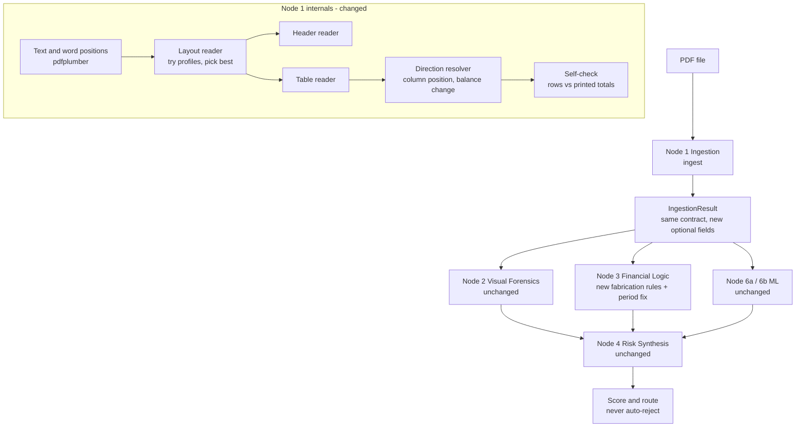
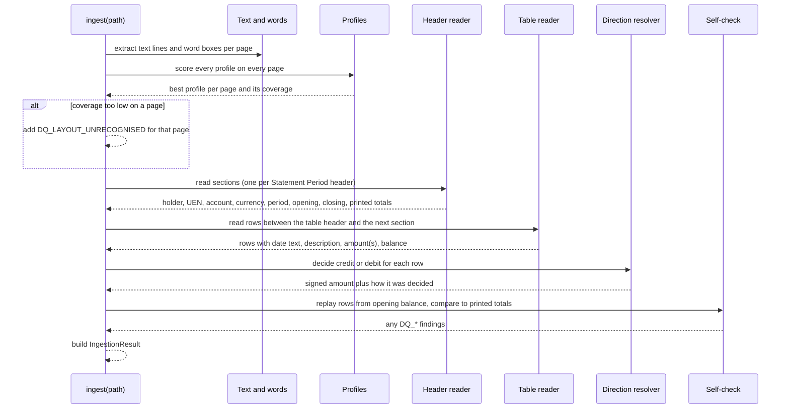

# Design Document: Multi-Layout Ingestion and Fabrication Rules

## Overview

Today the first step of the screening pipeline (Node 1, Ingestion) can only read bank statements that look exactly like the ones our own generator makes. On the downloaded forgery dataset it reads layout 1 perfectly (669 of 669 transactions) and layouts 2 to 5 not at all. On the real test file `statement_E.pdf` it finds no holder, no UEN, no period, no opening balance and no transactions. Every later step (Node 3 financial logic, Node 6a and 6b ML) then has nothing to look at, so the case scores about 57 and goes to human review. That is safe, but it is useless: the reviewer gets no help.

This design does two things.

1. **Teach Node 1 to read many statement layouts.** We replace the single fixed pattern with a small, layout-tolerant parser. It understands several date styles, several header wordings, summary boxes whose label and value sit on different lines, and tables with either one signed amount column or two columns (Money out / Money in). When it cannot read something it still says so with the existing `DQ_*` codes. It never guesses.
2. **Teach Node 3 to spot made-up transactions.** A fabricated statement can have perfect arithmetic, so the number-checking rules we have today cannot see it. We add three content-level rules: the same invoice reference used twice with different amounts, invoice numbers out of date order, and income that jumps while fixed costs stay flat. These produce new reason codes with row and page evidence for the reviewer. Nothing is ever auto-rejected.

We check the work against two labelled files (`statement_E` tampered, `statement_F` genuine) plus the 5-layout dataset. Those files are used for testing only, never for training or tuning by hand-fitting to a single file's quirks. With only two labelled files the results are indicative, not statistical, and the design says so wherever it matters.

### Scope of Stage 1 (this spec)

| Item | Status |
|---|---|
| Node 1 layout-tolerant parser (dates, money, header reader, table reader, direction resolver, profiles and selection, self-check, `DQ_LAYOUT_UNRECOGNISED`, `DQ_DIRECTION_UNCERTAIN`, `DQ_PARSE_INCONSISTENT`) with exactly six profiles: `generator_v1`, `two_col_dmon`, `two_col_slash`, `two_col_dual_date`, `signed_amount_iso`, `two_col_ddmmyy_cr` | **In scope** |
| Multi-page handling: "Page 1 of 1" on every monthly page, continuation pages, per-section opening/closing, file closing = last section's closing | **In scope** |
| Evaluation script and README "how to add a profile" | **In scope** |
| Node 3 fabrication rules `FL_DUP_INVOICE_REF`, `FL_INVOICE_SEQUENCE_BREAK`, `FL_TURNOVER_COST_MISMATCH`, `FL_RULE_SKIPPED`/`DQ_RULE_SKIPPED` and `FabricationConfig` | **Deferred to a follow-up spec.** The design text below is kept for that spec. |
| `FL_PERIOD_LENGTH` inclusive-end fix (`period_months()` in `financial_logic.py`, branch `fix/period-length-inclusive`) | **Done and merged.** Not re-implemented here. |
| Retraining ML, OCR, UIs, Node 4 weights | Out of scope |

**Evidence limitation.** Only synthetic layouts are available (the five-layout dataset, `statement_E`/`statement_F`, and our generator). Success proves the parser design, not that real Singapore bank statements will parse. Real-bank profiles come later, when data can be handled safely (on-premises, anonymised, consented). The external files are never committed; tests that need them skip when they are missing.

### Corrections after reading the sample PDFs

Before writing requirements, 100 genuine dataset PDFs (20 per layout) and `statement_E` were read with pdfplumber. On all 100, a plain date-first/amount-last line pattern finds exactly `n_transactions` rows, and every summary row holds four clean amounts. The following items in the first draft were wrong or incomplete and are corrected in the text below:

1. **Continuation pages.** Layouts 1 and 2 run onto a second page that has a repeated table header but no `Statement Period` line and no brought-forward row. The draft said a section starts at each `Statement Period` header and did not say what a page without one is. Now: such a page continues the previous section.
2. **Holder label.** No layout uses `Account Holder:`. The holder is the left half of the `<NAME> Account No. <number>` line in all five layouts and in `statement_E`. This is now the main strategy, not a fallback.
3. **Period wording.** All layouts print `Statement Period <start> to <end>` with no colon and `to` as the separator.
4. **Merged summary digits.** The draft said layout 1's summary values merge in `extract_text` (for example `1417,,307010..6040`). This was **not** seen on any of the 1,000 genuine dataset documents. Word-position mapping stays as a fallback only.
5. **Column assignment.** Amounts are right-aligned. Columns must be matched on the right edge (`x1`) of the amount and of the column header, not the left edge. Measured: layout 1 debit header right edge 400 and amount right edges 400, credit 475; layout 2 420 and 490; layout 4 395 and 470; layout 5 headers `Money out`/`Money in` are two words each and must be joined before use.
6. **Layout 3 signs.** Credits are printed with an explicit `+SGD`, debits with `-SGD`. Both are signed. The draft said a plain amount is a credit.
7. **Layout 4 suffix.** `CR` appears on the balance column, on `BALANCE BROUGHT FORWARD` and on `CLOSING BALANCE`, but not in the summary row.
8. **Layout 5 / `statement_E`.** Rows print `d Mon` with no year. The statement period gives the year. `statement_E` additionally has a `Company UEN` label and a `BUSINESS CURRENT ACCOUNT` line under the holder.
9. **Footer noise.** Every page has a `SPECIMEN · Fictional institution ...` line and a `<Bank> is a fictional entity ... Ref ...` line. They must be excluded from rows.
10. **Test baseline.** The suite now has 199 passing tests, not 188.

### What was checked before writing this design

| Question | Answer (verified by reading the code) |
|---|---|
| Does Node 3 already have a duplicate-invoice-reference rule? | **No.** `fraud_detect/nodes/financial_logic.py` has these codes only: `FL_BALANCE_BREAK`, `FL_CLOSING_MISMATCH`, `FL_PERIOD_GAP`, `FL_PERIOD_LENGTH`, `FL_MONTH_MISSING`, `FL_MONTH_DUPLICATE`, `FL_MONTH_OUT_OF_ORDER`, `FL_SUDDEN_DEPOSIT`, `FL_UNVERIFIED_COUNTERPARTY`, `FL_STRUCTURING`, `FL_UEN_NOT_FOUND`, `FL_UEN_NAME_MISMATCH`. A search for `INV` / `invoice` in `fraud_detect/nodes/` finds nothing. |
| Is there an invoice-sequence rule or a turnover-vs-cost rule? | **No** to both. `FL_SUDDEN_DEPOSIT` only compares one credit to a stored per-UEN baseline (and `statement_E`'s UEN is not in that baseline). |
| Which Node 1 pieces are fixed? | `_PERIOD_RE` (needs `Statement Period:` with a colon and `dd/mm/yyyy - dd/mm/yyyy`), `_ROW_RE` (date, text, one signed amount, balance on one line), `_parse_date` (two formats), and header regexes `Account Holder:`, `UEN:`, `Account No:`, `Currency:`, `Opening Balance:`, `Closing Balance:`. |
| Do tests import Node 1's private helpers? | No test imports `_ROW_RE`, `_PERIOD_RE`, `_parse_date` or `_parse_money` directly (searched). We still keep those names working to be safe. |
| Test baseline | 199 tests pass today (the first draft said 188). They must all still pass. |

### Two existing quirks the design must handle

1. **`FL_PERIOD_LENGTH` would wrongly flag a genuine 6-month statement.** The rule counts whole months as `(end.year - start.year) * 12 + (end.month - start.month)`, minus one if the end day is before the start day. For `01 Apr 2026` to `30 Sep 2026` that gives **5**, so a genuine 6-month statement would be called "too short" and `statement_F` could never reach `AUTO_CLEAR`. Our synthetic generator avoids this by ending on `start + N months` (for example 1 Jan to 1 Jul). Real statements end on the last day of the month. The fix is to count the end date as inclusive (measure up to the day after `period_end`). This gives 6 for 1 Apr to 30 Sep, and still gives exactly N for the generator's 1 Jan to 1 Jul style, so the existing `test_synthetic_clean.py` expectations (2, 5, 6, 9, 12, 13) hold. **Status: done and merged** (`period_months()` in `financial_logic.py`, branch `fix/period-length-inclusive`). It is not part of Stage 1 work.
2. **Header balances for multi-month files.** Today `opening_balance` and `closing_balance` are the first regex match in the whole text. With six monthly pages that would take the first month's closing balance as the file's closing balance, and `FL_CLOSING_MISMATCH` would fire against the last row. The new parser records opening and closing per monthly section, and the file-level values become the first section's opening and the last section's closing.

## Architecture

### Where the change sits



Nodes 2, 4, 5, 6a, 6b are untouched. They benefit because Node 1 now hands them real data.

### Approach chosen: one tolerant parser with small layout profiles

We considered three options.

| Option | What it is | Pros | Cons | Decision |
|---|---|---|---|---|
| A. One regex per bank layout | Add `_ROW_RE_2`, `_ROW_RE_3` ... | Quick | Breaks on the next unseen bank; code grows with every layout | No |
| B. **Layout profiles over a shared tolerant core** | A shared parser for dates, money, labels and tables. A "profile" is just a small bundle of settings (which date styles, which header words, one or two amount columns). Node 1 tries every profile, scores each by how much of the page it explains, keeps the best, and flags if none is good enough | Handles all five known layouts and `statement_E` with the same code; new banks usually need only a new settings bundle; fully explainable; no new dependencies | Needs careful testing so a wrong profile cannot win quietly | **Yes** |
| C. Generic "figure it out" heuristic parser with no profiles | Detect columns and dates purely from geometry | Most flexible | Hard to explain to a reviewer; wrong guesses look confident | No (the profile scoring and self-check below give most of the flexibility with less risk) |
| D. LLM or OCR | Send the page to a model | Handles anything | Cost, latency, data privacy for bank documents, non-determinism that fights our "same input, same answer, auditable" rule, and licensing/vendor review. The files in scope have a clean text layer, so there is nothing for OCR to add | **Not now.** Scanned images stay out of scope; they continue to get `DQ_NO_TEXT` and go to a human |

Dependencies stay as they are: `pdfplumber` 0.11.4 and `pypdf` 4.3.1 (both permissive). No new packages are needed. The standard library (`re`, `datetime`, `decimal`-free float math with 2-decimal rounding as today) is enough.

### How Node 1 reads a statement (data flow)



### Multi-page files with "Page 1 of 1" on every page

`statement_E` and `statement_F` are six pages, one month per page, and each page says "Page 1 of 1". The reader treats the printed page counter as noise. A new section starts at each `Statement Period` header, exactly like the current segmentation, so each page becomes its own `StatementSegment` with its own period. A page with no `Statement Period` line is a **continuation page** of the previous section (dataset layouts 1 and 2 split one month over two pages with a repeated table header and no brought-forward row); its rows join that section and its `CLOSING BALANCE` row ends it. Each month therefore has a distinct period, so `FL_MONTH_DUPLICATE` does not fire. `FL_MONTH_OUT_OF_ORDER` only fires if the pages really are in the wrong date order. A test locks this in (see Testing Strategy).

## Components and Interfaces

All code is Python, matching the repo. New Node 1 helpers live in a new package `fraud_detect/nodes/ingest_parse/` so `ingestion.py` stays a thin coordinator. Node 3 additions go in a new module `fraud_detect/nodes/fabrication.py` that `financial_logic.analyze` calls, which keeps `financial_logic.py` from growing and keeps the new rules testable on their own.

### Component 1: Date reader (`ingest_parse/dates.py`)

**Purpose**: turn the many date styles into real dates without guessing.

```python
@dataclass(frozen=True)
class ParsedDate:
    value: date | None          # None if it could not be read safely
    raw: str                    # text exactly as printed
    year_inferred: bool         # True for "4 Apr" style where the year came from the period

def parse_full_date(raw: str) -> ParsedDate: ...
def parse_period(text: str) -> tuple[ParsedDate, ParsedDate] | None: ...
def parse_day_month(raw: str, period_start: date, period_end: date) -> ParsedDate: ...
```

Supported full-date styles: `dd/mm/yyyy`, `yyyy-mm-dd`, `d Mon yyyy` (and `dd Mon yyyy`), `dd-mm-yy`, `dd-mm-yyyy`. Supported period styles: optional colon after `Statement Period`, separator `-`, `to`, or an en dash.

Rules:
- Two-digit years: `yy` is read as 20yy. A statement period is within a few years of today, so this is safe for bank statements; the choice is documented and tested.
- `d Mon` (no year): the year is taken from the section's period. If the period crosses a year end (for example 1 Dec to 31 Dec spanning into January), a month earlier than the period start's month is assigned to the end year. If the resulting date falls outside the period, the date stays `None` and the row gets a data-quality finding. Never silently pick a year.
- Ambiguity: `dd/mm/yyyy` versus `mm/dd/yyyy` is resolved as day-first (Singapore). If the first number is above 12 it is certainly the day; if both are 12 or below the section period is used to confirm, and if neither reading falls in the period the date is left unread and flagged.

### Component 2: Money reader (`ingest_parse/money.py`)

**Purpose**: read amounts such as `S$5,365.00`, `SGD 28,249.88`, `-SGD 13.47`, `3,900.18 CR`, `(1,200.00)`.

```python
@dataclass(frozen=True)
class Money:
    value: float                 # magnitude with sign only if explicitly printed (-, parentheses)
    explicit_sign: int | None    # -1, +1, or None when no sign was printed
    suffix: str | None           # "CR" or "DR" when printed

def parse_money(raw: str) -> Money | None: ...
```

Currency prefixes handled: `SGD`, `S$`, `$`, none. `CR` after a balance is read as "credit balance" and does not change the number's sign. `DR` after a balance means overdrawn and makes the balance negative. Values are rounded to 2 decimals, as the current code effectively does.

### Component 3: Header reader (`ingest_parse/header.py`)

**Purpose**: read holder, UEN, account number, currency, period, opening, closing and printed totals from a section, tolerant of wording and layout.

```python
@dataclass
class SectionHeader:
    holder: str | None
    uen: str | None
    account_number: str | None
    currency: str | None
    period_start: ParsedDate | None
    period_end: ParsedDate | None
    statement_date: ParsedDate | None
    opening: float | None
    closing: float | None
    printed_total_withdrawals: float | None
    printed_total_deposits: float | None
    page: int

def read_header(lines: list[Line], words: list[Word], profile: LayoutProfile, page: int) -> SectionHeader: ...
```

*Correction after reading samples:* none of the six layouts uses an `Account Holder` label; strategy 2 below (the left half of the `<NAME> Account No. <number>` line) is the main path for all of them. The period line is `Statement Period <start> to <end>`.

Label variants (all case-insensitive, colon optional): `Account Holder`, `Account Name`; `UEN`, `Company UEN`, `Co. Reg. No.`; `Account No`, `Account No.`, `Account Number`; `Statement Period`, `Period`; `Currency`. UEN is validated against the Singapore pattern (9 or 10 characters ending in a letter, for example `209947062H`); a value that does not fit is left unread rather than stored.

Three header reading strategies, tried in order:

1. **Same line**: `Label: value` or `Label value`.
2. **Left column / right column pairs**: in `statement_E` and the dataset layouts, one text line holds two cells, for example `HALBERD LANE JOINERY PTE. LTD. Account No. VCB 6762 3357 1326`. The reader splits such a line at a known label, so the left part is a candidate holder and the right part is the label's value.
3. **Summary box**: four labels in a row (`Opening Balance / Total Withdrawals / Total Deposits / Closing Balance`) followed by a row of values. The reader maps values to labels **by x-position of the words**, not by order in the text. Mapping by position is a fallback: the first draft expected layout 1's totals to merge digits in `extract_text` (for example `1417,,307010..6040`), but all 1,000 genuine dataset documents gave four clean amounts, so the plain text path is tried first and word boxes are used only when it fails. If neither text nor positions give a clean number, the field stays unread and is flagged, because the printed totals are only used for cross-checks and can never block parsing the rows.

**Holder**: if no labelled holder exists, the holder is the first prominent line after the bank name block (the line before `Account No.`), cut off at the label. This is how `statement_E` works ("the first bold line"). The reader prefers the line with the larger or bold font when the font information is available, and otherwise the first line that is not the bank name, `STATEMENT OF ACCOUNT`, `Page x of y` or `SPECIMEN`. If two lines are equally plausible the holder is left unread and flagged. No guess is made.

**Personal-account layouts** (the 5-layout dataset) have no UEN. The reader leaves `uen = None`, so `DQ_MISSING_UEN` still appears as it does today. That is consistent with the product, which screens corporate-loan statements; we do not change it in this spec.

### Component 4: Table reader (`ingest_parse/table.py`)

**Purpose**: find the transaction table, work out its columns, and read each row.

```python
@dataclass
class RawRow:
    page: int
    date_text: str
    value_date_text: str | None      # second date column such as Halcyon's "Value Date"
    description: str
    amount_cells: list[AmountCell]   # 1 or 2 amounts found on the row, each with its x-position
    balance: Money
    line_text: str

@dataclass
class TableLayout:
    header_y: float
    columns: dict[str, tuple[float, float]]   # e.g. {"money_out": (x0, x1), "money_in": (...), "balance": (...)}
    kind: Literal["two_column", "single_signed", "unknown"]

def find_table(page_words: list[Word], profile: LayoutProfile) -> TableLayout | None: ...
def read_rows(page_words: list[Word], layout: TableLayout, profile: LayoutProfile) -> list[RawRow]: ...
```

How it works:
- The table header is the line containing `Date` and `Description` or `Details` or `Particulars` plus a balance column. Column names accepted: `Debit/Credit`, `Withdrawals/Deposits`, `Money out/Money in`, or a single `Amount`. The x-ranges of those header words define the columns. Amounts are right-aligned, so an amount belongs to the column whose header **right edge** is closest to the amount's right edge (not the left edge). Two-word headers (`Money out`, `Money in`) are joined first.
- Words on later lines are grouped into rows by their vertical position. The last money cell on the row is the balance; the money cell(s) before it are amount(s).
- Rows whose text starts with `BALANCE BROUGHT FORWARD`, `BROUGHT FORWARD`, `CLOSING BALANCE`, `BALANCE C/F`, `TOTAL` or the page footer are **not transactions**. The brought-forward value is kept as that section's starting balance for the arithmetic below.
- A description that wraps onto a second line (a line with no date and no money) is appended to the previous row's description, so a wrapped line never becomes a fake row and never swallows a real one.
- If no table header is found, the reader falls back to line-based reading of text (date, description, one or two amounts, balance), which is how the old parser worked.

### Component 5: Direction resolver (`ingest_parse/direction.py`)

**Purpose**: decide whether each amount is money in (positive) or money out (negative).

```python
@dataclass(frozen=True)
class Resolved:
    amount: float                      # signed: credits +, debits -
    method: Literal["column", "printed_sign", "balance_change"]
    agrees_with_balance: bool | None   # None when there was no previous balance to compare

def resolve_direction(row: RawRow, layout: TableLayout, prev_balance: float | None) -> Resolved | None: ...
```

Order of evidence:
1. **Column position** (two-column tables): an amount under `Money out` is a debit; under `Money in` is a credit. This is the primary evidence when columns were found.
2. **Printed sign** (single-signed tables such as layout 3): `-SGD 13.47` is a debit and `+SGD 11.08` is a credit (both signs are printed in dataset layout 3; a plain unsigned amount in a single-signed table is read as a credit).
3. **Balance change** (no columns and no sign): `sign(balance - previous balance)` gives the direction.

In every case the **magnitude is the amount as printed**, never recomputed from the balance. This is deliberate. If we replaced a printed amount with `balance - previous balance`, a statement whose amount was edited would look consistent and `FL_BALANCE_BREAK` would never fire. By keeping the printed amount, Node 3's existing reconciliation keeps catching edited amounts.

**Consistency check** ("flag it, do not guess"): after the direction is chosen, the resolver compares it with the balance change. If the evidence from columns or sign points one way and the balance moved the other way, the row keeps the column/sign direction and gets `DQ_DIRECTION_UNCERTAIN` (LOW). Node 3 will additionally raise `FL_BALANCE_BREAK` for that row if the arithmetic really does not reconcile. When only the balance-change method was available and the printed amount does not equal the balance change within 0.01, the row is kept with the balance-change direction and also flagged `DQ_DIRECTION_UNCERTAIN`.

### Component 6: Layout profiles and selection (`ingest_parse/layouts.py`)

**Purpose**: small bundles of settings, with an automatic choice of the best one.

```python
@dataclass(frozen=True)
class LayoutProfile:
    name: str                              # e.g. "generator_v1", "two_col_dmon", "signed_amount_iso"
    date_styles: tuple[str, ...]
    period_separators: tuple[str, ...]
    holder_labels: tuple[str, ...]
    amount_style: Literal["two_column", "single_signed", "auto"]
    two_date_columns: bool
    balance_suffix_cr: bool

REGISTRY: tuple[LayoutProfile, ...]        # ordered; "generator_v1" is first for backward compatibility

def choose_profile(pages: list[PageContent]) -> ProfileChoice: ...

@dataclass
class ProfileChoice:
    profile: LayoutProfile | None
    coverage: float            # share of table-looking lines that became valid rows (0..1)
    per_page: dict[int, float]
```

How a profile is picked: every profile in the registry parses the page. The score is "how many table-looking lines became a row whose date was read and whose arithmetic fits", divided by "how many table-looking lines there are". The highest score wins; ties go to the earlier profile in the registry. A profile only counts as recognised if its coverage is at least a configurable minimum (default 0.9 per page). Below that, the page gets `DQ_LAYOUT_UNRECOGNISED` and the rows that were read are still returned, but the reviewer is told the page may be incomplete.

Initial registry (all built from facts seen in the files, not hand-fitted to a single file):

| Profile | Covers |
|---|---|
| `generator_v1` | Our own generator: `Statement Period:` with a colon, `dd/mm/yyyy - dd/mm/yyyy`, single signed amount, `Account Holder:` and `UEN:` labels |
| `two_col_dmon` | `statement_E`/`statement_F` and dataset layout 5: `d Mon` rows, Money out / Money in, `S$` values |
| `two_col_slash` | Dataset layout 1: `dd/mm/yyyy`, Withdrawals / Deposits |
| `two_col_dual_date` | Dataset layout 2: `dd Mon yyyy` twice (Txn date and Value date), Debit / Credit |
| `signed_amount_iso` | Dataset layout 3: `yyyy-mm-dd`, one signed `Amount` column with `SGD` prefix |
| `two_col_ddmmyy_cr` | Dataset layout 4: `dd-mm-yy`, Debit / Credit, balance with `CR` suffix |

Because the shared core does the real work, most profiles differ by one or two settings. Adding a new bank is "add a profile and a fixture test", not "write a new parser".

### Component 7: Self-check (`ingest_parse/selfcheck.py`)

**Purpose**: catch our own reading mistakes so they are never mistaken for fraud, and vice versa.

```python
def self_check(section: SectionHeader, rows: list[Transaction]) -> list[Finding]: ...
```

For each section the check replays the rows from the section's opening balance and compares the result to the printed closing balance, and compares the sums of debits and credits to the printed Total Withdrawals and Total Deposits. A disagreement means either our reading is wrong or the document is wrong. The two cases look different and are separated like this:
- If every row's own running balance reconciles row by row (so the rows are internally consistent) but the printed totals disagree, the finding is `DQ_PARSE_INCONSISTENT` (LOW, weight 3, "we may have misread this page; please check it"). Node 3 owns the fraud verdict.
- Row-by-row arithmetic problems stay with Node 3's `FL_BALANCE_BREAK` and `FL_CLOSING_MISMATCH`, which already exist and are not duplicated here.

### Component 8: Fabrication rules (`fraud_detect/nodes/fabrication.py`)

> **Deferred to a follow-up spec.** Component 8, Rules A to C, and the fabrication pseudocode and properties below are kept as design text only. No code for them is written in Stage 1. The period-length fix at the end of this component is already done.

**Purpose**: content-level checks that survive perfect arithmetic.

```python
@dataclass(frozen=True)
class FabricationConfig:
    # Invoice reference patterns (case-insensitive). Each match yields (prefix, number).
    invoice_patterns: tuple[str, ...] = (r"\bINV[\s\-#]*0*(\d{3,})\b",)
    # Duplicate invoice reference
    dup_escalate_min_refs: int = 3          # this many repeated refs in one file -> HIGH
    dup_isolated_severity: Severity = Severity.MEDIUM
    # Instalment tolerance
    instalment_max_days: int = 45           # two payments of one invoice this close can be instalments
    instalment_max_count: int = 3           # up to 3 payments of one invoice before it looks odd
    # Sequence break
    seq_min_breaks: int = 2                 # need this many out-of-order refs in one file to report
    seq_same_day_tolerance: bool = True     # same-day rows may appear in any order
    # Turnover vs cost
    fixed_cost_keywords: tuple[str, ...] = ("CPF", "PAYROLL", "SALARY", "RENT", "GST", "IRAS")
    credit_jump_ratio: float = 1.5          # month credits vs median of the other months
    fixed_cost_stability_pct: float = 0.10  # fixed costs within +/-10% of their median
    credit_to_cost_ratio_warn: float = 1.5  # whole-file credits / debits

def check_duplicate_invoice_refs(txns, cfg) -> list[Finding]: ...
def check_invoice_sequence(txns, cfg) -> list[Finding]: ...
def check_turnover_vs_costs(txns, cfg) -> list[Finding]: ...
def analyze_fabrication(ing: IngestionResult, cfg: FabricationConfig = DEFAULT) -> list[Finding]: ...
```

`financial_logic.analyze` calls `analyze_fabrication(ing)` and appends the findings. Every threshold above is a named default, overridable by passing a `FabricationConfig`, and is covered by tests. Nothing here changes Node 4's weights; each finding carries its own `weight`, as all existing Node 3 findings do.

#### Rule A: Duplicate invoice reference (`FL_DUP_INVOICE_REF`)

*Deferred to a follow-up spec.*

What it looks for: two or more **credits** that (1) name the same counterparty, (2) quote the same invoice reference, and (3) have different amounts. In `statement_E` all 12 fabricated receipts reuse the customer and the invoice number of a real receipt in the same month, with a different date and a different amount.

Counterparty name is taken from the description with the payment rail (`FAST FROM`, `PAYNOW FROM`, `GIRO`) and the invoice reference removed, then upper-cased and whitespace-collapsed, so `FAST FROM CINDERPATH HOLDINGS INV3277` becomes `CINDERPATH HOLDINGS` and `INV3277`.

The honest trade-off (instalments): a real customer may pay one invoice in two or three parts. Two payments with the same invoice reference look the same as a fabricated copy when judged by the statement alone. The design handles this as follows and states what it cannot separate:
- A single repeated reference is a **MEDIUM** finding (weight 10) whose evidence says "may be an instalment payment; check the invoice". It is not treated as proof.
- The same reference appearing more than `instalment_max_count` times, or the second payment falling more than `instalment_max_days` after the first, removes the "instalment" explanation from the evidence text, but the severity stays MEDIUM on its own.
- When **three or more different references** in the same file are repeated (`dup_escalate_min_refs`), the findings become **HIGH** (weight 22) because one customer paying in parts is plausible, but many customers all doing so on the same file is a pattern. `statement_E` has 12 such references.
- The false-negative risk is accepted: a forger who invents a brand-new invoice number is not caught by this rule. The other rules and Node 2 cover other angles.

Evidence given to the reviewer: counterparty, the invoice reference, and for each occurrence its date, amount, page and row number, for example `CINDERPATH HOLDINGS INV3277: 13 Apr S$6,606.41 (page 1, row 23) and 17 Apr S$8,318.10 (page 1, row 27)`. The finding's `page` is the page of the later row; the `field` lists all row numbers (`rows 23, 27`), following the existing `field="row N"` convention so no change to the `Finding` model is needed. When two payments have the same amount the evidence says so ("identical amount, possible duplicate posting").

#### Rule B: Invoice sequence break (`FL_INVOICE_SEQUENCE_BREAK`)

*Deferred to a follow-up spec.*

What it looks for: in `statement_E` genuine invoice numbers rise with date, and each fabricated row is out of step with its neighbours (for example `INV3272` dated 28 Apr after receipts already numbered around 3290).

Method: take credit rows with a reference, in statement order (date, then row number). Find the longest run that is already in non-decreasing reference order. Rows outside that run are the "out of order" rows. Same-day rows may appear in any order. Each out-of-order row is reported only when at least `seq_min_breaks` are found in the file.

Trade-off, stated plainly: in real life customers often pay invoices late and out of order, so a break alone is weak. It is a **supporting** signal: LOW severity (weight 5) when it appears alone, and it **names the likelier forged row** when it points at one of the rows already named by Rule A. That is useful because Rule A cannot say which of two rows with the same reference is the copy; Rule B usually can.

#### Rule C: Turnover vs cost inconsistency (`FL_TURNOVER_COST_MISMATCH`)

*Deferred to a follow-up spec.*

What it looks for: money in jumping while the fixed costs of running the business (payroll, CPF, rent, GST) stay flat. A real business that earns 27% more usually pays more staff, more suppliers or more tax.

Method, per file:
1. For each month, add up credits, all debits, and the fixed-cost debits (matched by `fixed_cost_keywords`).
2. **Month jump**: a month's credits exceed `credit_jump_ratio` times the median of the other months **and** the fixed-cost total in that month is within `fixed_cost_stability_pct` of the median fixed-cost total.
3. **Whole-file ratio**: total credits divided by total debits above `credit_to_cost_ratio_warn` **and** fixed costs stable across months.
4. Both conditions must be true to report, so a naturally seasonal business with rising costs is not flagged.

Severity is **MEDIUM** (weight 8) because this is a business-logic hint, not a hard fact. Evidence shows the month figures: credits, fixed costs, the ratio, and the median it was compared with.

False-positive risks, stated: seasonal trading, one-off large contracts, loan drawdowns or capital injections that arrive as credits. The first version therefore counts only credits that carry an invoice reference or a trade-customer style description as "turnover", and leaves out descriptions containing `LOAN`, `CAPITAL`, `TRANSFER` or `INTEREST` (configurable). Default thresholds are starting points chosen from the synthetic generator's range and are **not** tuned on `statement_E`. A quick look at the labelled files shows why caution is needed: whole-file credit-to-debit is about 1.71 for `statement_E` as shown (about 1.34 if the fake receipts are removed) and about 1.33 for the genuine `statement_F`, so a single default can separate these two files by luck. With two files that is not evidence. The tasks therefore require running the rule over the synthetic corpus and the 5-layout dataset and reporting its false-alarm rate before the default is kept.

#### Period-length fix (`FL_PERIOD_LENGTH`)

*Done and merged (branch `fix/period-length-inclusive`, `period_months()`). Kept here as the record of the behaviour.*

Count the end date as inclusive: measure whole months from `period_start` to `period_end + 1 day`. Behaviour table:

| Start | End | Old count | New count |
|---|---|---|---|
| 1 Apr 2026 | 30 Sep 2026 | 5 (wrongly "too short") | 6 |
| 1 Jan 2024 | 1 Jul 2024 (generator style) | 6 | 6 |
| 1 Jan 2024 | 1 Jun 2024 | 5 | 5 |

### Interfaces that change (all additive and optional)

`IngestionResult` and `Transaction` keep every current field with the same meaning. New optional fields only:

```python
class Transaction(BaseModel):
    ...                                   # unchanged
    value_date_raw: Optional[str] = None  # second date column when present
    direction_method: Optional[str] = None  # "column" | "printed_sign" | "balance_change"
    invoice_ref: Optional[str] = None     # normalised, e.g. "INV3277"; filled by Node 1 so Node 3 stays simple

class SectionSummary(BaseModel):          # one per monthly section
    period_start: Optional[date] = None
    period_end: Optional[date] = None
    page_start: Optional[int] = None
    page_end: Optional[int] = None
    opening: Optional[float] = None
    closing: Optional[float] = None
    total_deposits: Optional[float] = None
    total_withdrawals: Optional[float] = None

class IngestionResult(BaseModel):
    ...                                   # unchanged
    layout_profile: Optional[str] = None
    parse_coverage: Optional[float] = None
    sections: list[SectionSummary] = []
```

Existing consumers (`risk_synthesis`, `ml_transaction`, `ml_statement`, `memory`, the UIs) do not read the new fields and keep working. `invoice_ref` is extracted in Node 1 with the same pattern list Node 3 uses by default; Node 3 falls back to extracting it from `description` when the field is empty, so hand-built `IngestionResult` objects in existing tests keep working.

## Data Models

### Reason codes

Stage 1 adds only `DQ_LAYOUT_UNRECOGNISED`, `DQ_DIRECTION_UNCERTAIN` and `DQ_PARSE_INCONSISTENT`. The Node 3 codes in the table (`DQ_RULE_SKIPPED`, `FL_DUP_INVOICE_REF`, `FL_INVOICE_SEQUENCE_BREAK`, `FL_TURNOVER_COST_MISMATCH`) are **Deferred to a follow-up spec**.

| Code | Owner | Severity | Weight | Meaning |
|---|---|---|---|---|
| `DQ_MISSING_HOLDER`, `DQ_MISSING_UEN`, `DQ_MISSING_PERIOD`, `DQ_MISSING_OPENING`, `DQ_NO_TXNS`, `DQ_NO_TEXT`, `DQ_UNREADABLE_ROW` | Node 1 | unchanged | unchanged | Existing codes, kept as they are |
| `DQ_LAYOUT_UNRECOGNISED` (new) | Node 1 | MEDIUM | 8 | Best profile explained less than the minimum share of a page; rows read may be incomplete |
| `DQ_DIRECTION_UNCERTAIN` (new) | Node 1 | LOW | 3 | Credit/debit direction disagreed with the balance change, or only balance change was available and the amount did not equal it |
| `DQ_PARSE_INCONSISTENT` (new) | Node 1 | LOW | 3 | Parsed rows do not reproduce the printed totals although rows are internally consistent; we may have misread |
| `DQ_RULE_SKIPPED` (new) | Node 3 | LOW | 2 | A fabrication rule hit an internal error and was skipped; the other rules still ran |
| `FL_DUP_INVOICE_REF` (new) | Node 3 | MEDIUM, HIGH when 3 or more refs repeat | 10 / 22 | Same counterparty and invoice reference, different amount or date |
| `FL_INVOICE_SEQUENCE_BREAK` (new) | Node 3 | LOW | 5 | Invoice references out of date order |
| `FL_TURNOVER_COST_MISMATCH` (new) | Node 3 | MEDIUM | 8 | Credits jump while fixed costs stay flat |

Weights are starting values in the same range as existing Node 3 rules (`FL_MONTH_*` is 12, `FL_BALANCE_BREAK` is 26). Whether Node 4 needs any change is decided by the evaluation, not assumed (see Out of scope).

### Validation rules
- Dates: a date that cannot be read safely is stored as `None` with the raw text kept in `date_raw`.
- Amount rows: a row needs a readable date, description, amount and balance to become a `Transaction`. Otherwise it produces `DQ_UNREADABLE_ROW` as today.
- Brought-forward and closing rows never become transactions.
- `invoice_ref` is the upper-cased prefix plus digits with leading zeros removed (`INV0042` and `INV42` are the same reference).

## Algorithmic Pseudocode

### Main flow of `ingest()`

```pascal
ALGORITHM ingest(path)
INPUT: path to a PDF
OUTPUT: IngestionResult

BEGIN
  pages ← extract_text_lines_and_words(path)         // pdfplumber, per page
  metadata ← extract_metadata(path)                  // unchanged
  fonts ← extract_fonts(path)                        // unchanged
  dq ← empty list

  IF all pages have no text THEN
    dq.add(DQ_NO_TEXT)
    RETURN result_with_nothing_read(dq)
  END IF

  choice ← choose_profile(pages)                     // try every profile, keep best
  sections ← split_into_sections(pages, choice)      // one per Statement Period header

  transactions ← empty list
  prev_balance ← NULL
  FOR each section IN sections (in physical page order) DO
    header ← read_header(section, choice.profile)
    IF section starts a table THEN
      prev_balance ← header.brought_forward OR header.opening OR prev_balance
    END IF
    raw_rows ← read_rows(section, choice.profile)
    FOR each raw IN raw_rows DO
      resolved ← resolve_direction(raw, section.layout, prev_balance)
      IF resolved IS NULL THEN
        dq.add(DQ_UNREADABLE_ROW for raw)
        CONTINUE
      END IF
      IF resolved is contradicted by balance change THEN
        dq.add(DQ_DIRECTION_UNCERTAIN for raw)
      END IF
      transactions.add(build_transaction(raw, resolved, header))
      prev_balance ← raw.balance
    END FOR
    dq.add_all(self_check(header, rows_of(section)))
  END FOR

  add DQ_MISSING_* for any mandatory field still unread           // unchanged behaviour
  IF transactions is empty THEN dq.add(DQ_NO_TXNS) END IF
  IF any page coverage < minimum THEN dq.add(DQ_LAYOUT_UNRECOGNISED) END IF

  RETURN build_ingestion_result(pages, metadata, fonts, sections, transactions, dq, choice)
END
```

**Preconditions**
- `path` points to a readable PDF (unreadable files already raise before this point, as today).

**Postconditions**
- Every returned `Transaction` has a printed amount whose magnitude matches the text on the page.
- No brought-forward, closing or footer row appears as a transaction.
- Every field that could not be read is `None` and has a matching `DQ_*` finding.
- File-level `opening_balance` is the first section's opening; `closing_balance` is the last section's closing.
- For a statement the old parser already read, the result is identical to the old result (backward compatibility).

**Loop invariant** (over sections and rows)
- `prev_balance` always equals the balance printed on the last accepted row, or the section's opening balance before the first row.

### Direction resolution

```pascal
ALGORITHM resolve_direction(row, layout, prev_balance)
INPUT: row (1 or 2 amount cells, a balance), layout, prev_balance (may be NULL)
OUTPUT: signed amount and method, or NULL

BEGIN
  IF row has no amount cell THEN RETURN NULL END IF

  IF layout.kind = "two_column" AND the amount cell lies inside a known column THEN
    sign ← -1 IF cell is in the money-out column ELSE +1
    method ← "column"
  ELSE IF the amount text carries an explicit sign THEN
    sign ← that sign
    method ← "printed_sign"
  ELSE IF prev_balance IS NOT NULL THEN
    sign ← sign(row.balance - prev_balance)      // 0 treated as unreadable
    method ← "balance_change"
  ELSE
    RETURN NULL
  END IF

  magnitude ← |printed amount|                    // never recomputed from balances
  RETURN (sign × magnitude, method)
END
```

**Preconditions**: amount cells already have the currency prefix removed.
**Postconditions**: `|result.amount|` equals the printed magnitude; the sign comes from the stated method only.

### Duplicate invoice reference

```pascal
ALGORITHM check_duplicate_invoice_refs(txns, cfg)
INPUT: transactions, configuration
OUTPUT: list of Finding

BEGIN
  groups ← empty map                               // (counterparty, ref) -> list of credits
  FOR each t IN txns DO
    IF t.amount > 0 AND t has an invoice ref THEN
      key ← (normalise_counterparty(t.description), t.ref)
      groups[key].add(t)
    END IF
  END FOR

  repeated ← groups whose list has 2 or more credits AND whose amounts are not all equal-and-identical-dates
  escalate ← (count of distinct refs in repeated) ≥ cfg.dup_escalate_min_refs
  findings ← empty list
  FOR each group IN repeated (in stable key order) DO
    severity ← HIGH IF escalate ELSE cfg.dup_isolated_severity
    note ← instalment note IF count ≤ cfg.instalment_max_count AND span_days ≤ cfg.instalment_max_days
    findings.add(Finding(code = FL_DUP_INVOICE_REF, rows, pages, dates, amounts, note))
  END FOR
  RETURN findings
END
```

**Preconditions**: `txns` carry signed amounts (credits positive).
**Postconditions**: output is deterministic and independent of the order in which groups were discovered; every finding lists every row in its group; no finding is produced for a reference that appears once.

### Invoice sequence

```pascal
ALGORITHM check_invoice_sequence(txns, cfg)
BEGIN
  seq ← credits with a ref, sorted by (date, row index), refs as integers per prefix
  keep ← longest non-decreasing subsequence of seq by ref number
  out_of_order ← rows in seq not in keep                // ties resolved by earliest row
  IF |out_of_order| < cfg.seq_min_breaks THEN RETURN empty END IF
  RETURN one Finding per out-of-order row, naming the neighbouring refs on either side
END
```

**Loop invariant**: while building the longest run, every kept row has a reference number greater than or equal to the previous kept row.

## Example Usage

```python
from fraud_detect.nodes import ingestion, financial_logic

ing = ingestion.ingest("/Users/weiyang01/Downloads/statement_E.pdf")
assert ing.account_holder == "PENROSE KEEL FACILITIES PTE. LTD."
assert ing.uen == "209947062H"
assert ing.statement_period_start.isoformat() == "2026-04-01"
assert ing.statement_period_end.isoformat() == "2026-09-30"
assert ing.opening_balance == 39879.66
assert len(ing.segments) == 6                 # one per monthly page, "Page 1 of 1" ignored

report = financial_logic.analyze(ing)
codes = {f.code for f in report.findings}
assert "FL_DUP_INVOICE_REF" in codes          # evidence names INV3277 on 13 Apr and 17 Apr
assert "FL_BALANCE_BREAK" not in codes        # arithmetic reconciles in this file
```

Custom thresholds for a lender with stricter policy:

```python
from fraud_detect.nodes.fabrication import FabricationConfig, analyze_fabrication
cfg = FabricationConfig(dup_escalate_min_refs=2, credit_jump_ratio=1.3)
findings = analyze_fabrication(ing, cfg)
```

## Correctness Properties

*A property is a characteristic or behavior that should hold true across all valid executions of a system, essentially a formal statement about what the system should do. Properties serve as the bridge between human-readable specifications and machine-verifiable correctness guarantees.*

These are the properties we expect to hold, each mapped to the numbered requirements it validates. Properties 11 to 15 belong to the deferred fabrication rules.

### Property 1: Date round trip

For any valid calendar date and any supported date style, formatting the date in that style and then reading it back gives the same date.

**Validates: Requirements 2.1, 2.2, 2.3, 2.6**

### Property 2: Money round trip

For any amount with two decimals and any supported currency prefix, sign style and balance suffix, formatting then reading gives the same number.

**Validates: Requirements 3.1, 3.2, 3.3, 3.4, 3.5, 3.6**

### Property 3: Printed amount is preserved

For any generated statement table in any supported layout, every parsed transaction's absolute amount equals the amount printed on its row, regardless of how the direction was decided.

**Validates: Requirements 5.9, 6.4**

### Property 4: Direction follows the evidence

For any generated statement whose rows reconcile, the signed amount of every parsed row equals the change in running balance, in both single-signed and two-column layouts.

**Validates: Requirements 6.1, 6.2, 6.3**

### Property 5: Non-transaction rows are excluded

For any generated statement containing brought-forward, closing-balance or footer rows, none of those rows appears in the transaction list, and the number of parsed transactions equals the number of real rows.

**Validates: Requirements 5.5, 5.9**

### Property 6: Layout independence

For any generated set of transactions, rendering them in any supported layout and ingesting the PDF yields the same list of dates, descriptions, signed amounts and balances.

**Validates: Requirements 7.3, 10.1, 10.2**

### Property 7: Unreadable means flagged, not guessed

For any statement with a field made unreadable, the corresponding result field is `None` and the matching `DQ_*` finding is present.

**Validates: Requirements 2.8, 4.7, 4.8**

### Property 8: Tampered amount stays visible

For any generated statement where one printed amount is changed so the running balance no longer reconciles, Node 1 returns the changed amount as printed and Node 3 reports `FL_BALANCE_BREAK` for that row.

**Validates: Requirements 6.4, 12.2**

### Property 9: Generated multi-page month files do not raise coverage false alarms

For any generated set of consecutive monthly pages, each carrying "Page 1 of 1", Node 1 produces one segment per page with distinct periods, and Node 3 reports neither `FL_MONTH_DUPLICATE` nor `FL_MONTH_MISSING`.

**Validates: Requirements 8.1, 8.2, 8.3, 8.7, 8.8**

### Property 10: Period length counts the last day

For any start date and any whole number of months N between 1 and 24, a period from the start to the day before the date N months later is counted as exactly N months, and a period ending exactly N months later (generator style) is also counted as N.

(Done and merged on branch `fix/period-length-inclusive`; the property is kept as a regression record.)

**Validates: Requirements 16.2**

### Property 11: Duplicate reference detection

For any clean list of credits with unique invoice references, adding a copy of any one credit with the same counterparty and reference but a different amount makes Node 3 report `FL_DUP_INVOICE_REF` naming both rows.

**Deferred to a follow-up spec.**

**Validates: Requirements 16.1**

### Property 12: Unique references are quiet

For any list of credits where each invoice reference appears at most once, Node 3 reports no `FL_DUP_INVOICE_REF`.

**Deferred to a follow-up spec.**

**Validates: Requirements 16.1**

### Property 13: Order independence

For any list of transactions, the set of fabrication findings (codes and rows) is the same however the findings groups are discovered internally, and running the rules twice gives identical output.

**Deferred to a follow-up spec.**

**Validates: Requirements 16.1**

### Property 14: Sequence break detection

For any list of credits whose reference numbers rise with date, moving two or more rows' references out of order makes Node 3 report `FL_INVOICE_SEQUENCE_BREAK` for exactly the moved rows; leaving them in order reports nothing.

**Deferred to a follow-up spec.**

**Validates: Requirements 16.1**

### Property 15: Turnover rule needs both conditions

For any monthly series, `FL_TURNOVER_COST_MISMATCH` is reported only when a month's credits exceed the configured ratio of the median **and** fixed costs are within the configured stability band; raising fixed costs in proportion removes the finding.

**Deferred to a follow-up spec.**

**Validates: Requirements 16.1**

### Property 16: Backward compatibility

For any statement produced by the existing generator, the new Node 1 returns the same header fields and transactions as the old Node 1, and all 199 existing tests pass.

**Validates: Requirements 1.1, 1.2, 1.3, 12.1**

## Error Handling

### Layout not recognised
**Condition**: no profile explains at least the minimum share of a page's table-like lines.
**Response**: return the rows that were read, add `DQ_LAYOUT_UNRECOGNISED` naming the page. Node 3 and Node 4 treat the data as incomplete and the case routes to human review as today.
**Recovery**: a person reads the page; the layout can later be added as a new profile with a fixture test.

### Two profiles score the same
**Condition**: tie on coverage.
**Response**: the earlier profile in the registry wins, so results are repeatable. If the tied profiles would produce different transactions the page is flagged `DQ_LAYOUT_UNRECOGNISED` instead of picking one.

### Missing year, ambiguous date, wrong direction
**Condition**: "4 Apr" with no usable period, a date outside the period, or direction evidence that disagrees with the balance.
**Response**: leave the date `None` or keep the evidence-based direction and add `DQ_UNREADABLE_ROW` or `DQ_DIRECTION_UNCERTAIN`. Never invent a value.

### Summary box unreadable (merged digits)
**Condition**: printed totals cannot be separated cleanly, as in dataset layout 1.
**Response**: the printed totals stay `None`; rows are still parsed; the self-check skips the comparison it cannot make. No `DQ_PARSE_INCONSISTENT` is raised for a total that was never read.

### Fabrication rules find nothing to work with
**Condition**: no credits carry invoice references (common for personal accounts), or fewer than three months exist.
**Response**: the rules return no findings. Absence of a finding is not a clean bill of health, and the reviewer UI wording stays "no signal", not "verified".

### Unexpected exception inside a new rule
**Condition**: an internal error in a fabrication rule.
**Response**: the rule is wrapped so an error is logged and that one rule is skipped; the other Node 3 rules still run. A skipped rule appends a LOW `DQ_RULE_SKIPPED` data-quality note so the skip is visible rather than silent.

## Testing Strategy

The test command is `/Users/weiyang01/AI-in-finance-/.venv/bin/python -m pytest -q`, run after unsetting `AUDIT_SIGNING_KEY_PATH` and `FRAUD_ENABLE_TXN_MODEL`. The new work is test-driven: each new rule or profile starts with a failing test.

### Unit tests
- Date, money and header readers: one parametrised table of strings per style (every date style, period separator, label variant, `S$`/`SGD`/`-SGD`/`CR`).
- Table reader on small hand-built PDFs (reportlab is already used by the generator): two-column, single-signed, dual-date, wrapped description, brought-forward and closing rows.
- Direction resolver: each method, plus conflicting-evidence cases that must emit `DQ_DIRECTION_UNCERTAIN`.
- Fabrication rules: the instalment case (two partial payments, 45 days apart or less, one reference) gives MEDIUM with the instalment note; three or more repeated references escalate to HIGH.
- Period length: the table above.
- Do not edit `fraud_detect/store.py`. The uncommitted one-line import fix on branch `fix/restore-audit-import` is separate, and the test run in this spec must not depend on it being changed here.

### Property-based tests
**Library**: `hypothesis` (the repo already has a `.hypothesis/` folder, so it is in use). Minimum 100 examples per property. Each test is tagged `Feature: multi-layout-ingestion-and-fabrication-rules, Property N: ...`.
Properties 1 to 6, 8, 9, 10, 11, 12, 13, 14, 15 are pure-logic or generator-driven and suit property tests. Properties 7 and 16 are better as a few concrete examples plus the existing suite. PDF rendering is slowish, so layout properties render small tables (up to about 30 rows) and keep `max_examples` modest for the PDF-based ones.

### Held-out evaluation harness (test-only)

*Stage 1 uses the header, transaction recovery, arithmetic, coverage, existing-sample and 5-layout rows below, plus a Node 1 check that all 12 inserted rows of `statement_E` appear as parsed transactions. The "Tamper detection (E)" and fabrication-code rows of the "Genuine file (F)" check are Deferred to a follow-up spec. The evaluation script is `fraud_detect/nodes/ingest_parse/eval_layouts.py` (Requirement 13).*

Files: `statement_E.pdf`, `statement_F.pdf`, `ANSWER_KEY_6M_v2.json` in `~/Downloads/`. These are **fixtures only**: nothing trains on them and no threshold is tuned by looking at them alone. The harness is a pytest module that skips cleanly when the files are absent (so CI and other machines still pass).

| Check | Pass condition |
|---|---|
| Header recovery | Holder, UEN, account number, period (1 Apr to 30 Sep 2026) and file opening balance match the key for both files |
| Transaction recovery | For every month, the parsed rows reproduce the key's `opening`, `total_deposits`, `total_withdrawals` and `closing` within 0.01, i.e. 100 percent of rows recovered, with no brought-forward or closing row counted |
| Arithmetic | Neither file produces `FL_BALANCE_BREAK` or `FL_CLOSING_MISMATCH` |
| Coverage | Neither file produces `FL_MONTH_DUPLICATE`, `FL_MONTH_MISSING` or `FL_PERIOD_LENGTH` |
| Tamper detection (E) | `FL_DUP_INVOICE_REF` is reported, and every one of the 12 `inserted_rows` (matched by month, date and amount) appears in the row evidence of some finding. Recall of inserted rows is 12 of 12. Precision is reported as inserted rows over flagged rows; because each pair holds one real and one fake row, about half of the flagged rows are real, and `FL_INVOICE_SEQUENCE_BREAK` is reported as the secondary hint that narrows it |
| Genuine file (F) | No `FL_DUP_INVOICE_REF`, `FL_INVOICE_SEQUENCE_BREAK`; `FL_TURNOVER_COST_MISMATCH` also absent. Overall risk for F is reported alongside the cause of any non-trivial score (the UEN-not-in-registry check applies to both files because the answer key says their 2099 UENs cannot match a real entity) |
| Existing synthetic clean sample | Still `AUTO_CLEAR` with a risk score of about 1 |
| 5-layout dataset | For layouts 1 to 5, report parse coverage per layout (target: all transactions recovered) and the new rules' false-alarm rate on the 1,000 genuine documents (target: near zero fabrication codes, since personal statements rarely carry invoice references). Reported as a table. If the dataset folder is missing, the check is skipped |

### What the results can and cannot show
Two labelled files means the E and F results are **indicative, not statistical**. A pass shows the design can see this one kind of forgery in one layout. It does not show a detection rate. The 5-layout dataset gives a larger count for reading accuracy and false alarms on personal accounts, but it contains no invoice-reference fabrication, so it says little about Rules A to C catching real forgeries. We do not claim more than that.

Node 2 already flags the editing-tool metadata (`OpenPage Writer 3.8`, later `ModDate`) at MEDIUM. Node 6b uses file-structure features and is **not expected** to catch content-level fabrication such as this; we do not promise it will.

## Performance Considerations

- Parsing is local and deterministic. Extracting word boxes in addition to text adds a small cost per page; for the 6-page files this is well under a second on a laptop. A soft budget of 2 seconds for a 12-page statement is a target, measured once in the tasks, not a guarantee.
- Trying every profile multiplies parsing work by the number of profiles (6 initially). To keep it cheap, profiles share the extracted words, and the scoring pass stops early on a page once a profile reaches full coverage.
- Fabrication rules are linear or near-linear in the number of rows (the sequence check is O(n log n)).

## Security Considerations

- Statements are untrusted input. The parsers only read text and never execute anything from the file. Regexes avoid nested unbounded repetition so a crafted line cannot cause catastrophic slowdowns; tests include long and pathological lines.
- Evidence strings include customer names from the statement. They are plain text and are already escaped by the reviewer UI templates; the new codes follow the same path.
- The audit trail records findings by stable code. New codes are additive, so existing audit verification and signed records are not affected.
- No data leaves the machine: no LLM, OCR service or network call is added.
- Nothing is auto-rejected. All new findings only raise risk and route to a human.

## Out of Scope

- **Deferred to a follow-up spec:** the Node 3 fabrication rules `FL_DUP_INVOICE_REF`, `FL_INVOICE_SEQUENCE_BREAK`, `FL_TURNOVER_COST_MISMATCH` and the `DQ_RULE_SKIPPED` wrapper.
- **Already done:** the `FL_PERIOD_LENGTH` inclusive-end fix.
- Retraining Node 6a (transaction model and GNN) or Node 6b (statement forgery model).
- OCR for scanned or image-only PDFs (they keep getting `DQ_NO_TEXT` and go to a human).
- Using an LLM to read statements (reasons given above; can be revisited if profile maintenance becomes costly).
- Changing Node 4 risk-synthesis weights, **unless** the evaluation shows a tampered file like `statement_E` still lands below human review because of weighting. In that case the need and the proposed change are documented in the evaluation report and raised for a separate decision, not slipped in here.
- The banker and customer web UIs.
- The unrelated uncommitted fix to `fraud_detect/store.py` on branch `fix/restore-audit-import`; this spec does not touch it.

### Follow-ups worth doing later
- Extend the generator to produce 6 to 12 month documents in the new layouts, so more tests and training data can be made without relying on the two labelled files.
- Treat each new rule or profile as test-driven: a bank layout that fails to parse becomes a fixture first, then a profile.
- Collect real (consented) statements to calibrate the Rule A to C thresholds properly.

## Dependencies

- `pdfplumber==0.11.4` and `pypdf==4.3.1` (already in `requirements.txt`, permissive licences).
- `pytest` and `hypothesis` for tests (already in use).
- `reportlab` is used by the existing generator and the dataset generator for building small test PDFs. It must not be a runtime dependency of the live pipeline. If it is not already a dev dependency, confirm its licence is acceptable for test-only use before adding it.
- Fixtures outside the repo (optional, tests skip if missing): `~/Downloads/statement_E.pdf`, `~/Downloads/statement_F.pdf`, `~/Downloads/ANSWER_KEY_6M_v2.json`, `~/Downloads/statement_forgery_dataset/`.
