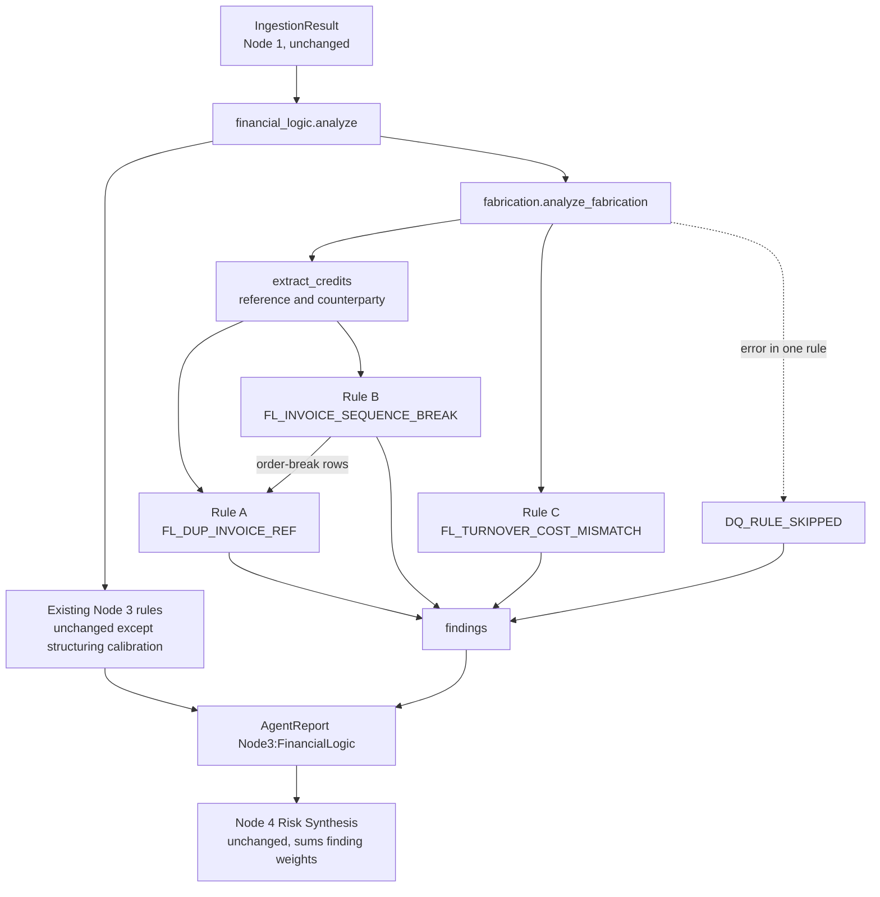
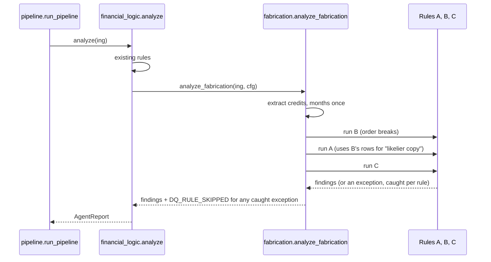

# Design Document: Node 3 Fabrication Rules

## Overview

This spec adds three content-level checks to Node 3 (Financial Logic) that catch a kind of forgery the existing checks cannot see: **fabricated receipts that keep the arithmetic perfect**. In `statement_E.pdf` someone inserted 12 fake incoming payments and re-calculated every balance, so `FL_BALANCE_BREAK` and `FL_CLOSING_MISMATCH` stay silent. What gives the forgery away is the content: each fake receipt reuses the customer name and invoice number of a real receipt in the same month, the invoice numbers go out of date order, and the money-in total rises while payroll, CPF and rent do not move.

The origin of this work is the deferred Component 8 ("Fabrication rules") in `.kiro/specs/multi-layout-ingestion-and-fabrication-rules/design.md`. That older spec finished Stage 1 (Node 1 now reads `statement_E` and `statement_F` to the cent) and left the three rules for later. This design copies what is needed from the older text so this spec stands alone, and tightens it using what the real code and the two labelled files show. Section "Corrections to the older design" lists every change. The older spec folder is not edited.

Three things are in scope:

1. A new module `fraud_detect/nodes/fabrication.py` with `FabricationConfig` and three rules, called from `financial_logic.analyze`: `FL_DUP_INVOICE_REF`, `FL_INVOICE_SEQUENCE_BREAK` and `FL_TURNOVER_COST_MISMATCH`. A rule that hits an internal error is skipped and reported as `DQ_RULE_SKIPPED`; it never crashes the pipeline.
2. A small, separable review of the existing `FL_STRUCTURING` rule, which today gives the genuine `statement_F` a false HIGH finding.
3. Two report-only investigations (why `statement_E` shows no metadata finding, and why both files get `VF_CURRENCY_MIX`) and an evaluation plan with honest limits.

Out of scope: retraining Node 6a/6b, extending the generator to 6 to 12 month statements with fraud patterns, any Node 1 change, UIs, Node 4 weights, OCR, and `fraud_detect/store.py`.

## Background: what was measured

All figures below were measured by reading the code and running Node 1 and Node 3 read-only on the files in `~/Downloads`. They are the reason for several design choices.

| Fact | Value |
|---|---|
| Node 1 on `statement_E` / `statement_F` | 212 / 217 transactions; every month matches the answer key to the cent; all 12 inserted rows are present as credits |
| `statement_F` (genuine) today | `HUMAN_REVIEW`, risk 40: `FL_STRUCTURING` HIGH (20), `FL_UEN_NOT_FOUND` MEDIUM (10), `VF_CURRENCY_MIX` MEDIUM (10) |
| `statement_E` (tampered) today | `HUMAN_REVIEW`, risk 26: `FL_UEN_NOT_FOUND` (10), `VF_CURRENCY_MIX` (10). The tampered file scores **lower** than the genuine one |
| Repeated invoice reference groups (same customer, same reference) | `statement_E`: 12 groups, exactly the 12 inserted rows plus their 12 genuine twins. `statement_F`: 0 groups |
| Invoice numbers out of date order (longest in-order run kept) | `statement_E`: 11 rows, of which 10 are fakes. `statement_F`: 0 rows. In 10 of the 12 pairs the fake is the one flagged |
| Credits with an invoice reference | `statement_E`: 76 of 94 credits. `statement_F`: 65 of 84 credits |
| Month credits against the median of the other five months | `statement_E`: 1.25, 0.80, 1.30, 0.68, 1.25, 0.61. `statement_F`: 0.84, 1.13, 0.54, 1.14, 0.88, 1.14 |
| Fixed-cost debits per month (payroll, CPF, rent, GST) | About S$30,000 each month in both files, except two months with a GST payment (about S$37,000 to S$40,000 in April and July) |
| Whole-file credits divided by debits | `statement_E` as shown 1.43, `statement_E` without fakes 1.12, `statement_F` 1.33 |
| Credits between 9,500 and 10,000 | `statement_E`: 1 (9,982.56). `statement_F`: 3 (9,721.98 on 28 Jul, 9,926.42 on 1 Aug, 9,817.90 on 28 Aug) |
| `statement_E` PDF metadata | Producer and Creator are `OpenPage Writer 3.8`; ModDate (5 Oct 2026) is later than CreationDate (3 Oct 2026). `statement_F`: Producer `Vellichor Paperless 1.12`, Creator `VCB Statements`, the two dates are equal |
| Generator statements (`fraud_detect/synthetic.py`) | Credit descriptions come from a fixed list; the only one containing "INV" is `Customer Payment INV` with no digits, so it has no invoice reference |

Two readings of this table matter most. First, the arithmetic of `statement_E` is perfect, so only content rules can find it. Second, the credit-jump numbers show that the threshold in the older design (1.5 times the median) would be silent on `statement_E`, whose largest month is 1.30 times; see "Rule C" for how the design deals with that honestly.

### Corrections to the older design

| # | Older design said | This design does | Why |
|---|---|---|---|
| 1 | `Transaction.invoice_ref` is filled by Node 1 | No model change. Node 3 reads the reference from `description` | The field was never added in Stage 1 (`fraud_detect/models.py`). Keeping the change inside `fabrication.py` also keeps this spec to one module |
| 2 | Skip code written both `FL_RULE_SKIPPED` and `DQ_RULE_SKIPPED` | One code: `DQ_RULE_SKIPPED` | Stable reason codes need one spelling |
| 3 | HIGH when 3 or more references repeat, weight 22, written per finding | When 3 or more references repeat, **one** HIGH summary finding (weight 22) lists all groups | Node 4 adds up weights. Twelve findings of 22 would clamp the score at 100 and bury every other signal. Fewer than 3 groups give one MEDIUM finding (weight 10) per group |
| 4 | One sequence-break finding per out-of-order row | One LOW finding per file (weight 5) that lists the rows | Same reason as row 3 |
| 5 | A "whole-file credits to debits" trigger in Rule C | Dropped | Measured 1.43 for the tampered file and 1.33 for the genuine file: no defensible threshold separates them. The older text also quoted 1.71 for `statement_E`; the answer key gives 1.43 |
| 6 | Fixed costs matched on `CPF, PAYROLL, SALARY, RENT, GST, IRAS` | Default is `CPF, PAYROLL, SALARY, RENT` | GST is paid quarterly. April and July look "not flat" in both files, which would block Rule C for the wrong reason |
| 7 | Credit jump ratio 1.5 | Default 1.2 and at least two such months (see Rule C decision record) | 1.5 would be silent on `statement_E`. The new default is partly informed by the two labelled files, and this is stated plainly |
| 8 | Rule A needs "different amounts", yet also describes the same-amount case | A repeated reference is reported whatever the amounts; identical amounts get their own wording | The older text contradicted itself |
| 9 | Count only credits with an invoice reference or a "trade-customer style description" as turnover | Count every credit except the excluded kinds (LOAN, CAPITAL, TRANSFER, INTEREST) | "Trade-customer style" cannot be tested. Partial first and last months are skipped instead |
| 10 | `field` lists `rows 23, 27` | Kept, with a known side effect | `memory.py` and `webapp.py` link a finding to a table row only when `field` starts with `row ` followed by one number. Multi-row findings are therefore shown in the findings list but not highlighted on a table row. Fixing the UI is out of scope |

## Architecture



Nothing upstream or downstream changes. Node 4 already adds up each finding's own `weight` and routes any MEDIUM or HIGH finding to a human, so the new findings take effect with no change to Node 4.



## Components and Interfaces

All code is Python, matching the repo.

### Component 1: `fraud_detect/nodes/fabrication.py`

**Purpose**: content-level checks that survive perfect arithmetic.

```python
@dataclass(frozen=True)
class FabricationConfig:
    # --- reading references and customers ---
    # Each pattern has group 1 = prefix and group 2 = number. Case-insensitive.
    invoice_patterns: tuple[str, ...] = (r"\b(INV)[\s\-#]*0*(\d{3,})\b",)
    rail_prefixes: tuple[str, ...] = ("FAST FROM", "PAYNOW FROM", "GIRO", "TT FROM")

    # --- Rule A: duplicate invoice reference ---
    dup_escalate_min_refs: int = 3        # this many repeated references in one file -> one HIGH finding
    dup_isolated_weight: float = 10.0     # MEDIUM, per repeated reference (fewer than the escalate count)
    dup_escalated_weight: float = 22.0    # HIGH, one finding for the whole file
    instalment_max_days: int = 45         # first-to-last payment span that can still look like instalments
    instalment_max_count: int = 3         # most payments of one invoice that can still look like instalments
    evidence_max_groups: int = 20         # evidence lists at most this many groups, then "and N more"

    # --- Rule B: invoice sequence break ---
    seq_min_refs: int = 6                 # need at least this many dated references to judge an order
    seq_min_breaks: int = 2               # report only when this many rows are out of order
    seq_weight: float = 5.0               # LOW

    # --- Rule C: turnover against fixed costs ---
    fixed_cost_keywords: tuple[str, ...] = ("CPF", "PAYROLL", "SALARY", "RENT")
    turnover_exclude_keywords: tuple[str, ...] = ("LOAN", "CAPITAL", "TRANSFER", "INTEREST")
    credit_jump_ratio: float = 1.2        # month credits against the median of the other full months
    fixed_cost_stability_pct: float = 0.10   # fixed costs within +/-10% of their median
    turnover_min_months: int = 4          # full months with fixed costs needed to judge
    turnover_min_stable_share: float = 2/3   # share of full months whose fixed costs must be within the band
    turnover_min_jump_months: int = 2     # a single high month is noise; this many is a pattern
    turnover_weight: float = 8.0          # MEDIUM

    def __post_init__(self) -> None: ...  # raises ValueError for impossible values

DEFAULT_CONFIG = FabricationConfig()

@dataclass(frozen=True)
class CreditRef:
    row: int                  # Transaction.index
    page: Optional[int]
    date: Optional[date]
    amount: float
    ref: str                  # normalised, e.g. "INV3277"
    ref_number: int           # 3277
    counterparty: str         # e.g. "CINDERPATH HOLDINGS"

def extract_invoice_ref(description: str, cfg) -> Optional[tuple[str, int]]: ...
def normalise_counterparty(description: str, cfg) -> str: ...
def extract_credit_refs(txns: Sequence[Transaction], cfg) -> list[CreditRef]: ...

def find_order_breaks(refs: Sequence[CreditRef], cfg) -> set[int]: ...        # row numbers
def check_duplicate_invoice_refs(txns, cfg, likely_copies: set[int] = frozenset()) -> list[Finding]: ...
def check_invoice_sequence(txns, cfg) -> list[Finding]: ...
def check_turnover_vs_costs(ing, cfg) -> list[Finding]: ...
def analyze_fabrication(ing: IngestionResult, cfg: FabricationConfig = DEFAULT_CONFIG) -> list[Finding]: ...
```

**Responsibilities**:
- Own every threshold as a named, documented default; no threshold is hard-coded inside a rule.
- Be pure: same input gives the same findings in the same order; the input is never changed.
- Never raise out of `analyze_fabrication`.

### Component 2: `financial_logic.analyze` (small change)

```python
def analyze(ing: IngestionResult, fabrication_config: FabricationConfig | None = None) -> AgentReport:
    ...                                   # existing rules, same order
    findings += analyze_fabrication(ing, fabrication_config or DEFAULT_CONFIG)
    return AgentReport(agent=AGENT, findings=findings)
```

The new parameter is optional, so every existing caller keeps working. Findings use the existing agent label `Node3:FinancialLogic` (the `AGENT` constant), so Node 4's single-dimension confidence check treats them as Node 3 evidence like the rest.

### Component 3: `FL_STRUCTURING` calibration (small and separable)

Today `_structuring` fires HIGH (weight 20) when 3 or more amounts fall in 9,500 to 9,999.99 anywhere in the file. In a six-month business statement with 84 credits this happens by chance: 41 credits sit between 5,000 and 15,000, which is about 4 credits per 1,000 of range, so a 500-wide window is expected to hold about 2 credits at random, and `statement_F` has 3.

Structuring means splitting a deposit into several pieces over a **short time**. The calibration therefore asks for the near-threshold credits to be close in time as well as close in amount:

```python
_STRUCTURING_CLUSTER_DAYS = 14   # near-threshold credits must fall within this many days

def _structuring(ing) -> list[Finding]:
    near = [near-threshold credits, in date order]
    # fire when some group of >= 3 near-threshold credits fits inside a 14-day span
    # rows with no date cannot be placed in time: they count as inside any span (never silently dropped)
```

| Case | Result |
|---|---|
| Generator plant: 4 deposits of 9,797 to 9,800 on consecutive days | Fires (4 inside 3 days), as today |
| `statement_F`: 28 Jul, 1 Aug, 28 Aug | Silent (the best 14-day span holds 2) |
| 3 near-threshold credits on one day | Fires |
| 3 near-threshold credits spread over 40 days | Silent. This is the accepted trade-off: slow structuring is missed |

Evidence is unchanged except that it names the span. This calibration is a separate task group that can be dropped without touching the three new rules. If it is dropped, the existing strict `xfail` on `test_statement_f_outcome` stays as it is.

### Rule A: duplicate invoice reference (`FL_DUP_INVOICE_REF`)

What it looks for: two or more **credits** with (1) the same counterparty and (2) the same invoice reference. In `statement_E` all 12 fake receipts reuse the customer and invoice number of a real receipt in the same month, on a different date with a different amount.

How the counterparty is found: take the description, remove the invoice reference and any leading payment rail (`FAST FROM`, `PAYNOW FROM`, `GIRO`), upper-case, and collapse spaces. `FAST FROM CINDERPATH HOLDINGS INV3277` gives counterparty `CINDERPATH HOLDINGS` and reference `INV3277`. `INV0042`, `inv-042` and `INV #042` are the same reference (leading zeros removed; a reference needs at least three digits, so `INV12` is not a reference).

Severity and weight, with the instalment trade-off stated plainly:
- A real customer may pay one invoice in two or three parts, and from the statement alone that looks the same as a fabricated copy. So fewer than three repeated references give **one MEDIUM finding per reference** (weight 10). The evidence says "may be an instalment payment; check the invoice" when the payments number at most `instalment_max_count` and span at most `instalment_max_days`. Otherwise that sentence is left out. It is never presented as proof.
- At `dup_escalate_min_refs` (3) or more repeated references in the same file, **one HIGH finding** (weight 22) replaces them and lists every group. One customer paying in parts is plausible; many customers doing so in one file is a pattern. `statement_E` has 12.
- Identical amounts under one reference say "identical amount, possible duplicate posting".
- Accepted false negative: a forger who invents a brand-new invoice number is not caught by this rule.

Evidence for each occurrence: date, amount, page and row, for example `CINDERPATH HOLDINGS INV3277: 13 Apr 2026 S$6,606.41 (page 1, row 16) and 17 Apr 2026 S$8,318.10 (page 1, row 23)`. The finding's `page` is the page of the later row and `field` is `rows 16, 23` (all rows, ascending).

The rule **cannot say which of the two rows is the copy**. About half of the rows it names are genuine. Evidence says so once, and Rule B narrows it down.

### Rule B: invoice sequence break (`FL_INVOICE_SEQUENCE_BREAK`)

What it looks for: in `statement_E` genuine invoice numbers rise with date, and a fake receipt that reuses an older number is out of step with its neighbours.

Method: take credits with a reference and a date, sort by date, then by reference number for rows on the same day (so same-day rows may come in any order). Find the longest run whose reference numbers never go down (patience sort in O(n log n), tie-broken by keeping the earliest rows). Rows outside that run are the **order-break rows**. Report only when there are at least `seq_min_refs` such credits and at least `seq_min_breaks` break rows.

It is a **supporting** signal: LOW severity, weight 5, because customers do pay late and out of order. Its second job is to **name the likelier copy**: for every Rule A group in which exactly one row is an order-break row, Rule A's evidence adds "row N breaks the invoice number order, so it is the likelier copy". If both or neither row is an order-break row, no row is named. Measured on `statement_E`: the fake is named in 10 of 12 pairs; in the other 2 nothing is named. This is a hint, not a verdict.

### Rule C: turnover against fixed costs (`FL_TURNOVER_COST_MISMATCH`)

What it looks for: money in jumps while the fixed costs of running the business (payroll, CPF, rent) stay flat. A business that earns a fifth more in a month usually pays more staff, more suppliers or more tax.

Method, per file:
1. Group transactions by calendar month. Use only **full months**: when the statement period is known, a month counts only if the period covers it from its first to its last day; if the period is unknown, every month with a dated row counts.
2. Per month: **turnover** is the sum of credits, leaving out credits whose description holds a word in `turnover_exclude_keywords`; **fixed costs** is the sum of debits whose description holds a word in `fixed_cost_keywords`. Keywords match whole words, so `RENT` does not match `CURRENT`.
3. Judge the file only when at least `turnover_min_months` (4) full months have fixed costs above zero and at least `turnover_min_stable_share` (two thirds) of the full months have fixed costs within `fixed_cost_stability_pct` of the median fixed costs.
4. A **jump month** is a full month whose turnover exceeds `credit_jump_ratio` times the median turnover of the other full months, **and** whose fixed costs are within the stability band.
5. Report when there are at least `turnover_min_jump_months` jump months. MEDIUM, weight 8. One finding per file.

Evidence lists each jump month: turnover, the median it was compared with, the ratio, and the fixed costs against their median.

**Decision record (read this before trusting the rule).** The older design set the jump ratio at 1.5. On `statement_E` the largest month is 1.30 times the median of the others, so 1.5 is silent. On `statement_F` the largest is 1.14. The default is set to 1.2, with at least two such months, a round value that sits between the two files (`statement_F` tops out at 1.14, `statement_E` has three months at 1.25 or more). That value was chosen after seeing both files, so the fact that it separates them is a sanity check, **not** evidence that it works. A genuine business whose sales swing by 20 percent in two months while payroll and rent stay put will be flagged. Because every MEDIUM finding already routes to a human reviewer and the weight is only 8, a false alarm costs a reviewer a look. It cannot reject anyone. Only one business-style genuine file exists, so the true false-alarm rate on real businesses is unknown.

### Failure isolation and data gaps

`analyze_fabrication` runs the rules one by one, each inside its own `try/except Exception`. On an error it logs the exception type and appends a LOW `DQ_RULE_SKIPPED` finding (weight 2, `field` = the skipped rule's code, evidence = "Rule X was skipped because of an internal error (TypeName); the other checks still ran") and carries on. When there is nothing to judge (no credits carry references, fewer than `seq_min_refs`, fewer than `turnover_min_months` full months) the rule returns nothing. That is "no signal", not "verified clean".

## Data Models

### Reason codes

| Code | Severity | Weight | Meaning |
|---|---|---|---|
| `FL_DUP_INVOICE_REF` | MEDIUM (one per repeated reference) or HIGH (one per file when 3 or more repeat) | 10 / 22 | Same customer and invoice reference on more than one credit |
| `FL_INVOICE_SEQUENCE_BREAK` | LOW | 5 | Invoice numbers go out of date order on 2 or more credits |
| `FL_TURNOVER_COST_MISMATCH` | MEDIUM | 8 | Credits jump in 2 or more months while fixed costs stay flat |
| `DQ_RULE_SKIPPED` | LOW | 2 | A fabrication rule hit an internal error and was skipped |
| `FL_STRUCTURING` (existing) | HIGH | 20 | Unchanged, except it now needs 3 near-threshold credits within 14 days |

All findings use `agent="Node3:FinancialLogic"`. Weights are chosen from first principles in the range of existing Node 3 rules (`FL_MONTH_*` is 12, `FL_BALANCE_BREAK` is 26), **not** fitted to the labelled files.

### Validation rules for `FabricationConfig`
- `dup_escalate_min_refs`, `instalment_max_count`, `seq_min_refs`, `seq_min_breaks`, `turnover_min_months`, `turnover_min_jump_months`, `evidence_max_groups` are integers of at least 1.
- `credit_jump_ratio` is greater than 1.
- `fixed_cost_stability_pct` is at least 0 and below 1; `turnover_min_stable_share` is above 0 and at most 1.
- Weights are at least 0. An invalid config raises `ValueError` when it is built, never inside the pipeline.

### Expected effect on the risk score (to be reported, not asserted)

Node 4 sums weights. Using the weights above and the measured findings:

| File | Today | After this spec (expected) |
|---|---|---|
| `statement_E` | 26 (UEN 10 + currency 10, lifted to the MEDIUM floor of 26) | 20 + 22 (duplicates, HIGH) + 5 (sequence) + 8 (turnover) = 55, band HIGH |
| `statement_F` | 40 | 20 if the structuring calibration is kept (then lifted to 26), 40 if it is dropped |
| Synthetic clean sample | 1, `AUTO_CLEAR` | 1, `AUTO_CLEAR` |

The target is that E scores above F and above the auto-clear threshold (25) with F's remaining findings explained. Node 4's weights and thresholds do not change. If a metadata finding is added later (see Investigations) E rises further.

## Investigations (report-only, no behaviour change)

### I-1: why `statement_E` has no metadata finding

Already established by reading the code and the PDF: the file **does** carry the evidence (Producer and Creator `OpenPage Writer 3.8`, ModDate two days after CreationDate), so the metadata is not lost. Node 2 (`visual_forensics.py`) only knows editing tools in `_EDITING_SOFTWARE = photoshop, illustrator, gimp, inkscape, acdsee, corel`, so a word processor name passes, and it has no check that ModDate is later than CreationDate. The task re-runs this read-only and writes the result to `investigation.md` in the spec folder.

Caution for any later fix: the forgery dataset README says 64 genuine documents are "re-saved" with a print or export Producer and a later ModDate. Any new metadata rule must be checked against those 64 (`genuine_resaved=1` in `labels.csv`) before it is trusted. The fix itself belongs to a Node 2 spec.

### I-2: `VF_CURRENCY_MIX` on both E and F

By reading the code: Node 2 counts the styles `SGD` and `S$` found anywhere in the raw text. Amounts print as `S$...` and the header says `Currency SGD`, so two styles are found and the finding fires on a template quirk. The task measures how many of the 1,000 genuine dataset documents trigger it and reports the figure. No change is made here.

## Correctness Properties

*A property is a characteristic or behavior that should hold true across all valid executions of a system-essentially, a formal statement about what the system should do. Properties serve as the bridge between human-readable specifications and machine-verifiable correctness guarantees.*

These properties cover the pure-logic parts. The investigations, the labelled-file checks and the report script are integration or smoke checks and have no property. The numbering follows the older spec's properties 11 to 15 where they carried over (old 11 is 2, old 12 is 3, old 13 is 10, old 14 is 6, old 15 is 8).

### Property 1: Invoice reference normalisation

For any invoice number and any amount of leading zeros or separator (space, hyphen, hash) between the prefix and the number, and in any letter case, the extracted Invoice_Reference is the same; for any description with no digits after the prefix, no Invoice_Reference is extracted.

**Validates: Requirements 2.1, 2.2, 2.3**

### Property 2: Duplicate reference detection

For any list of credits with unique references per counterparty, adding a copy of any one credit with the same counterparty and reference (any amount, any date) makes the Dup_Rule report `FL_DUP_INVOICE_REF` naming both rows; the same reference under a different counterparty, or on a debit, does not.

**Validates: Requirements 3.1, 3.2, 3.3**

### Property 3: Unique references are quiet

For any list of transactions in which each counterparty and reference pair appears on at most one credit, or in which no credit carries a reference, the Fabrication_Module reports no `FL_DUP_INVOICE_REF` and no `FL_INVOICE_SEQUENCE_BREAK`.

**Validates: Requirements 3.4, 9.4**

### Property 4: Severity follows the number of repeated references

For any file with k Repeated_Reference_Groups, the Dup_Rule reports k MEDIUM findings when k is below `dup_escalate_min_refs` and exactly one HIGH finding naming the rows of all k groups when k is at or above it; changing `dup_escalate_min_refs` moves that boundary and nothing else.

**Validates: Requirements 4.1, 4.2**

### Property 5: Evidence names every occurrence

For any Repeated_Reference_Group, the finding's evidence contains the date, amount, page and row number of every credit in the group, the `field` lists those rows in ascending order, and the `page` equals the page of the latest row.

**Validates: Requirements 5.2, 5.3, 5.4**

### Property 6: Sequence break detection

For any list of dated credits whose reference numbers rise with date, the Sequence_Rule reports nothing, even when same-day rows are shuffled; moving the references of two or more rows out of order (with at least `seq_min_refs` credits in the file) makes it report `FL_INVOICE_SEQUENCE_BREAK` naming exactly the moved rows.

**Validates: Requirements 6.1, 6.2, 6.3, 6.4, 6.5**

### Property 7: Likelier copy is named only when unambiguous

For any Repeated_Reference_Group, the Dup_Rule names a likelier copy if and only if exactly one row of the group is an Order_Break_Row, and the row it names is that row.

**Validates: Requirements 7.1, 7.2**

### Property 8: Turnover rule needs both conditions

For any monthly series of Turnover and Fixed_Costs, `FL_TURNOVER_COST_MISMATCH` is reported only when at least `turnover_min_jump_months` full months have Turnover above `credit_jump_ratio` times the median of the other months **and** Fixed_Costs within the stability band; raising the Fixed_Costs of the jump months beyond the band removes the finding.

**Validates: Requirements 8.3, 8.4, 8.5, 8.6**

### Property 9: Rules never crash and skips are visible

For any list of transactions, including rows with missing dates, amounts or descriptions, `analyze_fabrication` returns without raising; and when any one rule is forced to raise, the result holds exactly one `DQ_RULE_SKIPPED` finding naming that rule together with the unchanged findings of the other rules.

**Validates: Requirements 2.5, 9.1, 9.2, 9.3**

### Property 10: Determinism and no mutation

For any list of transactions, calling `analyze_fabrication` twice returns identical findings in identical order, and the input transactions are equal to a copy taken beforehand.

**Validates: Requirements 6.6, 9.5**

### Property 11: Structuring needs a cluster in time

For any set of Near_Threshold_Credits, the Structuring_Rule reports `FL_STRUCTURING` if and only if some three of them (counting undated ones as inside every span) fit inside a span of 14 days.

**Validates: Requirements 11.1, 11.2, 11.3**

### Property 12: Invalid configuration is rejected

For any Fabrication_Config built with a `credit_jump_ratio` of 1 or less, a `fixed_cost_stability_pct` outside 0 up to but not including 1, a count limit below 1, or a negative weight, construction raises `ValueError`; every other combination of in-range values constructs.

**Validates: Requirements 1.3**

## Error Handling

### A rule raises an unexpected error
**Condition**: any exception inside Rule A, B or C (for example a description that is `None`).
**Response**: that rule is skipped and a LOW `DQ_RULE_SKIPPED` finding names it; the others still run; the pipeline continues.
**Recovery**: a developer reads the log line, which carries the exception type, and fixes the rule.

### Missing data in a row
**Condition**: a credit has no date, no amount or no description.
**Response**: the row is left out of rules that need the missing field (a row with no date is not placed in Rule B or C, a row with no description has no reference). No value is invented.

### Nothing to judge
**Condition**: no references, too few dated references, too few full months.
**Response**: no finding. The UI wording stays "no signal".

### Very long or hostile descriptions
**Condition**: statement text is untrusted input.
**Response**: the reference patterns are simple and bounded, descriptions longer than 500 characters are cut before matching, and evidence lists at most `evidence_max_groups` groups followed by "and N more".

## Testing Strategy

The test command is `/Users/weiyang01/AI-in-finance-/.venv/bin/python -m pytest -q -p no:cacheprovider -W ignore`, run after unsetting `AUDIT_SIGNING_KEY_PATH` and `FRAUD_ENABLE_TXN_MODEL`. Work is test-first: each rule starts with a failing test. Today the suite shows 571 passed and 1 xfail.

### Unit tests (always run, in-code fixtures)
- Reference and counterparty reading: `INV0042` equals `inv-042` and `INV #042` (at least three digits, so `INV12` has no reference), rails removed, `Customer Payment INV` has no reference.
- Rule A: no repeats (silent), one repeat (MEDIUM with the instalment sentence), a repeat of 4 payments or over 45 days (no instalment sentence), identical amounts (duplicate-posting wording), three repeated references (one HIGH finding covering all), debit rows ignored, the same reference under two different customers (silent).
- Rule B: in-order list (silent), two moved rows (reported), one moved row (silent), same-day rows in any order (silent), fewer than 6 references (silent), the likelier-copy sentence.
- Rule C: flat costs plus two jump months (reported), one jump month (silent), costs rising with credits (silent), partial months skipped, too few months (silent), excluded credit kinds, whole-word keyword matching.
- Structuring: the four-in-four-days plant fires, three credits 30 days apart is silent, three on one day fires, undated rows are not dropped.
- Isolation: monkeypatch one rule to raise and assert `DQ_RULE_SKIPPED` plus the other rules' findings.
- Config: invalid values raise `ValueError`; `analyze(ing, fabrication_config=...)` honours overrides.

### Property-based tests
**Library**: `hypothesis` (already installed). At least 100 examples per property. Each test is tagged `Feature: node3-fabrication-rules, Property N: ...`. Properties are pure logic on lists of `Transaction` built in memory, so they are fast.

### Acceptance tests on the labelled files (skip when missing)
Files: `~/Downloads/statement_E.pdf`, `statement_F.pdf`, `ANSWER_KEY_6M_v2.json`. Path constants are local to the test module (tests is not a package). They are fixtures only: nothing trains on them and they are never committed.

| Check | Pass condition |
|---|---|
| Duplicate rule on E | `FL_DUP_INVOICE_REF` is reported and the evidence covers 12 of 12 `inserted_rows` (matched by date and amount). About half of the rows named are the genuine twins, and the test also reports how many fakes Rule B names |
| Turnover rule on E | `FL_TURNOVER_COST_MISMATCH` is reported (sanity check, see decision record) |
| New rules on F | None of the three new codes is reported |
| Structuring on F | `FL_STRUCTURING` is no longer reported (only if the calibration group is kept) |
| Regression | Synthetic clean sample is still `AUTO_CLEAR` with risk about 1; the full suite still passes |

### Report-only evaluation (no assertions)
A small read-only script (`python -m fraud_detect.nodes.fabrication_eval`) runs Node 3 over the 1,000 genuine documents of the forgery dataset and a batch of generator statements and prints, per rule, how many documents fired. Expected: zero, because those files carry no invoice references; the point is to **verify** that. It also prints how many dataset documents trigger `VF_CURRENCY_MIX`, and the before-and-after risk score of E and F.

### What the results can and cannot show
- Two labelled files only. They show the rules work on this one forgery recipe, not on forgeries in general.
- Thresholds were set from first principles except the Rule C ratio, which was informed by both files (decision record above). Results are indicative.
- A forger who invents a brand-new invoice number evades Rule A.
- Genuine instalment payments can look like duplicates; the rule says so and never calls it proof.
- Rule C can flag a genuine business with volatile sales and steady payroll.
- Passing these tests does not prove real Singapore bank statements behave the same way.

## Performance Considerations

All rules are a single pass over the transactions plus a sort, O(n log n) for n transactions. A 12-month statement of about 500 rows adds well under a millisecond of work compared with PDF reading.

## Security Considerations

Descriptions come from an untrusted PDF. They are only matched and quoted, never executed or used as paths. Evidence strings are plain text built with formatting, with no templates evaluated. The module makes no network calls and adds no dependency. The external files are never committed and `fraud_detect/store.py` is not touched.

## Dependencies

- Python standard library only for the rules (`dataclasses`, `re`, `statistics`, `datetime`, `logging`, `bisect`).
- Existing: `pydantic` models in `fraud_detect/models.py`, `pytest`, `hypothesis` (tests).
- External read-only test inputs under `~/Downloads`; every test using them skips when absent.
