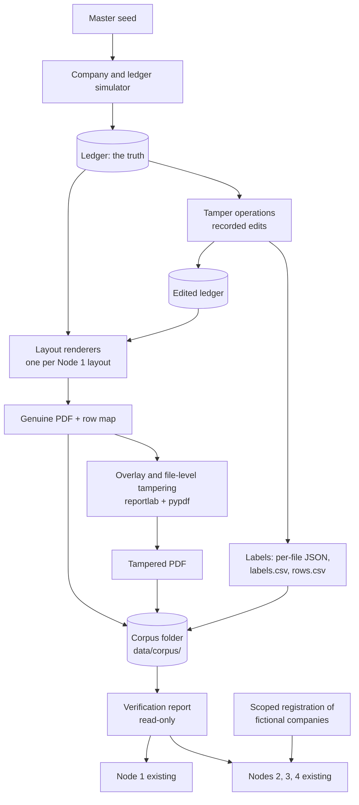
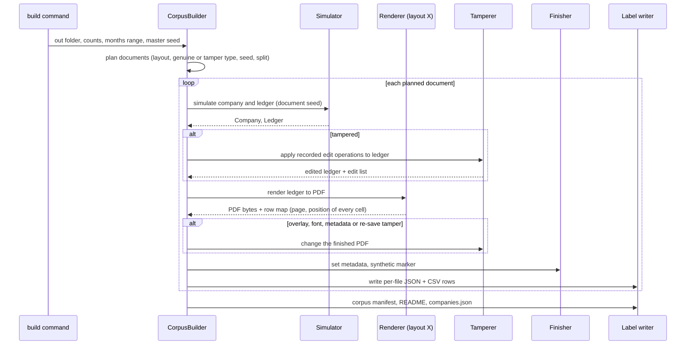

# Design Document: Synthetic Corpus Generator

## Overview

This project is a working prototype that we want to show to financial institutions. We cannot get real corporate bank statements (data-leakage and PDPA concerns), so we build our own **fake but realistic** ones. This design describes a **corpus generator**: a program that writes a large, labelled set of fictional business bank statements as PDF files.

The generator does four things:

1. **Simulates a small fictional company** for 6 to 12 months: customers who pay invoices, monthly payroll, CPF contributions and rent, quarterly GST, supplier payments, utilities, card payments and bank charges.
2. **Prints the result as a PDF in any of the six layouts that Node 1 can read.** The same simulated company can be shown as any layout. Each PDF is one file with one month per section, as in the real examples.
3. **Plants fraud on purpose and writes down exactly what was planted.** Every fraudulent file comes with a label file saying what was changed, where, and what the original value was. Genuine files carry no fraud labels.
4. **Measures the existing screening nodes.** A separate read-only report runs the corpus through Node 1 (does it read every row?), then Nodes 2, 3 and 4 (how often do genuine files raise false alarms? which planted frauds are noticed?). It also lists the frauds that no node notices today (the "blind spots").

The key idea, in plain words: **the simulated bank ledger is the truth.** A statement is just a picture of the ledger. When we plant fraud we edit the ledger (or the picture) with a recorded edit, so we always know the correct answer.

### Why this is worth building

| Benefit | How |
|---|---|
| A safe test set for false alarms | Genuine generated statements look like business statements (payroll, rent, invoices). They exercise Node 3 rules that today's old generator never reaches. |
| A labelled test set for detection | Each planted fraud has a known type, location and original value. |
| Consistent data for the later ML retraining (Stage B) | Nodes 6a and 6b can later be retrained on files that match the rest of the workflow. |
| Reproducible and shareable | One master seed rebuilds the same corpus. The generator lives in the repo; the PDFs do not. |
| Honest by construction | Every file says it is synthetic. No external licensed data is used. |

### Stages

| Stage | What | In this spec? |
|---|---|---|
| **A (this spec)** | Corpus generator, labels, splits, verification report, measured results | **Yes** |
| **B (separate spec, "ml-retraining")** | Retrain Node 6a and 6b on the corpus | **No**. Prerequisites listed at the end of this document |

### What I checked in the code before designing (verified, not assumed)

| Question | Answer |
|---|---|
| Where is the old generator? | `fraud_detect/synthetic.py` (665 lines). It draws **one** layout (`generator_v1`, left-aligned, colon labels) with reportlab (`_render_pdf`), plants issues with `PlantedIssue`, and has no invoice references, payroll, CPF or rent. Node 3's fabrication rules therefore never run on it. It stays unchanged. |
| Which layouts must we draw? | Six profiles in `fraud_detect/nodes/ingest_parse/layouts.py` `REGISTRY`: `generator_v1`, `two_col_dmon`, `two_col_slash`, `two_col_dual_date`, `signed_amount_iso`, `two_col_ddmmyy_cr`. Node 1 tries every profile on every page and keeps the best; it never uses the bank name. |
| Where is the layout geometry written down? | In-code fixtures in `tests/ingest_parse/fixtures.py` (`ALL_FIXTURES`, `continuation_fixture`, `six_page_page1of1_fixture`): column right edges, header words, summary box positions, footer lines, row step, which layouts print `CR`, `S$`, `SGD`, `+SGD/-SGD`. Corrections from reading real sample PDFs are in `.kiro/specs/multi-layout-ingestion-and-fabrication-rules/design.md`. We use these as the layout specification. |
| What do the profiles require? | `two_col_dmon`: `d Mon` dates (year taken from the period line), two amount columns, `Account No.` label. `two_col_slash`: `dd/mm/yyyy`. `two_col_dual_date`: two date columns (transaction and value date). `signed_amount_iso`: `yyyy-mm-dd`, one signed amount (`+SGD` / `-SGD`). `two_col_ddmmyy_cr`: `dd-mm-yy`, balance with a `CR` suffix. `generator_v1`: `Account Holder:` and `UEN:` labels, `dd/mm/yyyy`, one signed amount. |
| How does Node 1 number rows? | `index = start_index + len(txns)` in `ingest_parse/parser.py`. The corpus will store its own row order and a test will confirm it matches Node 1's order. |
| What does Node 2 look at? | `visual_forensics.py`: foreign font in under 5% of glyphs (fonts outside Helvetica, Helvetica-Bold, Arial, Arial-Bold, Times-Roman), mixed date formats, mixed currency notation **on transaction rows only**, editing-software words in Producer/Creator (including the whole word "editor"), `VF_MODIFIED_AFTER_CREATION` (ModDate more than 60 seconds after CreationDate, unless Producer contains a print/export word such as `print`, `export`, `quartz`, `skia`, `chrome`), and creation date before the period. |
| What does Node 3 look at? | `financial_logic.py` plus `fabrication.py`. Balance replay, closing check, period gaps/length/missing months, `FL_SUDDEN_DEPOSIT` (one credit above 3 times the per-UEN average monthly credit in `CASHFLOW_BASELINE`), `FL_UNVERIFIED_COUNTERPARTY` (credit of 50,000 or more and the text `UNKNOWN`, `LLC`, `HOLDINGS` or `TT` anywhere in the description), `FL_STRUCTURING` (3 or more credits in 9,500 to 9,999.99 within 14 days), `FL_UEN_NOT_FOUND` / `FL_UEN_NAME_MISMATCH` (registry), and the fabrication rules (`FL_DUP_INVOICE_REF`, `FL_INVOICE_SEQUENCE_BREAK`, `FL_TURNOVER_COST_MISMATCH`). Invoice references are read with the pattern `INV` plus 3 or more digits. |
| How does the registry work? | `registry.lookup_entity` reads the dictionary `reference_data.ACRA_REGISTRY` first; `financial_logic` reads `CASHFLOW_BASELINE` the same way (both imported by name, so changing the dictionaries in place is seen by the nodes). The tests force live lookup off (`tests/conftest.py`). |
| What protects the repo from stray PDFs? | `tests/test_repo_hygiene.py` fails if any PDF, `labels.csv` or dataset file is tracked by git. `.gitignore` already ignores `data/`. So the corpus goes to `data/corpus/` and can never be committed by accident. |
| Test baseline | 1155 passed and 1 skipped (command in the task list). The branch is `feature/Machine-learning-optimization`. |
| Tools available | reportlab 4.2.2, pypdf 4.3.1, pdfplumber 0.11.4, hypothesis 6.170.13. No new dependency is needed. |

### Rules this design follows

- **Clean-room.** The external forgery dataset (`~/Downloads/statement_forgery_dataset`) has a script (`generate_documents.py`) with an **unknown licence**. We do not copy it, import it, or reuse its code, text or file layout. The renderers are written from the layout *facts* (column positions, header words, date styles) already recorded in the repo's own fixtures and design notes. Bank names, footer wording, people, customer and company names are our own inventions. Reading a few sample PDFs read-only with pdfplumber to double-check geometry is allowed; nothing is copied into the repo. We mirror the *idea* of its tamper taxonomy (the names of tamper types and the label columns) with our own names and our own code.
- **Never train on `statement_E` / `statement_F`**, and never commit them or the answer key. They are only a *style reference* (company holder, UEN, `FAST FROM <CUSTOMER> INV<n>` receipts with rising invoice numbers, PAYNOW deposits, rent, payroll, CPF, GST, supplier payments, service charge, card payments).
- **No change to the application.** Nodes 1 to 4, `synthetic.py`, the registry and all existing tests stay as they are. Everything new lives in a new package and new tests. Measuring a node never changes it.

## Architecture

### Where the new package sits



Nothing in the screening pipeline is changed. The verification report only calls the existing functions (`ingest`, `visual_forensics.analyze`, `financial_logic.analyze`, `risk_synthesis.synthesize`) in memory, as `fabrication_eval.py` already does.

### Flow of one build



### Folder layout

```
fraud_detect/corpus/
  __init__.py
  schema.py        data classes, constants, label columns, generator version
  seeding.py       stable seeds (no global random state)
  company.py       fictional company, customers, suppliers
  ledger.py        month-by-month simulator, balance replay
  layouts/
    base.py        LayoutRenderer interface, RowMap
    specs.py       column positions and wording for each layout (data, not code)
    dataset_family.py   one drawing engine for the five table layouts
    generator_v1.py     drawing engine for the colon-label layout
  finish.py        metadata, synthetic marker, file finishing
  tamper/
    ledger_ops.py  edits that change the ledger (rerender and behavioural)
    pdf_ops.py     overlay, font, metadata, re-save (change a finished PDF)
    catalog.py     the list of tamper types and what each one records
  splits.py        train / validation / test and the held-out layout
  builder.py       CorpusBuilder
  build.py         command: python -m fraud_detect.corpus.build
  scope.py         temporary registration of the fictional companies
  verify.py        command: python -m fraud_detect.corpus.verify
tests/corpus/      new tests (small in-code corpus; no external files)
data/corpus/       output (git-ignored, never committed)
```

## Design decisions (options, choice, reason)

### D1. How do we guarantee the right answer? (ground truth)

| Option | Plain description | Verdict |
|---|---|---|
| A. Draw a PDF, then read it back to find the answer | The answer is only as good as the reader | No: it would make Node 1 grade itself |
| B. **Render from a ledger; the ledger is the truth** | We keep a list of transactions with a stable id for each row. The PDF is generated from it. Tampered versions are made by explicit, recorded edits | **Yes** |

Reason: we always know exactly what each row should say, so "did Node 1 read every row?" has a hard answer. A tampered file is the genuine ledger plus a list of edits, and that list *is* the label.

### D2. One drawing program per layout, or a shared one?

| Option | Verdict |
|---|---|
| A. Six separate drawing programs | Lots of repeated code; six places to keep in step |
| B. **One drawing engine for the five table layouts, driven by a data table of positions and wording, plus one small engine for `generator_v1`** | **Yes** |

The five table layouts (`two_col_dmon`, `two_col_slash`, `two_col_dual_date`, `signed_amount_iso`, `two_col_ddmmyy_cr`) share one skeleton: title, holder block, summary box, table header, brought-forward row, rows, closing row, footer. They differ only in date style, column positions, amount style and a few words. `generator_v1` has a different skeleton (colon labels, one amount column) and keeps its own engine. To the rest of the system each layout still looks like its own renderer (one `LayoutRenderer` per layout name), so tests and tasks are per layout.

### D3. Which layouts can spill onto a second page?

The real samples spill for `two_col_slash` and `two_col_dual_date` (repeated table header, no period line on the second page). The others fit a month on one page in the samples we know.

Choice: the drawing engine spills **any** layout to a continuation page when a month has more rows than fit (about 43 rows on a first page and 54 on a continuation page). The company simulator is told how many rows a month may have per layout:

- `two_col_slash` and `two_col_dual_date`: unlimited, so spills happen naturally (real behaviour).
- `two_col_dmon`: limited to what fits on one page, and every month page prints "Page 1 of 1" (the real quirk Node 1 must cope with).
- Other layouts: normally one page, but allowed to spill, marked in the manifest as "spill not seen in real samples" (an honest extension).

### D4. How is an "overlay" tamper done?

An overlay in the real world means someone draws a new number on top of the old one, so the file contains both. Choices:

| Option | Verdict |
|---|---|
| A. Remove the old text and write the new text | That is a re-render, not an overlay. Both values would not be in the file |
| B. **Make a one-page overlay with reportlab (optional white box, then the new text at the exact spot) and merge it onto the original page with pypdf** | **Yes** |

To know "the exact spot", every renderer returns a **row map**: for each ledger row, the page, the vertical position, and the left or right edge of each cell. The overlay uses that map, so we never guess coordinates. After merging, both the old and the new text are in the text layer; pdfplumber will interleave or garble them. Node 1 may then drop that row without warning. That is a **known blind spot** (about 20% of the external dataset's tampered files show it); we label it, measure it, and report it. We do not fix Node 1 in this spec.

A "re-render" tamper instead regenerates the page(s) from the edited ledger.

### D5. Metadata, font and re-save tampering

All three are done on the finished PDF with pypdf or by drawing with a different built-in font:

- **Metadata inconsistency.** Set Producer to an editing-tool name (a fictional "PDF Editor" name, or one of the words Node 2 lists) and ModDate later than CreationDate. Optional variant: CreationDate earlier than the period start.
- **Font mismatch.** Draw the edited amount in `Courier` (one of reportlab's built-in fonts; no font file, so no font licence question). Node 2 flags a font outside its body list used in under 5% of glyphs.
- **Genuine re-saved (hard negative).** Content unchanged. Producer becomes a print/export-style string (for example a fictional "Quartz PDFContext" or "Skia/PDF" string) and ModDate is later than CreationDate. This must **not** look like fraud; it checks that Node 2 does not over-react. `is_tampered` is false, `genuine_resaved` is true.

### D6. Randomness, seeds and sameness

- **No global random state.** Every random choice uses its own `random.Random` object created from a stable seed.
- **Stable seeds.** `stable_seed(master_seed, *parts)` hashes the master seed and the parts (for example `"doc"`, `layout`, `index`) with SHA-256 and takes an integer. Python's built-in `hash()` is not used because it changes between runs.
- **Same seed gives the same corpus.** Manifests (JSON) are byte-for-byte identical. PDFs are drawn with reportlab's fixed-output mode and metadata is written explicitly with fixed dates, so equal seeds give equal text layers, and equal bytes wherever the libraries allow. Tests compare the extracted words, the labels and a hash of the text layer; byte equality is attempted and reported but not the only check.
- **Version.** `GENERATOR_VERSION` (for example `"1.0.0"`) is written in every manifest. Any change that alters output for the same seed must bump it.

### D7. Splits and leakage rules

The danger: a model (or a detector) can look good only because near-copies of the same company sit in both the learning set and the testing set.

Rules:

1. **One company, one split.** A simulated company (and everything derived from its ledger) goes to exactly one split.
2. Split names: `train`, `validation`, `test`, plus `test_unseen_layout`.
3. **Held-out layout.** With `--hold-out-layout NAME`, every document of that layout goes to `test_unseen_layout` and none to train or validation. Default: no layout is held out, but the builder prints a reminder.
4. The split of a company is chosen by hashing the master seed and the company id into a fraction (default 70% / 15% / 15%), so it does not depend on the order of building.
5. The tamper-type mix per split is written to the corpus manifest, and the builder warns if a type is missing from a split (small corpora will have gaps; that is reported, not hidden).
6. Each tampered document has its own company, so there is no "genuine twin" in the same corpus. (A twin would be a second near-identical document and would make the leakage rule harder to keep.) The manifest still stores the original values, so a twin can be rebuilt on demand.

### D8. Registering the fictional companies for the measurement (without touching production data)

Problem: `FL_UEN_NOT_FOUND` fires for every generated company, which would make every genuine file look suspicious.

| Option | Verdict |
|---|---|
| A. Edit `reference_data.py` by hand | Changes production fixtures; forbidden here |
| B. Add `register_local()` to `registry.py` | Changes application code; possible later, outside this spec |
| C. **A context manager in the new package that adds the companies to the two in-memory dictionaries for the duration of a measurement and puts everything back afterwards (also after an error)** | **Yes** |

`companies.json`, written by the builder, lists each company's UEN, registered name and a baseline of average monthly credit and debit taken from its genuine ledger. The context manager reads this file, adds `ACRA_REGISTRY[uen] = name` and `CASHFLOW_BASELINE[uen] = {...}`, and removes them on exit. Live lookup stays off. The dictionaries on disk are never edited. It is not safe for several threads at once; the verification report is single-threaded.

For the `uen_mismatch` fraud, the registered name in `companies.json` is the true company name and the document prints a different holder name.

### D9. How big is a "smoke" corpus and a "large" corpus?

| Corpus | Size | Used for | Budget |
|---|---|---|---|
| In-test mini corpus | 6 layouts x 1 genuine at 6 months, plus 6 layouts x 1 genuine at 12 months, plus a handful of tampered files | Round-trip tests in CI | Whole new test folder under about 90 seconds |
| Smoke corpus | 6 layouts x (2 genuine + 2 tampered) = 24 files | Quick manual run and the numbers in the README | Under about 1 minute |
| Large offline corpus | 200 or more per layout | Stage B training and a real measurement | Minutes to tens of minutes; run by hand with the command |

Honest target: a 12-month statement renders in about 1 to 2 seconds on a laptop (to be measured and written down in the evaluation file, not promised). Tests build the mini corpus once per test session.

### D10. How "business-like" are genuine statements? (the simulator)

The simulator is a simple month-by-month model, not a finance engine:

- **Company.** Fictional name in `PTE. LTD.` style built from invented word lists, UEN-style identifier, address, an industry flavour (services, trading, food and beverage, logistics) that sets the scale and the mix of customers.
- **Customers and invoices.** 5 to 25 customers with different sizes. Each receipt is `FAST FROM <CUSTOMER> INV<n>` or `PAYNOW FROM <CUSTOMER> INV<n>` or a GIRO collection. **Invoice numbers rise with the receipt date** (numbers are handed out in receipt order; a simplification, written down in the limits). A knob `invoice_disorder` (default 0) can shuffle a small share of numbers, so we can test how sensitive Rule B is.
- **Instalments.** About 4% of invoices are paid in two parts. Sometimes the second part falls in the next month; sometimes both parts are identical round amounts. These are the *genuine hard cases* that Node 3's duplicate-reference rule can confuse with fabrication; they are listed in the manifest as `genuine_hard_cases`, so false alarms can be traced to them.
- **Fixed monthly costs.** `PAYROLL BATCH` and `CPF CONTRIBUTION` and `RENT` change by no more than a few percent from month to month (staying inside the band Node 3 expects), and CPF follows payroll. Quarterly `GST PAYMENT` in the usual quarter months, sized from turnover.
- **Other.** Supplier payments (`FAST TO <SUPPLIER>`), utilities and telco (invented names, not real brands), `NETS/CARD` payments, a small monthly `SERVICE CHARGE`, tiny `INTEREST CREDIT`. All amounts have cents.
- **Seasonality and growth.** A monthly multiplier vector (busy and quiet months) and a gentle monthly growth rate, both random per company within limits.
- **Balances.** A dry run finds the lowest balance and the opening balance is set so the account never goes below zero; balances are carried month to month, and each month's opening equals the previous month's closing.
- **Business days.** FAST, GIRO and card dates fall on weekdays; payroll near the end of the month; rent at the start.
- **Row volume.** About 20 to 60 rows a month, capped per layout as in D3.

The simulator never uses any real company name, person, UEN list or external data. Name lists are invented words kept in the code.

### D11. Where do the synthetic-data statements go in each PDF?

Each page carries a small footer in our own words (for example "SPECIMEN · Fictional institution · Synthetic data, not a real bank document") and each file's metadata Title and Subject say "synthetic". Node 1 already treats footer lines as noise. A test proves it: every row is still read with the footer present.

## Components and Interfaces

All code is Python, matching the repo.

### Data classes (`schema.py`)

```python
GENERATOR_VERSION = "1.0.0"
LAYOUTS = ("generator_v1", "two_col_dmon", "two_col_slash",
           "two_col_dual_date", "signed_amount_iso", "two_col_ddmmyy_cr")

@dataclass(frozen=True)
class CompanyProfile:
    company_id: str            # "C0001" (stable inside one corpus)
    name: str                  # "NORTHBROOK FACILITIES PTE. LTD."
    uen: str                   # fictional UEN-style id
    address_lines: tuple[str, ...]
    account_number: str
    archetype: str             # "services" | "trading" | "fnb" | "logistics"
    customers: tuple[Party, ...]
    suppliers: tuple[Party, ...]
    landlord: str
    payroll_base: float
    seed: int

@dataclass(frozen=True)
class LedgerRow:
    row_id: str                # "R0001", never reused; the key for labels
    month_index: int           # 0-based month inside the statement
    date: date
    description: str           # exactly what is printed
    amount: float              # signed: credit +, debit -
    kind: str                  # "receipt" | "payroll" | "cpf" | "rent" | "gst" | ...
    customer: str | None
    invoice_ref: str | None    # "INV1042"
    hard_case: str | None      # "instalment", "instalment_identical", ...
    fraud: bool = False        # True only for rows added or edited by a tamper

@dataclass(frozen=True)
class Ledger:
    company: CompanyProfile
    opening_balance: float
    months: tuple[date, ...]            # first day of each month shown
    rows: tuple[LedgerRow, ...]         # in print order
    printed_balances: tuple[float, ...] | None   # None = recompute by replay
    printed_holder: str | None = None   # for uen_mismatch only

@dataclass(frozen=True)
class EditOp:
    op: str                    # "set_amount" | "set_date" | "insert_row" | "delete_row" | "delete_month" ...
    row_id: str | None
    field: str | None
    original: str | None
    new: str | None
```

`replay(ledger)` gives the balance after every row. When `printed_balances` is `None` the printed balance is the replay; a tamper that wants a broken balance sets `printed_balances` itself (so "arithmetic consistent" is simply "printed equals replay").

### Simulator (`company.py`, `ledger.py`)

```python
def make_company(seed: int, company_id: str) -> CompanyProfile: ...
def simulate_ledger(company: CompanyProfile, start: date, n_months: int,
                    seed: int, knobs: SimulatorKnobs,
                    max_rows_per_month: int | None) -> Ledger: ...
def replay(ledger: Ledger) -> list[float]: ...
```

`SimulatorKnobs` holds growth, seasonality strength, instalment rate (default 0.04), invoice disorder (default 0.0), and the volume range.

### Renderers (`layouts/`)

```python
@dataclass(frozen=True)
class CellBox:             # where one printed cell sits (points, pdfplumber "top" style)
    page: int; top: float; x0: float; x1: float; text: str

@dataclass(frozen=True)
class RowMap:
    cells: dict[str, dict[str, CellBox]]    # row_id -> {"date","description","amount","balance"}
    pages_per_month: tuple[int, ...]

@dataclass(frozen=True)
class RenderResult:
    pdf: bytes
    row_map: RowMap
    printed: tuple[PrintedRow, ...]         # row_id, text of each cell, printed balance
    section_summaries: tuple[SectionSummary, ...]

class LayoutRenderer(Protocol):
    name: str                                # one of LAYOUTS
    max_rows_per_month: int | None           # None = unlimited
    def render(self, ledger: Ledger, style: StyleKnobs, seed: int) -> RenderResult: ...
```

`StyleKnobs` are small random variations that do not change what Node 1 needs: bank name (from our own invented list), address wording, producer string, creation time of day, row step within a small range, whether the holder block has a second address line. They exist so a model cannot learn "every file has exactly this pixel position".

Registry: `RENDERERS: dict[str, LayoutRenderer]` with six entries.

### Tamper operations (`tamper/`)

```python
@dataclass(frozen=True)
class TamperResult:
    ledger: Ledger                 # edited ledger (equal to the input for pure file-level tampers)
    edits: tuple[EditOp, ...]
    file_ops: tuple[FileOp, ...]   # "overlay", "set_font", "set_metadata", "resave"
    label: TamperLabel             # see "Label schema"

class Tamperer(Protocol):
    name: str                      # a tamper type from the catalog
    def plan(self, ledger: Ledger, renderer: LayoutRenderer, rng: random.Random) -> TamperResult: ...

def apply_file_ops(pdf: bytes, file_ops, row_map: RowMap, seed: int) -> bytes: ...
```

`plan` decides *what* to change and returns the edited ledger plus the label. The builder renders the edited ledger. Overlay and metadata edits are then applied to the finished PDF by `apply_file_ops`.

### Builder and splits

```python
@dataclass(frozen=True)
class BuildConfig:
    out_dir: Path
    master_seed: int
    per_layout_genuine: int
    per_layout_tampered: int
    months_min: int = 6
    months_max: int = 12
    hold_out_layout: str | None = None
    tamper_mix: Mapping[str, float] | None = None   # None = even over all types
    split_fractions: tuple[float, float, float] = (0.70, 0.15, 0.15)

class CorpusBuilder:
    def plan(self) -> list[DocumentPlan]: ...          # no PDFs yet; cheap; deterministic
    def build(self, progress=None) -> CorpusSummary: ...

def assign_split(master_seed: int, company_id: str, layout: str,
                 hold_out_layout: str | None, fractions) -> str: ...
```

### Scoped registration (`scope.py`)

```python
@contextlib.contextmanager
def registered_companies(companies_json: Path | Iterable[CompanyRecord]):
    """Add the fictional companies to ACRA_REGISTRY and CASHFLOW_BASELINE, then restore."""
```

### Verification report (`verify.py`)

```python
def load_corpus(corpus_dir: Path) -> list[DocRecord]: ...
def measure_node1(records, ingest=ingest) -> list[Node1Result]: ...
def measure_nodes_2_to_4(records, screen=default_screen) -> list[ScreenResult]: ...
def summarise_layout(results) -> dict: ...
def detection_by_tamper_type(results, labels) -> list[Row]: ...
def blind_spots(table) -> list[str]: ...
def main(argv=None, *, corpus_dir=None, out=None, ingest=..., screen=...) -> int: ...
```

Like `eval_layouts.py` and `fabrication_eval.py`: read-only, injectable (`ingest`, `screen`), deterministic, prints an `elapsed` line, and prints "skipped" when the corpus folder is missing. It uses no `CaseStore`, so nothing is written to `data/` cases or the audit chain.

## Data Models

### Output files (all under the corpus folder, e.g. `data/corpus/`)

| File | What it holds |
|---|---|
| `pdfs/<doc_id>.pdf` | The statement |
| `manifests/<doc_id>.json` | The full truth for one document (see below) |
| `labels.csv` | One line per document (columns below) |
| `rows.csv` | One line per transaction row with `is_fraud_row` |
| `companies.json` | Each fictional company: UEN, registered name, baseline for the measurement |
| `corpus_manifest.json` | Generator version, master seed, command line, counts per layout / split / tamper type, tamper mix per split, "SYNTHETIC DATA" statement |
| `README.txt` | Plain-language explanation with the SYNTHETIC DATA notice |

### `labels.csv` columns

Names are our own. They carry the same *ideas* as the external dataset's label columns.

| Column | Meaning |
|---|---|
| `doc_id` | Stable id, for example `two_col_slash-0007` |
| `file` | Path to the PDF relative to the corpus folder |
| `split` | `train`, `validation`, `test`, `test_unseen_layout` |
| `layout` | One of the six profile names |
| `company_id` | The simulated company (the leakage unit) |
| `doc_seed` | Seed for this document |
| `n_months`, `first_month`, `last_month` | Months shown |
| `n_pages`, `n_rows` | Size |
| `is_tampered` | 1 if fraud or tampering was planted. 0 for genuine files, including re-saved ones |
| `tamper_types` | Semicolon list from the catalog (empty if genuine) |
| `tamper_method` | `overlay`, `rerender`, `content` or `file` (empty if genuine) |
| `arithmetic_consistent` | 1 if every printed balance equals the replay from the printed amounts |
| `genuine_resaved` | 1 for the print/export re-save hard negatives |
| `metadata_altered`, `font_inconsistent`, `date_inconsistent`, `overlay_bg_matched`, `hidden_text_layer` | 0/1 flags (`hidden_text_layer` is 1 for overlays: both values remain in the text) |
| `n_affected_rows` | Count of rows labelled as fraud rows |
| `spill_not_in_real_samples` | 1 when a layout was spilled that the real samples do not spill |
| `genuine_hard_cases` | Semicolon list (instalments etc.), for tracing false alarms |
| `generator_version` | From the code |

### Per-document manifest (JSON)

```json
{
  "doc_id": "two_col_slash-0007",
  "generator_version": "1.0.0",
  "synthetic": true,
  "layout": "two_col_slash",
  "company": {"company_id": "C0042", "name": "…PTE. LTD.", "uen": "…", "registered_name": "…PTE. LTD."},
  "seeds": {"master": 12345, "document": 987654321},
  "months": ["2025-01", "2025-02"],
  "split": "train",
  "label": {
    "is_tampered": true,
    "tamper_types": ["fabricated_receipts"],
    "method": "content",
    "arithmetic_consistent": true,
    "flags": {"metadata_altered": false, "font_inconsistent": false,
              "date_inconsistent": false, "overlay_bg_matched": null,
              "hidden_text_layer": false, "genuine_resaved": false},
    "affected_rows": [
      {"row_id": "R0231", "row_index": 117, "page": 9, "month": "2025-05",
       "field": "row", "original": null, "new": "FAST FROM … INV1042  2,310.45"}
    ],
    "edits": [ {"op": "insert_row", "row_id": "R0231", "original": null, "new": "…"} ],
    "should_be_seen_by": ["Node3:FL_DUP_INVOICE_REF"],
    "notes": "descriptive only, not a promise"
  },
  "genuine_hard_cases": ["instalment"],
  "rows": [ {"row_id": "R0001", "row_index": 1, "page": 1, "month": "2025-01",
             "date": "2025-01-02", "description": "…", "amount": -1200.0,
             "balance": 8800.0, "is_fraud_row": false} ],
  "section_summaries": [ {"opening": 10000.0, "closing": 12000.0,
                          "total_withdrawals": 0.0, "total_deposits": 0.0} ],
  "text_layer_sha256": "…"
}
```

`row_index` is the 1-based position of the row in print order. A test confirms it equals the order Node 1 reads.

### Tamper catalog (the list of fraud types and what is recorded)

| Type | Group | Method | What the edit is | Arithmetic stays consistent? | Should in principle be seen by (descriptive) |
|---|---|---|---|---|---|
| `edited_amount` | Document | overlay | New number drawn over one amount (white box optional); both numbers remain in the text layer | No (balance not redrawn) | Node 3 balance checks, only if Node 1 keeps the row; Node 2 (font) if fonts differ; otherwise a blind spot |
| `edited_amount` | Document | rerender | One amount changed in the ledger; page redrawn | Yes or No (random, recorded) | Node 3 balance checks when No |
| `altered_date` | Document | overlay or rerender | One date changed; flag `date_inconsistent` when it falls out of order or outside the month | Yes | Node 3 period checks; Node 2 date-format mix if the style changed |
| `broken_balance` | Document | overlay or rerender | One printed balance changed, amounts untouched | No | Node 3 `FL_BALANCE_BREAK` |
| `font_mismatch` | Document | overlay or rerender | The edited amount is drawn in `Courier` | Yes or No (recorded) | Node 2 `VF_FONT_MISMATCH` |
| `metadata_inconsistency` | Document | file | Editor-style Producer, later ModDate (variant: creation date before the period) | Yes (content untouched) | Node 2 `VF_EDIT_SOFTWARE`, `VF_MODIFIED_AFTER_CREATION`, `VF_CREATION_BEFORE_PERIOD` |
| `genuine_resaved` | Hard negative | file | Print/export Producer, later ModDate. `is_tampered = 0` | Yes | Nobody (should stay quiet) |
| `fabricated_receipts` | Content | rerender | 6 to 12 extra credits that copy an existing receipt's customer and invoice number with a different date and amount in the same calendar month; balances recomputed | Yes | Node 3 `FL_DUP_INVOICE_REF`, possibly `FL_TURNOVER_COST_MISMATCH` |
| `cross_month_copy` | Content | rerender | The same copy idea, but the copy lands in a different month | Yes | Node 3 `FL_DUP_INVOICE_REF` (LOW when close, MEDIUM when far) |
| `turnover_inflation` | Content | rerender | Extra credits with new invoice numbers in 2 or more months, fixed costs unchanged | Yes | Node 3 `FL_TURNOVER_COST_MISMATCH` |
| `structuring` | Behaviour | rerender | 3 to 5 credits between 9,500 and 9,999.99 within 14 days (variant: spread over more than 30 days) | Yes | Node 3 `FL_STRUCTURING` (the slow variant is expected to be missed) |
| `sudden_large_deposit` | Behaviour | rerender | One credit above 3 times the company's average monthly credit (variant: 1.5 to 2.5 times) | Yes | Node 3 `FL_SUDDEN_DEPOSIT` (the moderate variant is expected to be missed) |
| `shell_counterparty` | Behaviour | rerender | One credit of 50,000 or more from a name such as `UNKNOWN TRADING LLC` | Yes | Node 3 `FL_UNVERIFIED_COUNTERPARTY` |
| `rapid_pass_through` (round tripping) | Behaviour | rerender | Money in, then almost the same amount out to another party within 1 to 3 days, repeated 2 to 4 times | Yes | No node (expected blind spot) |
| `dormant_reactivation` | Behaviour | rerender | First 3 to 5 months show only bank charges, then large activity | Yes | No node (expected blind spot) |
| `period_gap` | Behaviour | rerender | One middle month section removed; the next month still opens at its own opening | Yes inside each section | Node 3 `FL_MONTH_MISSING`, `FL_PERIOD_GAP` |
| `uen_mismatch` | Behaviour | content | Printed holder name differs from the registered name | Yes | Node 3 `FL_UEN_NAME_MISMATCH` (only when the company is registered for the measurement) |

A document may carry one primary type (default) or, as an option, two. The label lists all types applied.

### Row-level labels

`rows.csv` has one line per printed row: `doc_id, row_index, row_id, page, month, date, amount, balance, kind, is_fraud_row, fraud_type`. A row is a fraud row when a tamper added it or changed one of its values. Rows that only moved because balances were recomputed are **not** fraud rows. Delete-type tampers (`period_gap`) have no fraud rows; they are described at month level in the manifest (`affected_months`).

## Algorithmic Pseudocode

### Build one document

```python
def build_document(plan: DocumentPlan, cfg: BuildConfig) -> DocumentRecord:
    rng = Random(stable_seed(cfg.master_seed, "doc", plan.layout, plan.index))
    company = make_company(stable_seed(cfg.master_seed, "company", plan.company_key),
                           plan.company_id)
    renderer = RENDERERS[plan.layout]
    ledger = simulate_ledger(company, plan.start, plan.n_months, doc_seed,
                             plan.knobs, renderer.max_rows_per_month)
    assert replay_matches_printed(ledger)                  # genuine ledgers are consistent

    if plan.tamper_type is None or plan.tamper_type == "genuine_resaved_free":
        result = TamperResult.none(ledger)
    else:
        result = CATALOG[plan.tamper_type].plan(ledger, renderer, rng)

    rendered = renderer.render(result.ledger, plan.style, doc_seed)
    pdf = apply_file_ops(rendered.pdf, result.file_ops, rendered.row_map, doc_seed)
    pdf = finish(pdf, company, result.ledger, plan, rendered)    # metadata + synthetic marker
    return write_outputs(pdf, rendered, result, plan)             # PDF, manifest, csv lines
```

**Preconditions:** `plan.layout` is one of the six names; `6 <= plan.n_months <= 12` unless the user overrides; the output folder is writable.
**Postconditions:** the PDF exists; the manifest lists every printed row with its `row_id`; for a genuine document `is_tampered` is false and no row is a fraud row; for a tampered document every `affected_rows` entry names a `row_id` that exists in the manifest `rows` (or a month that exists, for month-level types).
**Loop invariants:** none beyond "each document uses only its own random object".

### Month-by-month simulation

```python
def simulate_ledger(company, start, n_months, seed, knobs, max_rows):
    rng = Random(seed)
    rows, invoice_counter = [], company.first_invoice_number
    for m in range(n_months):                     # invariant: rows so far are in date order
        month_start = add_months(start, m)
        turnover_target = company.base_turnover * growth(m) * season(m)
        receipts = draw_receipts(rng, company, month_start, turnover_target, knobs)
        # numbers are handed out in receipt-date order, so they rise with date
        for r in sorted(receipts, key=lambda r: (r.date, r.customer)):
            invoice_counter += 1
            r.invoice_ref = f"INV{invoice_counter}"
        rows += receipts + fixed_costs(rng, company, month_start)   # payroll, CPF, rent
        rows += gst_if_quarter(rng, company, month_start) + suppliers_and_utilities(rng, company, month_start)
        rows += card_payments(...) + [service_charge(...)] + [interest_credit(...)]
        rows = cap_volume(rows, m, max_rows)      # drop small card payments first
    rows = sort_by_date_then_stable_order(rows)
    opening = choose_opening_so_balance_never_negative(rows, rng)
    return Ledger(company, opening, months, assign_row_ids(rows), None)
```

**Preconditions:** `n_months >= 1`; the company has at least one customer.
**Postconditions:** rows are in non-decreasing date order; invoice numbers are non-decreasing with date (when `invoice_disorder = 0`); fixed-cost rows stay inside the stability band; replayed balance never falls below zero; every amount has two decimals.
**Loop invariant:** after month `m`, all rows so far are dated inside months `0..m`.

### Render with a row map (all table layouts)

```python
def render(ledger, spec, style, seed):
    c = canvas.Canvas(buf, pagesize=A4, invariant=1)
    row_map, printed, balance = {}, [], ledger.opening_balance
    for month in ledger.months:
        page = start_new_page(c)
        draw_header_block(c, spec, month, balance)       # holder, account, period, summary box
        draw_table_header(c, spec); draw_brought_forward(c, spec, balance)
        for row in rows_of(ledger, month):
            if page_is_full(c): finish_page(c); page = start_continuation(c, spec)   # repeat table header, no period line
            balance = round(balance + row.amount, 2)
            record(row_map, row.row_id, draw_row(c, spec, row, balance))
        draw_closing_row(c, spec, balance); draw_footer(c, spec); finish_page(c)
    return RenderResult(c.getpdfdata(), RowMap(row_map), ...)
```

**Preconditions:** the ledger has at least one month; every row date lies in its month.
**Postconditions:** for each ledger row exactly one printed row exists; each section's opening equals the previous section's closing; the summary box equals the replayed totals (unless the ledger deliberately says otherwise); every amount is right-aligned to the column edge in `spec`; footers and header never overlap rows.
**Loop invariant:** `balance` equals the replayed balance after the last drawn row.

### Overlay one value

```python
def overlay_value(pdf, cell: CellBox, new_text, font, background_match):
    ov = reportlab_page(size_of(pdf, cell.page))
    if background_match:  draw_white_box(ov, cell, margin=1.0)
    draw_text_right_aligned(ov, cell.x1, cell.top, new_text, font)   # same right edge as the old value
    return merge_page(pdf, cell.page, ov)                             # pypdf: old text stays underneath
```

**Postconditions:** the old text and the new text are both extractable from the page; nothing else on the page changes.

## Example Usage

```python
# Build a small corpus (24 files, about a minute)
#   python -m fraud_detect.corpus.build --out data/corpus --per-layout-genuine 2 \
#       --per-layout-tampered 2 --months-min 6 --months-max 12 --seed 20260601
#
# Hold one layout out for an "unseen layout" test:
#   python -m fraud_detect.corpus.build ... --hold-out-layout two_col_ddmmyy_cr
#
# Measure the existing nodes on it:
#   python -m fraud_detect.corpus.verify --corpus data/corpus

from fraud_detect.corpus.builder import BuildConfig, CorpusBuilder
cfg = BuildConfig(out_dir=Path("data/corpus"), master_seed=20260601,
                  per_layout_genuine=2, per_layout_tampered=2)
summary = CorpusBuilder(cfg).build()

from fraud_detect.corpus.scope import registered_companies
with registered_companies(Path("data/corpus/companies.json")):
    report = run_pipeline("data/corpus/pdfs/two_col_slash-0001.pdf")   # no FL_UEN_NOT_FOUND
```

## Correctness Properties

A property is a characteristic that should hold true across all valid executions of the system: a formal statement about what the system should do. Properties are the bridge between the human-readable requirements and machine-checkable correctness.

Automated random-input testing fits the simulator, seeding, splits, label checks, tamper structure and report arithmetic. It does not fit the PDF look, the written documents, or the "no code was copied" requirement; those use example tests, a source scan, or a manual check. Properties that draw PDFs use a small example budget (about 10 to 20 examples per layout); the pure ones use 100 or more. Each test is tagged `Feature: synthetic-corpus-generator, Property N: ...`.

### Property 1: Node 1 reads every genuine generated statement completely

For any seed, any Layout and any number of months from 6 to 12, ingesting the generated Genuine_Statement with Node 1 yields every Ledger row in order with the generated date, amount and balance; the balance replayed from those rows equals the printed closing balance; the chosen profile equals the Layout drawn; the holder, UEN and first and last period dates equal the generated values; and no MEDIUM or HIGH data-quality finding appears.

**Validates: Requirements 2.2, 2.3, 2.10, 3.1, 3.2, 3.3, 3.4, 3.5, 3.6**

### Property 2: Receipts carry readable, rising invoice references

For any seed and any start month, every receipt in the Ledger has a rail word, a customer name and an `INV` reference with at least 3 digits that Node 3's reference reader extracts, and, when invoice disorder is 0, the invoice numbers never decrease as receipt dates increase.

**Validates: Requirements 1.3, 1.4**

### Property 3: Fixed costs are flat and the balance behaves

For any seed and any number of months from 6 to 12, each month's PAYROLL, CPF CONTRIBUTION and RENT amount is within 10% of that kind's median, a GST PAYMENT exists in each calendar quarter whose last month is inside the statement, every amount has at most two decimals, the replayed balance is never below zero, and each month's opening balance equals the previous month's closing balance.

**Validates: Requirements 1.5, 1.6, 1.7, 1.10**

### Property 4: The ledger has the requested shape

For any seed, start month and month count n from 6 to 12, the Ledger covers exactly n consecutive calendar months in date order; the company name ends with "PTE. LTD."; the company has 5 to 25 customers; receipts, card payments, supplier payments and GIRO payments fall on weekdays; and when the month count is not given, the drawn month count is within 6 to 12.

**Validates: Requirements 1.1, 1.2, 1.11, 12.2**

### Property 5: Instalments are recorded as genuine hard cases

For any seed and instalment rate, every invoice reference that appears on two or more receipts in a Genuine Ledger is listed as a genuine hard case in the Manifest, and when the instalment rate is 0 no invoice reference appears twice.

**Validates: Requirements 1.8**

### Property 6: Row caps are respected and the trim is recorded

For any seed and any row cap, every month of the Ledger has at most the capped number of rows, the trim is recorded in the Manifest, and no non-card row is dropped while a card payment of lower value remains.

**Validates: Requirements 1.12**

### Property 7: Printed cells sit where the layout says, and the footer is there

For any Layout and any Ledger, the right edge of every printed amount and balance cell is within 2 points of the right edge recorded for that column in the Fixture_Geometry, every page carries the specimen footer, every Ledger row has an entry in the Row_Map, and the text found in the PDF at each mapped position equals the printed cell text.

**Validates: Requirements 2.4, 2.11, 2.12**

### Property 8: Same seed, same corpus

For any configuration and Master_Seed, building twice gives byte-equal Manifests, Labels_File, Rows_File and companies file and PDFs with equal extracted words, positions and metadata; the stable seed of any list of parts is the same on every call, independent of the global random state and of the order in which other documents are planned; and a different Master_Seed gives at least one different company name in a corpus of 6 or more documents.

**Validates: Requirements 10.1, 10.2, 10.3, 10.5, 10.6**

### Property 9: Labels tell the truth

For any generated document, the Manifest lists every printed row; a Genuine_Statement has no Tamper_Type, no Fraud_Row and `is_tampered` false; for a tampered document every affected `row_id` exists among the rows and every affected month is a statement month or a recorded missing month; the number of Fraud_Rows in the Rows_File equals `n_affected_rows` in the Labels_File; the recorded text-layer hash equals the hash recomputed from the PDF; and applying the recorded edit operations to the genuine Ledger reproduces the edited Ledger.

**Validates: Requirements 4.2, 4.3, 4.4, 4.5, 9.4, 9.6, 9.7**

### Property 10: The arithmetic flag is honest

For any generated document, `arithmetic_consistent` is true if and only if every printed balance equals the balance replayed from the printed amounts; content-fraud and behavioural tampers are consistent in every monthly section, and `broken_balance` is inconsistent in exactly one balance.

**Validates: Requirements 5.3, 5.8, 7.4, 8.8**

### Property 11: Single-edit tampers change exactly one thing

For any seed, any Layout and either method, `edited_amount` changes exactly one amount and `altered_date` changes exactly one date, each recorded with its original and new value; `date_inconsistent` is true if and only if the new date breaks date order or lies outside its month.

**Validates: Requirements 5.1, 5.2**

### Property 12: Overlay keeps both values; rerender keeps only the new one

For any seed and Layout, an overlay tamper leaves both the original and the new value extractable at the overlaid position, sets `hidden_text_layer` true and leaves every text element outside the overlaid cell unchanged, while a rerender tamper's text layer contains the new value and not the original value (where the original is unique on the page).

**Validates: Requirements 6.2, 6.4, 6.5**

### Property 13: File-level tampers leave the pages alone

For any seed and Layout, `metadata_inconsistency` and `genuine_resaved` documents have the same text-layer hash as their untampered rendering; the metadata-tamper Producer names an editing tool and its ModDate is later than its CreationDate; the re-saved genuine Producer is a print or export string with a later ModDate and `is_tampered` false.

**Validates: Requirements 5.5, 5.7**

### Property 14: Fabrication tampers copy real receipts the way they should

For any seed, `fabricated_receipts` inserts 6 to 12 credits that each copy the customer and invoice reference of an existing genuine receipt with a different date and amount in the same calendar month; `cross_month_copy` does the same in a different calendar month; `turnover_inflation` inserts credits with new references in at least two months and leaves payroll, CPF and rent rows unchanged; the inserted rows, and only they, are Fraud_Rows; and each inserted copy names the genuine row it copies.

**Validates: Requirements 7.1, 7.2, 7.3, 7.5, 7.6**

### Property 15: Behavioural tampers have the right shape

For any seed, `structuring` adds 3 to 5 credits from 9,500.00 up to 9,999.99 within 14 days (more than 30 days for the slow variant); `sudden_large_deposit` adds one credit above 3 times the company's average monthly credit (1.5 to 2.5 times for the moderate variant); `shell_counterparty` adds one credit of 50,000.00 or more with a shell-like name; `rapid_pass_through` adds 2 to 4 credit-and-debit pairs with the debit 95% to 100% of the credit within 1 to 3 days; `dormant_reactivation` leaves only charges and interest in the first 3 to 5 months; `period_gap` removes exactly one middle monthly section and lists it; `uen_mismatch` prints a holder different from the registered name.

**Validates: Requirements 8.1, 8.2, 8.3, 8.4, 8.5, 8.6, 8.7**

### Property 16: Splits never leak

For any plan of documents, every document has exactly one Split from the allowed set, all documents of one company share a Split, the Split of a company does not depend on build order, and with a Held_Out_Layout a document is in `test_unseen_layout` if and only if its Layout is the held-out one.

**Validates: Requirements 11.1, 11.2, 11.3, 11.4, 11.5**

### Property 17: Counts add up

For any counts of genuine and tampered documents per Layout, the plan has that many of each per Layout, tamper types follow the requested mix (evenly when none is given), and the per-Split, per-Layout and per-Tamper_Type counts in the corpus manifest add up to the number of documents.

**Validates: Requirements 11.6, 12.10, 12.11**

### Property 18: Company registration is temporary

For any set of generated companies, inside the scope the registry finds each UEN under its registered name and Node 3 finds each baseline; after the scope, including after an error inside it, `ACRA_REGISTRY` and `CASHFLOW_BASELINE` equal their earlier contents.

**Validates: Requirements 13.2, 13.3, 13.4**

### Property 19: The companies file matches the ledger

For any generated company, the baseline in the companies file equals the average monthly credit and debit computed from its genuine Ledger.

**Validates: Requirements 13.1**

### Property 20: The report's arithmetic is right

For any list of per-document results, the per-Layout shares of rows read, the genuine and re-saved figures, the detection shares by Tamper_Type and Tamper_Method, and the per-Split figures equal the values computed directly from the list; a Tamper_Type, method or variant is in the blind-spot table if and only if its share of documents with a MEDIUM or HIGH finding is 0% or its share not routed to AUTO_CLEAR is no higher than the genuine share; and with `--sample N` at most N documents per Layout are measured.

**Validates: Requirements 14.2, 14.9, 15.2, 15.3, 15.5, 15.8**

### Property 21: Documents are marked synthetic and use only built-in fonts

For any generated document, the PDF Title and Subject state that it is synthetic, and every font used in the PDF is one of reportlab's built-in fonts.

**Validates: Requirements 12.8, 18.5**

### Property 22: Generated UENs never clash and are repeatable

For any Master_Seed, any set of reserved UENs (a snapshot, the in-repo registry) and any set of planned documents, every company UEN in the corpus is different from every reserved UEN and from every other company UEN, and building twice with the same seed and the same reserved set gives the same UENs. A company whose first draw did not clash has the same profile as without the check.

**Validates: Requirements 20.1, 20.2, 20.3**

## Build-time UEN collision check

Added after the first version. It makes sure an invented UEN is never a real one (Requirement 20). Verified in `fraud_detect/registry.py` before writing this section.

### Which registry functions are used

- Only the public `lookup_entity(uen, *, live=None, fetch=None, clock=...)` is used. It never raises and returns a `RegistryResult` whose `state` is `FOUND`, `NOT_FOUND` or `UNAVAILABLE`.
- Local part: `lookup_entity(uen, live=False)` answers `FOUND` when the UEN is in `ACRA_REGISTRY` (case-insensitive), without any network call. It is used for the in-repo check so the check does not read `ACRA_REGISTRY` directly.
- Live part: `lookup_entity(uen, live=True, fetch=...)`. `live=True` is passed explicitly, so the environment variable `ACRA_LIVE_LOOKUP` and `set_live_default` are neither read nor changed. `FOUND` means a real company has this UEN (clash). `NOT_FOUND` means free. `UNAVAILABLE` means the check could not be made (build fails). A UEN that does not look like 9 or 10 characters of 0-9/A-Z is answered `NOT_FOUND` without a request; generated UENs always have that shape (8 or 9 digits plus a letter).
- Tests pass a fake `fetch` (a function that returns the JSON a data.gov.sg response would) so no network is used. The registry's in-process cache is cleared with the public `clear_cache()` between tests.
- Not used: the private helpers `_query_live`, `_dataset_ids`, `_http_get_json`, the cache dictionaries, and `live_lookup_lifespan`. Only the `record.name` of a `FOUND` result could reveal a real company name; the checker reads `state` only and never keeps the record.

### Where the check lives

- New module `fraud_detect/corpus/uen_check.py` (standard library plus `fraud_detect.registry`):
  - `load_snapshot(path) -> frozenset[str]`: reads `.json` (a list of strings, or a list of objects with a `uen` key), `.csv` (a header with a column named `uen`, any case), or anything else as text (one UEN per line; blank lines and lines starting with `#` skipped). UENs are stripped and upper-cased. A missing, unreadable, empty or unrecognised file raises `UenCheckError`.
  - `class UenChecker`: holds `snapshot` (frozenset, may be empty), `live` (bool), `fetch` (optional, for tests), and counters `checked` and `redraws`. `is_taken(uen) -> bool` is true when the UEN is in the snapshot, or `lookup_entity(uen, live=False)` is `FOUND`, or, if `live`, `lookup_entity(uen, live=True, fetch=...)` is `FOUND`. If the live state is `UNAVAILABLE` it raises `UenCheckError` (never returns "free"). `describe()` returns the source label, the snapshot file name, snapshot UEN count and the SHA-256 of the snapshot file, `checked`, `redraws` and `real_registry_checked`.
  - `UenCheckError(Exception)` with a plain-language message.
- `company.py`: `make_company(seed, company_id, is_taken=None)` gets an optional callback `is_taken(uen) -> bool`. With `None` it behaves exactly as today. The first UEN is drawn exactly as today from the company stream. While `is_taken(uen)` is true, a new UEN is drawn from a dedicated child stream `rng(seed, "company", company_id, "uen-redraw")`, one draw per try, up to 1000 tries (then `UenCheckError`). The function returns the profile and does not otherwise change it. The number of redraws is exposed by the checker's counter.
- `builder.py`: `CorpusBuilder` builds the `UenChecker` from `BuildConfig`. Before creating the output folder, a pre-pass walks the planned documents in plan order (which is fixed by the seed), calls `make_company` with `is_taken=lambda u: checker.is_taken(u) or u in claimed_in_corpus`, and adds each result to `claimed_in_corpus`. The profiles are kept in a dictionary by `doc_id` and `_build_document` uses them instead of calling `make_company` again. Any `UenCheckError` ends the run with nothing written. `corpus_manifest.json` gets a `uen_check` object (`source`, `snapshot_file`, `snapshot_sha256`, `snapshot_uens`, `uens_checked`, `redraws`, `real_registry_checked`), and `README.txt` gets a matching "UEN check" line. When the real registry was not checked, a warning is added to the `warnings` list and printed.
- `schema.py`: `BuildConfig` gets `uen_snapshot: Path | None = None` and `check_live_uen: bool = False`. Existing code that builds a `BuildConfig` keeps working.
- `build.py`: adds `--uen-snapshot PATH` and `--check-live-uen` (a flag). A `UenCheckError` is printed and the command returns exit code 2, like the other refusals.

### Determinism argument

- The first draw is the same as before, so a corpus built with the default options and no clash is byte-for-byte what it was before this change.
- A redraw uses a child stream derived only from the Master_Seed and the company id, so the rest of the company profile (drawn from the main stream after the UEN) is not shifted by a clash.
- The pre-pass runs in plan order, so which of two clashing companies keeps its first UEN does not depend on how fast a document builds or on failures.
- The result depends only on the seed, the plan, `ACRA_REGISTRY` and the snapshot. With a live check it also depends on the live registry at that moment; the manifest records that the live source was used, so a rerun is only repeatable with the same snapshot or while the live data are unchanged. That is the reason live lookup is never the default.
- Changing the snapshot changes the corpus only where a clash actually happens.

### Error handling

- Snapshot missing, unreadable, empty or in an unknown format: message names the file and the reason, exit code 2, nothing written (the check runs before the output folder is created).
- Live lookup `UNAVAILABLE` while `--check-live-uen` was given: message "live UEN check could not be completed" with the reason from the registry result, exit code 2, nothing written. A clash is never assumed away.
- Redraw limit reached (1000 tries): exit code 2 with a message; practically unreachable.
- Without either option: no error; a warning "UENs were not checked against the real registry" is printed and stored.
- No real company name or figure is stored: only the `state` is read, and the manifest holds counts, the source label, the snapshot file name and its hash.

### Tests (all in `tests/corpus/`, no network)

- `test_uen_check.py`: snapshot loader (text, CSV with `uen` column in any case, JSON list of strings and of objects, blank and comment lines, lower case input, missing file, empty file, CSV without a `uen` column); `UenChecker.is_taken` with a tiny fake snapshot, with a UEN from `ACRA_REGISTRY`, and with a fake `fetch` returning a found record, an empty result and a failure; a failing `fetch` raises `UenCheckError`.
- `make_company`: `is_taken=None` gives exactly the old profile (compare with a pinned profile); a forced clash on the first UEN gives a different UEN and an otherwise equal profile; the redraw is the same on every call; a callback that always says "taken" ends with `UenCheckError`.
- Builder: in-corpus uniqueness (a callback pair that forces two companies to the same first UEN gets two different UENs); same seed and same snapshot give equal `companies.json`; a snapshot holding the first UEN of a company changes only that company; manifest and README show source, counts and the warning in the default case; `--uen-snapshot` with a bad file and `--check-live-uen` with a failing fake fetch both give exit code 2 and an empty output folder.
- `build.py`: the two options are parsed; the default is `None` and `False`; the live flag never turns on by itself.
- A test that fails if `uen_check.py` or the tests import `urllib`, `socket` or `requests` directly, and a fixture that makes `urllib.request.urlopen` raise, so any accidental network use fails the test.
- Hygiene: `git diff` shows no change to `registry.py`, `reference_data.py` or Nodes 1 to 4.

## Error Handling

### Layout does not fit
**Condition:** a month has more rows than the layout allows and spilling is not allowed (`two_col_dmon`).
**Response:** the simulator trims the least important rows (small card payments first) to fit; the manifest records the trim.
**Recovery:** none needed.

### Node 1 cannot read a generated genuine file
**Condition:** the round-trip test finds fewer rows than generated.
**Response:** the test fails with the layout, month and row id. It is a generator or geometry bug, not a Node 1 change.
**Recovery:** fix the renderer geometry against the fixtures.

### Overlay garbles a row
**Condition:** Node 1 drops an overlaid row.
**Response:** expected. The report counts it as "overlay rows dropped by Node 1" and lists it in the blind spots.
**Recovery:** none in this spec (follow-up suggestion: raise a data-quality finding for rows that were dropped).

### Output folder problems
**Condition:** the folder exists and is not empty, or is outside `data/`.
**Response:** the build command refuses unless `--force` is given, and refuses to write inside tracked folders such as `fraud_detect/` or `tests/`.
**Recovery:** choose another folder or pass `--force`.

### Corpus missing in the report
**Condition:** `--corpus` folder is missing.
**Response:** prints "skipped: corpus folder not found" and exits 0, like the existing evaluation scripts.

### Registration restore
**Condition:** an error happens inside the measurement.
**Response:** `registered_companies` restores both dictionaries in a `finally` block.

### Rendering or tamper failure for one document
**Condition:** one document fails.
**Response:** the builder logs the document id and exception type, skips that document, records it in the corpus manifest under `failed`, and continues. A non-zero count makes the command exit with code 1.

## Testing Strategy

### Unit testing approach

- Seeding: same inputs give the same seed; different parts give different seeds; no use of global `random`.
- Simulator: each realism rule (invoice order, fixed-cost band, no negative balance, month joins, cents).
- Each renderer: geometry conformance (extracted word right edges close to the fixture values), footer present, "Page 1 of 1" on every `two_col_dmon` page, continuation page has a repeated table header and no period line for `two_col_slash` and `two_col_dual_date`.
- Each tamper type: the edit list, the label, and the effect on the text layer.
- Builder: plan is deterministic; splits; hold-out; refuse to overwrite; failed-document accounting.
- Hygiene: no PDF or corpus file is tracked by git; `data/` is ignored; the new package imports no dataset code.
- Report: pure helpers on in-memory results; missing corpus prints "skipped"; no files written.

### Property-based testing approach

**Property test library:** `hypothesis` (already installed; tests use at least 100 examples where the property is cheap, and fewer, explicitly noted, where each example renders a PDF).

Properties that need rendering use a small example budget (for example 10 to 20 examples per layout) to keep tests fast; pure properties (seeding, splits, simulator rules, label integrity) use 100 or more.

### Integration testing approach

- Round trip: in-code mini corpus through `ingest`, all six layouts, 6 and 12 months. **Asserted.**
- Node 2, 3 and 4 results on the mini corpus: **reported, not asserted.**
- Full run of the build command and the report on the smoke corpus, in a temporary folder.

## Performance Considerations

- A 12-month statement should render in about one to two seconds; the evaluation file records the measured time.
- Ingesting a 12-month file with the existing Node 1 is the slower part of the report. The report accepts `--sample N` per layout.
- The large corpus is a manual run. CI runs only the mini corpus.

## Security Considerations

- Everything is fictional. The package reads no external dataset and no real statement. A test scans the package source for the forbidden dataset path names and the dataset script name.
- Company names, people and bank names are invented. Utility and telco names are invented, not real brands. The old `generator_v1` title in `synthetic.py` names a real bank brand; the new `generator_v1` renderer uses a fictional name.
- Fictional UENs follow the shape of a real UEN and might coincide with a real one by chance. The live registry lookup is never used with this corpus.
- The output folder must be `data/...` (git-ignored). The existing hygiene test plus a new test make sure no PDF is tracked.
- No network calls are made by the generator or the report.

## Dependencies

| Package | Use | Status |
|---|---|---|
| reportlab 4.2.2 | draw PDFs and overlay pages | already used |
| pypdf 4.3.1 | merge overlay pages, write metadata | already used |
| pdfplumber 0.11.4 | read-back in tests and the report (through Node 1) | already used |
| hypothesis 6.170.13 | property tests | already used |
| standard library | `random`, `hashlib`, `json`, `csv`, `argparse`, `datetime`, `contextlib` | built in |

No new runtime dependency.

## Honest limits

- **Synthetic only.** Results show how our nodes behave on our fictional statements. They are demonstrations, not real-world accuracy.
- **Circularity.** A model trained on the corpus can learn the generator's habits. Mitigations: a held-out layout, many seeds, randomised styling, never tuning detectors to the generator, and never training on `statement_E` / `statement_F`. A second line of defence is Stage B's rule that a new model is switched on only if it is at least as good on the held-out layout.
- **Only six layouts.** The layouts are those Node 1 knows today. A real bank's statement may look different.
- **Simplifications.** Invoice numbers follow receipt order; the company model is simple; the fraud patterns are textbook ones.
- **The "should be seen by" column is descriptive**, not a promise or a target we tune to.
- **Overlay rows may vanish in Node 1.** That is a known limitation we measure and report.
- **FL_UNVERIFIED_COUNTERPARTY matches `TT` anywhere in a description** (for example inside a longer word). If a generated customer name contains it and the credit is 50,000 or more, the report will show a false alarm. We report it; we do not tune the generator to avoid it. It is listed as a follow-up for Node 3.

## Stage B prerequisites (for the later "ml-retraining" spec; not built here)

Stage B needs from this spec:

1. The large corpus built with a fixed seed and a held-out layout, with `labels.csv`, `rows.csv` and `companies.json`.
2. Feature extraction over the corpus using the existing `statement_features.py` (Node 6b) and `transaction_features.py` (Node 6a), with Node 6a limited to features that are visible in the PDF (`--feature-set pdf`).
3. A comparison of any new model with the current models on the held-out layout and on the real-style labelled files (read-only, never trained on).
4. A rule to switch a model on only if it is at least as good as the one in use; Node 6a stays off otherwise.
5. A decision on Node 6b's size guard (it abstains on long statements because it was trained on single-month files).

Stage B changes models only. It is outside this spec.

## Follow-ups to list in the report (measurements only; nothing implemented here)

- Raise a data-quality finding when Node 1 drops a row (overlay rows).
- Make the `TT` substring check in `FL_UNVERIFIED_COUNTERPARTY` match whole words.
- Consider a rule for rapid pass-through and for dormant-then-active accounts.
- Consider `register_local()` in the registry so tools do not touch the dictionaries directly.
